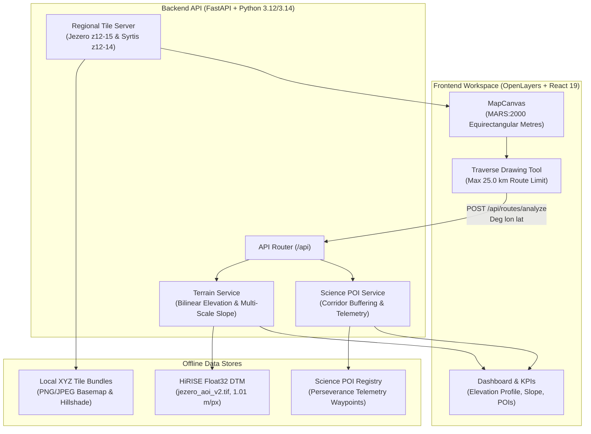

# VyomPath — Interplanetary Survival Guide: Martian Map

> **NASA Space Apps Challenge 2026** · Local Event: Jaipur, India  
> **Challenge:** Interplanetary Survival Guide: Martian Map  
> **Team:** NAKSHATRA X  
> **Event Dates:** November 14–15, 2026 (Timezone: IST)  
> **Repository:** `https://github.com/MayankSharma-2812/vyompath-spaceapps-2026.git`  
> **Last Updated:** November 14, 2026  

---

## 1. Project Overview

**VyomPath** is an open-source, air-gapped Martian traverse exploration workspace designed to assist planetary scientists, mission planners, and astronauts in drawing traverses across Mars, analyzing high-resolution terrain elevation and slope profiles, and discovering points of scientific interest.

VyomPath runs **100% locally and offline** without requiring external internet connectivity, utilizing pre-rendered regional Martian map tile pyramids and native Float32 Digital Terrain Models (DTMs).

---

## 2. Core Capabilities & Architecture



### Key Technical Pillars
1. **Certified Planetary Geodetics:** Adheres strictly to the IAU Mars 2000 Equirectangular metric projection ($R = 3,396,190.0\text{ m}$) across both map canvas and backend geodesic calculations.
2. **Authoritative Analytical Boundary:** Uses the true raster valid-data footprint ($63.16\%$ valid data in the $8.31 \times 10.00\text{ km}$ HiRISE stereo strip, vector outline `data/footprints/jezero_dtm.geojson`) rather than a loose bounding rectangle.
3. **Air-Gapped Offline Execution:** Complete regional XYZ tile pyramid (Jezero Crater $z=12\text{--}15$, Syrtis Major $z=12\text{--}14$) served locally on loopback with zero external network requests.
4. **Deterministic Terrain Math:** Multi-scale slope evaluation ($20\text{m}, 50\text{m}, 100\text{m}$ along-track windows) and Shapely Euclidean corridor buffering for operational science waypoints.
5. **Truth in Labeling:** A traverse is **never** labeled "safe" (orbital remote sensing cannot resolve sub-pixel boulder fields or regolith shear strength), and mock/production statuses are explicitly disclosed.

---

## 3. Team NAKSHATRA X — Responsibilities

| Team Member | Subsystem Ownership | Primary Responsibilities |
|---|---|---|
| **Mayank Sharma** | Backend & Cloud | FastAPI backend, route analysis engine, integration owner, Docker & deployment |
| **Arya Tiwari** | Map Engineering | OpenLayers map canvas, MARS:2000 projection, XYZ tile rendering, traverse drawing |
| **Kumkum Kushwah** | UI/UX Dashboard | Route metrics cards, Recharts elevation profiles, truthful status banners, UI states |
| **Pranav Sharma** | Terrain and Scientific Analysis | Geodetic constants ($R=3,396,190\text{ m}$), Float32 DTM sampling, slope math validation |
| **Shyam Sharma** | Data and GIS | Tile bundle generation, DTM/footprint metadata, licensing audit, citation registry |
| **Dheer Jain** | QA and Testing | Test suites execution, Windows validation, air-gapped rehearsal, release gates |

---

## 4. Setup & Quick Start

VyomPath supports **Linux, macOS, and Windows 11**.

### Prerequisites
- **Python:** Version `>= 3.12`
- **Node.js:** Version `>= 20.0` (LTS) or `v24` and `npm`
- **Docker:** Engine `>= 24.0` (optional, for containerised run)

---

### Option A: One-Command Air-Gapped Offline Launcher (Recommended)

Run both backend and frontend together with a single command:

```bash
# On Linux / macOS / Git Bash:
./scripts/run_offline.sh

# With custom ports if 8000/4173 are busy:
BACKEND_PORT=8871 FRONTEND_PORT=4871 ./scripts/run_offline.sh
```

On **Windows 11 (PowerShell)**:
```powershell
# Terminal 1: Backend
$env:PORT="8000"
$env:CORS_ORIGINS="http://localhost:4173,http://127.0.0.1:4173,http://localhost:5173"
python -m uvicorn backend.app.main:app --host 127.0.0.1 --port 8000

# Terminal 2: Frontend Preview
cd frontend
npm run preview -- --host 127.0.0.1 --port 4173
```

Open browser at: **`http://localhost:4173`**

---

### Option B: Standard Local Development

```bash
# 1. Backend Setup
python3 -m venv .venv
source .venv/bin/activate       # On Windows: .venv\Scripts\Activate.ps1
pip install -r backend/requirements.txt
pip install -r backend/requirements-dev.txt

python3 -m uvicorn backend.app.main:app --reload --host 127.0.0.1 --port 8000
```
- **API Health:** `http://127.0.0.1:8000/api/health`
- **Interactive Swagger Docs:** `http://127.0.0.1:8000/docs`

```bash
# 2. Frontend Setup
cd frontend
npm install
npm run dev
```
- **Local Dev Dashboard:** `http://localhost:5173`

---

## 5. API Endpoints Summary

| Method | Endpoint | Description | Status |
|---|---|---|---|
| `GET` | `/api/health` | Service liveness probe, version, and operational mode (`development/mock` vs `production`) | Active |
| `GET` | `/api/layers` | Catalog of available orbital layers, basemaps, and DTMs (`data/layers.json`) | Active |
| `POST` | `/api/routes/analyze` | Evaluates traverse coordinates, elevation profile, slope gradients, and POIs | Active (`development/mock` mode) |
| `GET` | `/api/science/points` | Direct POI catalog endpoint (buffering active in `backend/app/services/science.py`) | Planned (Event Day) |

*Wire convention:* Outgoing traverse coordinates are strictly `{"lon": <float>, "lat": <float>}` in planetocentric degrees (longitude first, east-positive). Canvas metres must be transformed before calling the API.

---

## 6. Automated Testing & Verification Evidence

VyomPath enforces rigorous automated verification across the entire stack:

```bash
# 1. Run Backend Pytest Suite (251 passed in CI, 257 passed with local DTM)
pytest tests/ -v

# 2. Run Standalone Tabletop Engineering Verification (6/6 PASS, zero network)
python3 scripts/verify_terrain_g3_g4.py

# 3. Run Science Data Quality Audit (100% PASS)
python3 tools/validate_data.py

# 4. Run Frontend Linter & Production Build (0 errors, 0 warnings; builds in 1.38s)
cd frontend
npm run lint
npm run build
npx playwright test     # Automated browser journey tests
```

### Verified Test Evidence
- **Pytest:** 251 tests passing in CI; 257 passing with local Float32 DTM mounted.
- **Tabletop Math:** 3D distance, multi-scale slope spread, corridor buffer math ($<1.0\text{ mm}$ tolerance), and 20-worker parallel read concurrency (400 runs in 0.84s, 0 deadlocks) verified.
- **Frontend Quality:** 0 errors and 0 warnings via `oxlint`. Playwright journeys verified.

---

## 7. Documentation Package

For in-depth specifications, refer to the canonical documentation package:

1. [System Architecture](docs/architecture.md): Subsystem breakdown, planetary geodetics, and data flow.
2. [Backend/Frontend Integration Contract](docs/backend-frontend-integration-contract.md): Strict wire formats, schemas, coordinate serialization, and error codes.
3. [Operational Runbook](docs/backend-cloud-operational-runbook.md): Production runbook, Docker commands, troubleshooting, and disaster recovery.
4. [Event-Day Implementation Plan](docs/event-day-implementation-plan.md): Step-by-step implementation milestones for November 14–15.
5. [Team Task Allocation & Timeline](docs/team-task-allocation-and-timeline.md): Full run sheet timetable and individual ownership matrix.
6. [QA & Testing Checklist](docs/qa-and-testing-checklist.md): Acceptance testing matrix, Windows compatibility, and release gates.
7. [Dataset Provenance & Licensing](docs/dataset-provenance-and-licensing.md): Sourcing, checksums, attribution, and license disclosures.
8. [Offline Demonstration Instructions](docs/offline-demonstration-instructions.md): Step-by-step guide for air-gapped evaluation.
9. [NASA Submission Checklist](docs/nasa-submission-checklist.md): 9-gate verification and submission asset registry.

---

## 8. License & Attribution

- **Codebase:** Distributed under the [Apache License 2.0](LICENSE).
- **Orbital Data & Science Attributions:** NASA/JPL-Caltech/University of Arizona (HiRISE), NASA/GSFC (MOLA), MSSS/The Murray Lab (CTX), and NASA Solar System Treks (USGS).
- **Telemetry Notice:** Mars 2020 Perseverance telemetry waypoints derived from NASA MMGIS; raw MMGIS feed terms of use remain unverified (`terms_of_use: null`).
