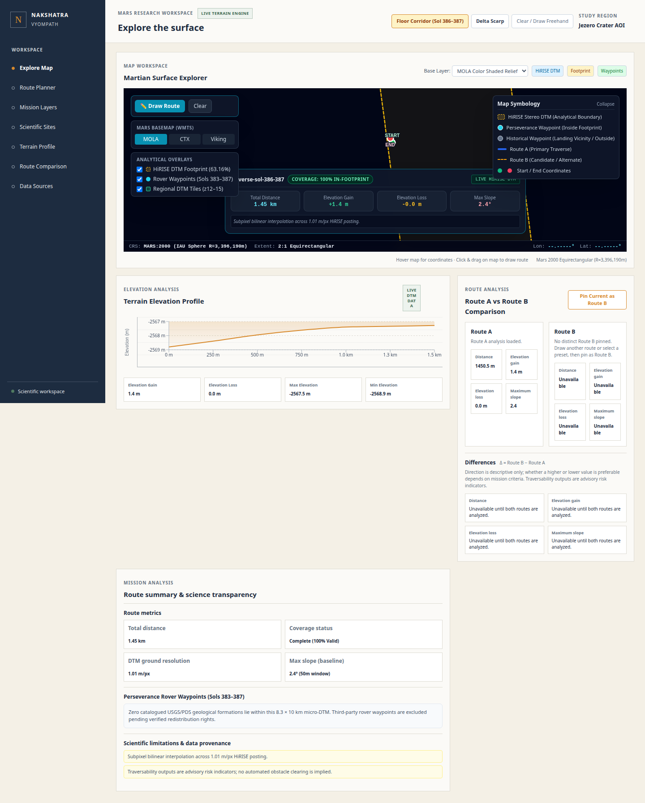
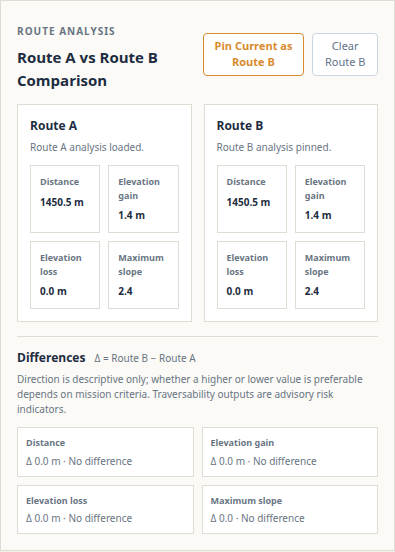
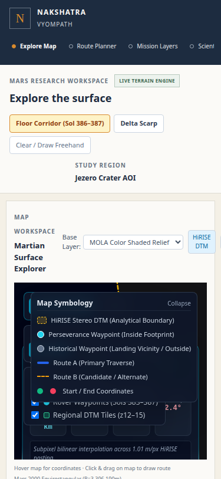
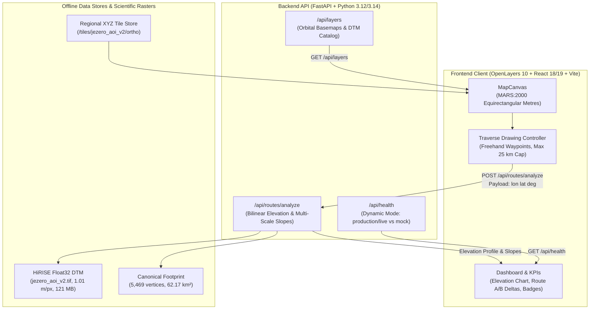

# VyomPath — Interplanetary Survival Guide: Martian Map

> **NASA Space Apps Challenge 2026** · Local Event: Jaipur, India  
> **Challenge:** Interplanetary Survival Guide: Martian Map  
> **Team:** NAKSHATRA X  
> **Event Dates:** November 14–15, 2026 (Timezone: IST)  
> **Repository:** `https://github.com/MayankSharma-2812/vyompath-spaceapps-2026`  
> **License:** Apache License 2.0  
> **Release Target:** Final Submission Release (Issue #18)  

---

## 1. Executive Summary

**VyomPath** is an open-source, air-gapped Martian traverse exploration workspace designed for planetary scientists, rover mission planners, and future astronaut exploration crews. It combines regional multi-resolution map pyramids with native sub-meter Float32 Digital Terrain Models (HiRISE Stereo DTM `DTEEC_023524_1985_023379_1985_U01`, $1.01\text{ m/pixel}$ posting) to evaluate traverse feasibility directly on uncompressed scientific rasters.

VyomPath operates **100% locally on local loopback (`127.0.0.1`)** with zero external network calls, ensuring reliable field execution in communication-delayed or air-gapped exploration environments.

---

## 2. Visual Proof & Screenshots

The application includes automated visual proof captured during end-to-end regression runs:

| Live DTM Analysis & Elevation Profile | Route A vs Route B Comparison Deltas | Mobile Responsive View (375px) |
|:---:|:---:|:---:|
|  |  |  |
| *Real HiRISE Float32 profile, multi-scale slopes, and valid-data coverage.* | *Head-to-head route comparison with real-time delta calculations.* | *Responsive research workspace on tablet and mobile viewports.* |

---

## 3. Core Architecture: The Two-Path Design

VyomPath enforces a strict physical separation between visual map presentation and quantitative terrain science:

```
┌────────────────────────────────────────────────────────────────────────┐
│                        VYOMPATH TWO-PATH DESIGN                        │
├──────────────────────────────────┬─────────────────────────────────────┤
│   PATH A: MAP DISPLAY (PICTURES) │   PATH B: ROUTE ANALYSIS (NUMBERS)  │
├──────────────────────────────────┼─────────────────────────────────────┤
│ • OpenLayers 10 in browser       │ • FastAPI + Rasterio on backend     │
│ • Regional XYZ Equirectangular   │ • Native Float32 HiRISE GeoTIFF     │
│ • 8-bit visual rendering         │ • Sub-pixel bilinear interpolation  │
│ • Strictly labelled: DISPLAY ONLY│ • Multi-scale slopes (20m, 50m, 100m)│
│ • NEVER sampled for elevation    │ • Enforces 25 km cap & gap validity │
└──────────────────────────────────┴─────────────────────────────────────┘
```



---

## 4. Key Scientific Pillars & Geodetic Standards

1. **Certified Planetary Geodetics:** Enforces a single, unified Mars spherical radius of **$R_{\text{Mars}} = 3,396,190.0\text{ m}$** (IAU Mars 2000 Sphere) across client canvas and backend geodesic distance calculations (`coords.py`).
2. **The 431-Pixel Northing Trap Prevention:** Transforms input coordinates directly into the native PDS Equirectangular projection ($\phi_{\text{ts}} = 15.0^\circ\text{N}$, $\lambda_0 = 77.53^\circ\text{E}$, $R_{\text{pds}} = 3,394,839.8133\text{ m}$) via `pyproj`. This eliminates the $435\text{ m}$ ($431\text{ pixel}$) northing shift that occurs when naive equirectangular projections omit the standard parallel scale factor.
3. **Sub-Pixel Bilinear Interpolation:** Samples native 32-bit floating-point rasters under a strict 4-neighbor validity rule. If any neighbor is NoData ($-3.4028227 \times 10^{38}$), the sample is flagged as invalid and never smuggled into mathematical averages.
4. **Authoritative Raster Boundary:** Uses the canonical Float32 valid-data mask ($5,469\text{ vertices}$, $62.17355\text{ km}^2$ valid area) rather than bounding boxes to classify routes as `complete`, `partial_gap`, or `out_of_bounds`.
5. **Multi-Scale Slope Evaluation:** Evaluates along-track grades across $20\text{ m}$ (wheelbase scale), $50\text{ m}$ (vehicle grade scale), and $100\text{ m}$ (regional scale), reporting the scale spread to distinguish genuine topography from localized micro-roughness.
6. **Scientific Honesty & Advisory Labeling:** VyomPath explicitly treats terrain analysis as **navigational guidance, not an automated safety certification**. Orbital remote sensing cannot resolve sub-pixel boulder fields or soil shear strength; traverses are never labeled "safe".

---

## 5. Quick Start & Execution

VyomPath is optimized for **instant launch on Linux, macOS, and Windows 11**.

### Option A: One-Command Offline Launcher (Recommended)

#### Linux / macOS:
```bash
# Launch both backend (8000) and frontend (4173) with auto-DTM detection:
./scripts/run_offline.sh

# Custom port override if 8000/4173 are busy:
BACKEND_PORT=8871 FRONTEND_PORT=4871 ./scripts/run_offline.sh
```

#### Windows 11 (PowerShell):
```powershell
# In PowerShell:
.\scripts\run_offline.ps1

# With custom parameters:
.\scripts\run_offline.ps1 -BackendPort 8871 -FrontendPort 4871
```

Open browser at: **`http://localhost:4173`** (or `http://127.0.0.1:4173`).

---

### Option B: Standard Local Development

#### 1. Backend Setup:
```bash
python3 -m venv .venv
source .venv/bin/activate       # On Windows: .venv\Scripts\Activate.ps1
pip install -r backend/requirements.txt
pip install -r backend/requirements-dev.txt

# Mount local HiRISE DTM (optional; falls back to deterministic mock if omitted):
export VYOMPATH_DEM_PATH="/path/to/jezero_aoi_v2.tif"

python3 -m uvicorn backend.app.main:app --host 127.0.0.1 --port 8000
```
- **API Health:** `http://127.0.0.1:8000/api/health`
- **Interactive Swagger Docs:** `http://127.0.0.1:8000/docs`

#### 2. Frontend Setup:
```bash
cd frontend
npm install
npm run dev
```
- **Local Dev Dashboard:** `http://localhost:5173`

---

### Option C: Docker Multi-Container Deployment (Production Arranged)

Run VyomPath as a production-grade multi-container stack orchestrated via Docker Compose:

```bash
# 1. Build and start frontend (Nginx reverse proxy) and backend (FastAPI):
docker compose up -d --build

# 2. Verify health status:
docker compose ps

# 3. Mount external DTM (optional):
VYOMPATH_DEM_PATH=/app/data/dtm/jezero_aoi_v2.tif docker compose up -d
```
- **Web UI & Map Explorer:** `http://localhost:8080`
- **Health Check Probe:** `http://localhost:8080/api/health`
- **Interactive API Docs:** `http://localhost:8080/api/docs`
- For cloud deployment instructions (AWS, GCP, DigitalOcean, Railway), see [docs/deployment.md](docs/deployment.md).

---

## 6. Operational Modes: Real DTM vs Mock Fallback

The application dynamically inspects its environment and truthfully reports its operational mode in the top toolbar:

| Environment | Health Mode | Toolbar Badge | Behavior |
|:---|:---|:---|:---|
| `VYOMPATH_DEM_PATH` set to valid GeoTIFF | `production/live` | `LIVE TERRAIN ENGINE` (Green) | Real sub-pixel Float32 HiRISE elevation sampling, genuine slopes, and valid-data mask coverage. |
| `VYOMPATH_DEM_PATH` unset or unreadable | `development/mock` | `DEVELOPMENT / MOCK BACKEND` (Neutral) | Deterministic synthetic elevation profile with explicit transparency caveat banners. |
| Backend service unreachable | `offline/mock` | `BACKEND OFFLINE (MOCK)` (Neutral) | Offline client preview with clear notice that API analysis is unavailable. |

### What Works Offline vs What Requires Internet Access

| Capability | Connectivity | Operational Behavior |
|:---|:---|:---|
| **Traverse Drawing & Freehand Editing** | **100% Offline** | Full interactive OpenLayers line-drawing on client canvas. |
| **Sub-Pixel DTM Elevation Analysis** | **100% Offline** | Python/Rasterio bilinear sampling over local GeoTIFF raster. |
| **Route A vs Route B Comparison** | **100% Offline** | In-browser comparative KPI calculations and metric deltas ($\Delta$). |
| **Regional HiRISE DTM Ortho Tiles** | **100% Offline** | Local pre-rendered XYZ tile pyramid in demo bundle (`z12–z15`). |
| **Global Mars Trek Basemaps (MOLA/CTX/Viking)** | **Online Required** | Live NASA Trek WMTS endpoints. Transparent fallback ensures zero application crashes when offline. |

---

## 7. Automated Test Suite & Quality Verification

VyomPath enforces comprehensive automated test gates:

```bash
# 1. Run Backend Unit & Integration Tests (283 passed, 6 skipped in CI)
python3 -m pytest tests/ -q

# 2. Run Targeted Real DTM Pipeline Tests (16 passed with real DTM mounted)
VYOMPATH_DEM_PATH=/path/to/jezero_aoi_v2.tif python3 -m pytest tests/unit/test_real_dtm_route_analysis.py -v

# 3. Run Data Quality & Licensing Validator (100% Quality Pass)
python3 tools/validate_data.py

# 4. Run Privacy & Security Governance Check (1 passed)
python3 -m pytest tests/test_privacy.py -v

# 5. Run Frontend Linter & Production Build (0 errors, 0 warnings)
cd frontend
npm run lint
npm run build

# 6. Run Playwright End-to-End Browser Journey Tests (17 passed)
npx playwright test
```

### Verification Proof Summary
- **Python / FastAPI Tests:** `283 passed, 6 skipped, 0 failed` in CI; `16 passed` in live DTM suite.
- **Frontend Quality:** `0 warnings, 0 errors` via `oxlint`; production bundle compiled cleanly via Vite 8.
- **Playwright Browser Tests:** `17 passed, 0 failed, 3 skipped` across Chromium test runs.
- **Process Lifecycle:** Tested clean launch, health probe verification, and leak-free SIGINT/SIGTERM process teardown.

---

## 8. Dataset Provenance & Licensing Register

| Dataset / Layer | Source Mission / Team | Product ID / DOI | License / Rights Status | Classification |
|:---|:---|:---|:---|:---|
| **HiRISE Jezero DTM** | MRO / NASA / JPL / UA LPL | `DTEEC_023524_1985_023379_1985_U01` | **PARTIALLY VERIFIED — PRODUCT-LEVEL RIGHTS EVIDENCE PENDING** | Distributable (Source & Bundles) |
| **MOLA Elevation Model** | MGS / NASA GSFC / PDS | MOLA MEGDR 128 ppd | **PARTIALLY VERIFIED — PRODUCT-LEVEL RIGHTS EVIDENCE PENDING** | Distributable |
| **Viking MDIM 2.1** | Viking / NASA / USGS | Mars Digital Image Model 2.1 | **PARTIALLY VERIFIED — PRODUCT-LEVEL RIGHTS EVIDENCE PENDING** | Distributable |
| **CTX Global Mosaic V01** | MRO / MSSS / Murray Lab Caltech | `10.17189/m23v-ae12` | **VERIFIED — FREE FOR ALL USES WITH ATTRIBUTION** | Distributable with Attribution |
| **MMGIS Software** | NASA-AMMOS / JPL | GitHub: `NASA-AMMOS/MMGIS` | **VERIFIED — APACHE 2.0 SOFTWARE ONLY** | Distributable (Code Only) |
| **MMGIS Rover Telemetry** | Mars 2020 / NASA MMGIS Feed | `M20_waypoints.json` | **EXCLUDED PENDING RIGHTS CONFIRMATION** (`terms_of_use: null`) | **QUARANTINED** (Excluded from Active Releases) |
| **Mars 2020 SPICE Archive** | Mars 2020 / NASA PDS NAIF | `M2020-M-SPICE-6-V1.0` | **PROVENANCE VERIFIED — REDISTRIBUTION RIGHTS NOT INDEPENDENTLY ESTABLISHED** | Approved Roadmap Baseline |

---

## 9. Team NAKSHATRA X — Subsystem Ownership

| Team Member | Subsystem Ownership | Core Contributions |
|:---|:---|:---|
| **Mayank Sharma** (@MayankSharma-2812) | Team Owner / Backend & Cloud Lead | FastAPI backend, route analysis engine, real DTM loader, process-group offline launchers, and central integration. |
| **Arya Tiwari** (@aryatiwari124) | Map Engineering Lead | OpenLayers MARS:2000 canvas, XYZ tile engine, interactive route drawing, and map QA. |
| **Kumkum Kushwah** (@kumkum098) | UI/UX Dashboard Lead | Responsive research workspace, Recharts elevation charts, Route A/B comparison cards, and status badge design. |
| **Pranav Sharma** (@PranavSharma124) | Terrain & Scientific Analysis Lead | IAU Mars 2000 geodetics ($R = 3,396,190\text{ m}$), 4-neighbor bilinear interpolation, multi-scale slope engine, and scientific verification. |
| **Shyam Sharma** (@shyamsharmas124-commits) | Data & GIS Lead | DTM valid-data footprint derivation (5,469 vertices), dataset provenance and licensing register, and automated data quality validator. |
| **Dheer Jain** (@dheerjain0508) | QA & Testing Lead | Comprehensive pytest suite, Playwright browser regression journeys, Windows 11 compatibility testing, and air-gapped rehearsal validation. |

---

## 10. Canonical Documentation Package

Detailed technical specifications and audit reports are available in the [`docs/`](docs/) directory and repository root:

1. [Master Defect Register & Audit Log](bug.md): Full audit of application controls, defects, root cause resolutions, and verification proofs.
2. [Production Containerization & Deployment Runbook](docs/deployment.md): Docker Compose multi-container setup, Nginx reverse proxy, and cloud deployment guidelines.
3. [System Architecture](docs/architecture.md): Subsystem breakdown, planetary geodetics, and two-path design.
4. [Backend/Frontend Integration Contract](docs/backend-frontend-integration-contract.md): Strict wire formats, schemas, and coordinate serialization.
5. [Scientific Methodology & Limitations](docs/scientific-methodology-and-limitations.md): Mathematical formulations, geodetic error bounds, and truth-in-labeling policies.
6. [Dataset Provenance & Licensing Register](docs/dataset-provenance-and-licensing.md): Sourcing, checksums, attribution, and license disclosures.
7. [Offline Demonstration & Evaluation Guide](docs/offline-demonstration-instructions.md): Step-by-step judge walkthrough for air-gapped evaluation.
8. [NASA Space Apps Submission Checklist](docs/nasa-submission-checklist.md): 9-gate verification and submission asset registry.
9. [Dashboard QA & Regression Report](frontend/src/features/dashboard/DASHBOARD_QA_REPORT.md): Visual proof, defect resolutions, and responsive layout verification.
10. [Scientific Validation Report](docs/scientific-validation-report.md): Ground-truth comparison against USGS/NASA benchmarks.
11. [Operational Runbook](docs/backend-cloud-operational-runbook.md): Production runbook, Docker commands, troubleshooting, and disaster recovery.
12. [Coordinate System Contract](docs/scientific-coordinate-contract.md): Strict wire conventions, geodetic formulas, and standard parallels.

---

## 11. AI Tools Disclosure

In accordance with NASA Space Apps Challenge 2026 rules:
- **AI Assistants Used:** Google DeepMind / Antigravity Agent and Anthropic Claude.
- **Specific Tasks Assisted:** Code scaffolding, unit and regression test authoring, Playwright journey script generation, documentation cross-referencing, and multi-perspective peer review simulation.
- **Human Governance:** All physical equations (3D distance integration, bilinear interpolation, multi-scale slope baselines, geodetic radius constants), data rights determinations, and architectural decisions were established, reviewed, verified, and approved by human team leads.
