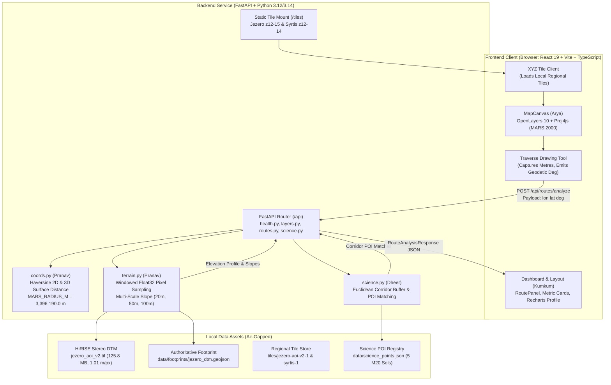

# VyomPath — System Architecture Specification

> **Project:** VyomPath — Interplanetary Survival Guide: Martian Map  
> **Challenge:** Interplanetary Survival Guide: Martian Map · NASA Space Apps Challenge 2026 (Jaipur, India)  
> **Team:** NAKSHATRA X  
> **Canonical Path:** `docs/architecture.md`  
> **Last Updated:** November 14, 2026  

---

## 1. Executive Architecture Summary: The Two-Path Design

VyomPath enforces a strict physical separation between visual rendering and quantitative terrain analysis:

```
┌────────────────────────────────────────────────────────────────────────┐
│                        VYOMPATH TWO-PATH DESIGN                        │
├──────────────────────────────────┬─────────────────────────────────────┤
│   PATH A: MAP DISPLAY (PICTURES) │   PATH B: ROUTE ANALYSIS (NUMBERS)  │
├──────────────────────────────────┼─────────────────────────────────────┤
│ • Renders raster map tiles in UI │ • Calculates physical measurements  │
│ • Uses regional XYZ tile pyramid │ • Uses native Float32 DTM GeoTIFF   │
│ • Runs in browser via OpenLayers │ • Runs on server via Rasterio/NumPy │
│ • Strictly labelled: DISPLAY ONLY│ • Evaluates distance, slope, NoData │
│ • NEVER sampled for elevation    │ • Enforces 25 km cap & POI buffer   │
└──────────────────────────────────┴─────────────────────────────────────┘
```

**The Core Invariant:** Visual display tiles are lossy, stretched 8-bit images meant for human perception. They are **never** queried, interpolated, or sampled for scientific measurements. All elevation, slope, and grade calculations originate exclusively from raw, uncompressed Float32 Digital Terrain Models on the backend.

---

## 2. Complete End-to-End System Architecture



---

## 3. Planetary Geodetic Specification

Standard Web Mercator (`EPSG:3857`) and WGS84 (`EPSG:4326`) assume terrestrial dimensions ($R \approx 6,378,137\text{ m}$) and cause $>87\%$ spatial distortion on Mars. VyomPath establishes an immutable planetary geodetic foundation signed off by Scientific Lead Pranav Sharma:

### 3.1 Custom Projection (`MARS:2000`)
- **PROJ String:**
  ```text
  +proj=eqc +lat_ts=0 +lat_0=0 +lon_0=0 +R=3396190 +units=m +no_defs
  ```
- **Equatorial Radius ($R$):** Exactly **$3,396,190.0\text{ m}$** (IAU Mars 2000 Spherical Model).
- **Half-World Extent:**
  - $HX = \pi \cdot R = 10,669,445.55\text{ m}$
  - $HY = HX / 2 = 5,334,722.78\text{ m}$
  - **Projected Bounds:** `[-10669445.55, -5334722.78, 10669445.55, 5334722.78]`
- **Coordinate Conventions:**
  - **Wire Payloads:** Strictly `{"lon": <float>, "lat": <float>}` in planetocentric decimal degrees.
  - **East-Positive:** Longitude spans $[-180.0^\circ, +180.0^\circ]$; Latitude spans $[-90.0^\circ, +90.0^\circ]$.
  - **Canvas Metres:** The frontend transforms screen projection metres to degrees before invoking the API.

---

## 4. Regional Tile Pyramid Architecture (Path A)

To guarantee high-speed operation during venue presentations without internet dependencies, VyomPath utilizes pre-rendered regional XYZ tile bundles conforming to the standard Slippy Map pyramid adapted to Martian Equirectangular bounds:

| Parameter | Specification |
|---|---|
| **Tile Resolution** | $256 \times 256$ pixels |
| **Grid Origin** | Top-Left $(-180^\circ\text{ Lon}, +90^\circ\text{ Lat})$, $Y$ increasing southward |
| **Zoom Levels** | Jezero Crater: $z=12\text{--}15$; Syrtis Major: $z=12\text{--}14$ |
| **Target Bundle Candidate (v1.6)** | Exactly **2,380 PNG tiles** ($61.09\text{ MiB}$) across basemap and hillshade |
| **Fallback Archive (v1.4 on disk)** | `vyompath-offline-v1.4.0.tar.gz` (7,313 JPEG tiles across $z=10\text{--}16$) |
| **URL Scheme** | `/tiles/{dataset_id}/{style}/{z}/{x}/{y}.png` |
| **Server Routing Alias** | `/tiles/jezero_aoi_v2/...` maps to on-disk directory `tiles/jezero-aoi-v2-1/...` |

---

## 5. Quantitative Terrain Processing Engine (Path B)

### 5.1 Authoritative Analytical Boundary
The analytical boundary of the system is the **raster valid-data footprint** ($63.16\%$ valid data coverage inside the $9014 \times 10896$ pixel HiRISE stereo DTM `jezero_aoi_v2.tif`). 
- Vector representation: [`data/footprints/jezero_dtm.geojson`](file:///home/mayank-sharma/Hackathon/NASA/vyompath-spaceapps-2026/data/footprints/jezero_dtm.geojson).
- Traverses outside the valid footprint return `coverage_status: "out_of_bounds"`.
- Traverses crossing the non-data margins return `coverage_status: "partial_gap"`.

### 5.2 3D Surface Distance & Sampling
Traverses are sampled along-track at discrete steps ($\Delta s \approx 5.0\text{ m}$ to $10.0\text{ m}$). Segment distance is computed using the 3D Pythagorean combination of spherical Great-Circle 2D distance and elevation change:
$$\Delta s_{3\text{D}} = \sqrt{(\Delta d_{2\text{D}})^2 + (\Delta z)^2}$$

### 5.3 Multi-Scale Slope Evaluation
Vehicle stability depends on the baseline scale over which terrain changes. VyomPath evaluates slopes across multiple along-track window lengths:
- **Wheelbase Scale ($W = 20\text{ m}$):** Captures local obstacles, micro-scarps, and roll hazards.
- **Vehicle Scale ($W = 50\text{ m}$):** Captures general traverse grade.
- **Regional Scale ($W = 100\text{ m}$):** Evaluates broader topography.
- **Slope Spread Metric:** $\text{Spread} = |\text{Slope}_{20\text{m}} - \text{Slope}_{100\text{m}}|$, flagging abrupt break-of-slope terrain.

---

## 6. Science POI Corridor Buffering

Operational science targets (derived from Mars 2020 Perseverance rover telemetry) are registered in `data/science_points.json`.
- When a user defines a traverse, the backend buffers the line geometry by a configurable Euclidean radius (default: $250.0\text{ m}$).
- Waypoints within the corridor are returned with cross-track offset distance and along-track stationing.
- **Geographic Reality:** Only **Sol 386** and **Sol 387** lie within the active HiRISE stereo footprint; Sols 13, 23, and 34 lie $\sim 0.6\text{ km}$ west outside coverage. Zero catalogued natural geological formations exist in this stereo swath.

---

## 7. Subsystem Ownership & Boundaries

| Subsystem | Owner | Primary Code & Test Boundaries |
|---|---|---|
| **Backend & Cloud Systems** | Mayank Sharma | `backend/app/main.py`, `backend/app/api/`, `Dockerfile`, `scripts/run_offline.sh` |
| **Map Engineering** | Arya Tiwari | `frontend/src/features/map/`, OpenLayers Proj4 integration, XYZ tile rendering |
| **UI/UX Dashboard** | Kumkum Kushwah | `frontend/src/features/dashboard/`, Recharts elevation charts, status badges |
| **Terrain & Scientific Analysis** | Pranav Sharma | `backend/app/services/terrain.py`, `backend/app/services/coords.py`, geodetic tests |
| **Data & GIS** | Shyam Sharma | `data/`, `tools/validate_data.py`, `scripts/build_regional_tiles.py` |
| **QA & Testing** | Dheer Jain | `tests/`, Windows PowerShell test harness, air-gapped rehearsal runbooks |
