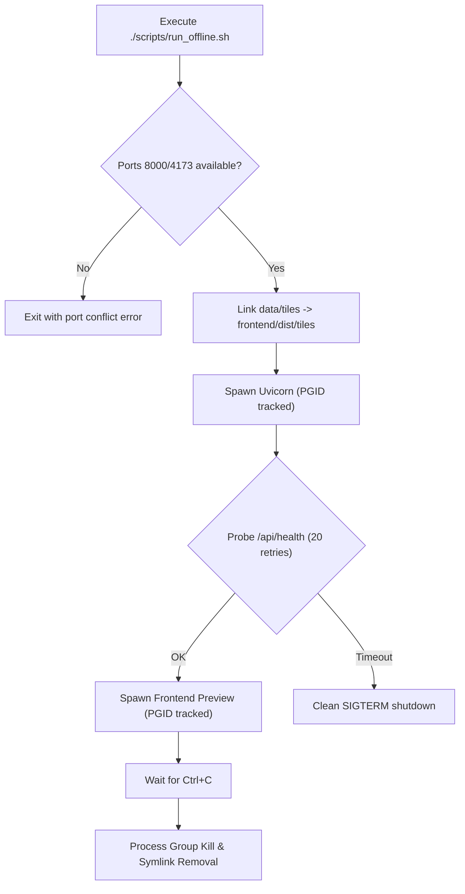

# VyomPath — Backend & Cloud Operational Runbook

**Document ID:** `VP-OPS-2026-EVENT`  
**Execution Window:** November 14–15, 2026 (NASA Space Apps Challenge Jaipur Local Event, IST)  
**Author & Integration Owner:** Mayank Sharma (Backend & Cloud)  
**Target Audience:** Mayank Sharma (Backend & Cloud), Pranav Sharma (Terrain and Scientific Analysis), Dheer Jain (QA and Testing), Arya Tiwari (Map Engineering), Kumkum Kushwah (UI/UX Dashboard), Shyam Sharma (Data and GIS)  
**Last Updated:** November 14, 2026  
**Governance State:** Implementation Baseline (`main` @ `c47dbc1`)  
**Hard Boundaries:** No real secrets in documentation; zero unverified claims; distinct mock vs live DTM modes; no large DTM binaries committed to Git.

---

## 1. Repository Setup & Clone Verification

### 1.1 Fresh Clone from Remote
```bash
# Clone the canonical repository
git clone https://github.com/MayankSharma-2812/nakshatra-vyompath.git
cd nakshatra-vyompath

# Verify clean state and HEAD commit (Must match c47dbc1)
git status
git log -1 --oneline
```

### 1.2 Restoring from Offline Git Bundle (Air-Gapped Handoff)
If internet access is unavailable at the event venue:
```bash
# Clone directly from the verified offline repository bundle
git clone dist/offline_bundle/vyompath-repo.bundle vyompath-restored
cd vyompath-restored

# Verify commit history integrity
git log -1 --oneline
```

---

## 2. Environment Setup

### 2.1 Python Backend Environment (Python 3.12+ / 3.14 compatible)
```bash
# 1. Create dedicated virtual environment
python3 -m venv .venv
source .venv/bin/activate

# 2. Upgrade core packaging tools
pip install --upgrade pip setuptools wheel

# 3. Install verified backend dependencies
pip install --no-cache-dir -r backend/requirements.txt
```

### 2.2 Node.js Frontend Environment (Node.js 18+ & npm)
```bash
cd frontend
npm ci || npm install
cd ..
```

---

## 3. Required Environment Variables

| Variable | Type | Default | Description |
|---|---|---|---|
| `PORT` | Integer | `8000` | Backend API listening port |
| `BACKEND_HOST` | String | `127.0.0.1` | Network interface binding for backend |
| `FRONTEND_PORT` | Integer | `4173` | Production preview port (`5173` for Vite dev) |
| `FRONTEND_HOST` | String | `127.0.0.1` | Network interface binding for frontend |
| `CORS_ORIGINS` | String (CSV) | `http://localhost:5173,http://127.0.0.1:5173` | Permitted browser origins |
| `VYOMPATH_DEM_PATH` | Path / S3 URI | *None* | Path to HiRISE DTM (`jezero_aoi_v2.tif`) |
| `PROJ_IGNORE_CELESTIAL_BODY` | String | `YES` | Prevents pyproj Mars/Earth ellipsoid mismatch errors |
| `VITE_API_URL` | URL | `http://localhost:8000` | Base backend URL targeted by frontend client |

> [!NOTE]
> In **Development / Mock mode** (pre-event), `VYOMPATH_DEM_PATH` is omitted; the server runs deterministic synthetic profiling. On **Event Day** (Nov 14), set `VYOMPATH_DEM_PATH` to enable live Float32 sampling.

---

## 4. Local Backend Startup

### 4.1 Development Mode (Auto-Reloading)
```bash
source .venv/bin/activate
uvicorn backend.app.main:app --reload --host 127.0.0.1 --port 8000
```
- Interactive Swagger UI: `http://localhost:8000/docs`
- ReDoc Documentation: `http://localhost:8000/redoc`

### 4.2 Production Single-Worker Mode
```bash
source .venv/bin/activate
python3 -m uvicorn backend.app.main:app --host 0.0.0.0 --port 8000 --workers 1
```

---

## 5. Frontend Startup

### 5.1 Development Server (Vite)
```bash
cd frontend
npm run dev
# Active at: http://localhost:5173
```

### 5.2 Production Build & Preview
```bash
cd frontend
npm run build
npm run preview -- --host 127.0.0.1 --port 4173
# Active at: http://127.0.0.1:4173
```

---

## 6. Docker Container Startup

### 6.1 Building the Container Image
The container uses `python:3.12-slim` and installs `libexpat1` to satisfy Rasterio dynamic linking:
```bash
docker build -t vyompath-api:latest .
```

### 6.2 Running in Default Mock Mode
```bash
docker run -d \
  --name vyompath-backend \
  -p 8000:8000 \
  -e PORT=8000 \
  -e CORS_ORIGINS="http://localhost:5173,http://127.0.0.1:5173" \
  vyompath-api:latest
```

### 6.3 Running with Local Live DTM (Event Staging Target)
```bash
docker run -d \
  --name vyompath-backend-live \
  -p 8000:8000 \
  -v /path/to/local/dtm:/app/data/dtm:ro \
  -e PORT=8000 \
  -e VYOMPATH_DEM_PATH=/app/data/dtm/jezero_aoi_v2.tif \
  vyompath-api:latest
```

---

## 7. Offline Deployment (Single-Command Air-Gapped Runner)

The project includes an automated, self-contained launcher: [`scripts/run_offline.sh`](file:///home/mayank-sharma/Hackathon/NASA/nakshatra-vyompath/scripts/run_offline.sh).



### 7.1 Running from Source Tree (Linux / macOS / Git Bash)
```bash
# Run with default ports (Backend: 8000, Frontend: 4173)
./scripts/run_offline.sh

# Or run with custom ports to avoid conflicts:
BACKEND_PORT=8871 FRONTEND_PORT=4871 ./scripts/run_offline.sh
```

### 7.2 Running on Physical Windows Presentation Machine (Dheer Runbook)
On native Windows 11 without bash, Dheer executes via PowerShell:
```powershell
# 1. Clean workspace
cd C:\vyompath-rehearsal

# 2. Start Backend API
$env:PORT="8000"
$env:CORS_ORIGINS="http://localhost:4173,http://127.0.0.1:4173,http://localhost:5173"
python -m uvicorn backend.app.main:app --host 127.0.0.1 --port 8000

# 3. Start Frontend Preview (separate terminal)
cd frontend
npm run preview -- --host 127.0.0.1 --port 4173
```

### 7.3 Running from Packaged USB Archive
```bash
# 1. Unpack verified distribution archive (v1.4 fallback or v1.6 candidate)
mkdir -p /tmp/vyompath-eval && cd /tmp/vyompath-eval
tar -xzf /path/to/dist/offline_bundle/vyompath-offline-v1.4.0.tar.gz

# 2. Launch air-gapped demonstration
./run_offline.sh
```

---

## 8. Health Checks & Verification

### 8.1 API Liveness Probe
```bash
curl -s http://127.0.0.1:8000/api/health | jq .
```
**Expected Response:**
```json
{
  "status": "ok",
  "service": "vyompath-api",
  "version": "0.1.0-day1",
  "mode": "development/mock",
  "timestamp_utc": "2026-11-12T07:30:00.000000+00:00",
  "notes": "All route-analysis and layer data is synthetic or illustrative..."
}
```

### 8.2 Docker Container Health
```bash
docker inspect --format='{{.State.Status}}' vyompath-backend
# Expected output: running
```

---

## 9. API Smoke Tests

### 9.1 Map Layers Catalogue Test
```bash
curl -s http://127.0.0.1:8000/api/layers | jq '{count: .count, source: .source}'
```
**Expected Output:**
```json
{
  "count": 4,
  "source": "data/layers.json"
}
```

### 9.2 Route Analysis Smoke Test (Valid Traverse)
```bash
curl -s -X POST http://127.0.0.1:8000/api/routes/analyze \
  -H "Content-Type: application/json" \
  -d '{
    "route_id": "smoke-test-traverse",
    "coordinates": [
      {"lon": 77.46313311, "lat": 18.46079140},
      {"lon": 77.46157944, "lat": 18.46447597}
    ],
    "buffer_distance_m": 250.0
  }' | jq '{route_id: .route_id, distance: .total_distance_m, dtm_source: .dtm_source, status: .coverage_status}'
```
**Expected Output:**
```json
{
  "route_id": "smoke-test-traverse",
  "distance": 242.15,
  "dtm_source": "synthetic/mock — no real DTM loaded",
  "status": "complete"
}
```

### 9.3 Validation Failure Check (HTTP 422 Rejection)
```bash
curl -s -o /dev/null -w "%{http_code}\n" -X POST http://127.0.0.1:8000/api/routes/analyze \
  -H "Content-Type: application/json" \
  -d '{"route_id": "bad", "coordinates": [{"lon": 999.0, "lat": 0.0}]}'
# Expected output: 422
```

---

## 10. Test Suite Execution

### 10.1 Backend Regression Suite
```bash
# Standard test run (251 passed, 6 skipped when no DEM configured)
pytest tests/ -v

# Full test run with local DTM mounted (257 passed, 0 skipped)
VYOMPATH_DEM_PATH=/path/to/jezero_aoi_v2.tif pytest tests/ -v
```

### 10.2 Pre-Event Gate Verification Script
```bash
python3 scripts/verify_terrain_g3_g4.py
# Must report: 6/6 verification steps PASS
```

### 10.3 Frontend Lint & Type Checks
```bash
cd frontend
npm run lint
npm run build
cd ..
```

### 10.4 Separate QA & Rehearsal Verification Ledger
- **Linux Staging Host (`Linux 7.0.0-42 x86_64`):**
  - **Status:** **100% VERIFIED PASS**
  - Backend pytest: 251 passed in standard CI mode, 257 passed with local DTM attached.
  - Verification script (`scripts/verify_terrain_g3_g4.py`): 6/6 PASS including 20-worker parallel concurrency (400 runs in 0.84s, 0 deadlocks).
  - Offline startup script (`scripts/run_offline.sh`): Verified clean process group shutdown leaving 0 orphan processes.
- **Physical Windows Presentation Machine (`Windows 11 AMD64`):**
  - **Status:** **PENDING DHEER EXECUTION**
  - Offline rehearsal runbook (§ 7.2) prepared for Dheer Jain; physical hardware test (Wi-Fi disable, presentation monitor scaling) scheduled for Nov 13 evening.

---

## 11. Data Validation & Scientific Sourcing Constraints

Verify the cryptographic checksums and schema integrity of all local science assets:
```bash
python3 tools/validate_data.py
# Must output: PASS — All data files validated successfully
```

> [!NOTE]
> **Scientific Sourcing & Coverage Rules (Pranav & Shyam Consensus):**
> 1. **Operational Rover Stops vs. Science Features:** All 5 POIs in `data/science_points.json` (Sols 13, 23, 34, 386, 387) are strictly **operational rover traverse waypoints** from Mars 2020 Perseverance telemetry, not natural geological landmarks.
> 2. **Catalogue vs. In-Footprint Subset:**
>    - **Complete Catalogue (`data/science_points.json`):** Sols 13, 23, 34, 386, 387.
>    - **In-Footprint Subset (`data/footprints/jezero_dtm.geojson`):** Exactly two waypoints (**Sol 386** and **Sol 387**) lie inside the valid HiRISE stereo DTM strip.
>    - **Out-of-Footprint Subset:** Sols 13, 23, and 34 lie ~0.6 km west of the DTM valid boundary (NoData).
>    - **Documented Traverse (`docs/arya-g3-map-research.md`):** Sols 383, 384, 385, 386, 387 from `M20_waypoints.json` all lie 100% inside coverage (with Sols 384 and 385 separated by only $13.56\text{ m}$, requiring decluttering). Formal amendment to `science_points.json` remains pending team ratification.
> 3. **Zero Geological Landmarks:** Across the valid $8.31 \times 10.00\text{ km}$ HiRISE stereo DTM strip, **zero catalogued geological formations** exist. UI must display an honest empty state, never reclassifying rover waypoints.
> 4. **Authoritative Analytical Boundary:** The **valid-data footprint (`data/footprints/jezero_dtm.geojson`)** (63.16% valid data) is the sole analytical boundary (not the DTM bounding rectangle). Gaps return `partial_gap` or `out_of_bounds`.
> 5. **Raw Telemetry Licensing:** Terms of use for raw NASA MMGIS rover telemetry remain **unverified** (`terms_of_use: null`, `source_policy_status: "unverified"`).

---

## 12. Tile Asset Validation

### 12.1 Tile Architecture (v1.6 Candidate vs v1.4 Fallback)
1. **Target v1.6 Delivery Specification (Confirmed by Shyam & Arya):**
   - **Total Tiles:** Exactly **2,380 PNG tiles** across two regions (z16 excluded):
     - **Jezero Crater (z12–z15):** 930 basemap + 930 hillshade = 1,860 tiles (48.04 MiB).
     - **Syrtis Major (z12–z14):** 260 basemap + 260 hillshade = 520 tiles (~12 MiB).
   - **On-Disk Directory vs. Client URL Agreement:**
     - Manifest directory: `tiles/jezero-aoi-v2-1/hillshade/{z}/{x}/{y}.png`
     - Arya's proposed client URL: `/tiles/jezero_aoi_v2/hillshade/{z}/{x}/{y}.png`
     - Requires server alias/symlink from `jezero_aoi_v2` to `jezero-aoi-v2-1`.
   - **Generation Script:** `python3 scripts/build_regional_tiles.py --min-zoom 12 --max-zoom 15` (Session E0).
2. **Current On-Disk Fallback (v1.4 Archive):**
   - Packaged in `dist/offline_bundle/vyompath-offline-v1.4.0.tar.gz` (57 MB, SHA-256: `f5cd07c5a5590321c4869d036b3dff55da11f4c94eb925709117d773f46de377`).
   - Contains 7,313 JPEG tiles (zooms 10–16) served at `/tiles/tiles_aoi/{z}/{x}/{y}.jpg`.

### 12.2 Tile File Count Verification
```bash
# Check presence of extracted tiles (v1.4 fallback on disk)
find frontend/public/tiles -type f \( -name "*.jpg" -o -name "*.png" \) 2>/dev/null | wc -l
# Expected: 7,313 tiles (v1.4 fallback) or 2,380 tiles (v1.6 candidate)
```

### 12.3 Tile Probe Test (HTTP 200 on Hit, HTTP 404 on Missing)
```bash
# Probe an existing tile (Zoom 12)
curl -s -o /dev/null -w "%{http_code}\n" http://127.0.0.1:4173/tiles/12/3245/1820.jpg
# Probe an invalid tile coordinate
curl -s -o /dev/null -w "%{http_code}\n" http://127.0.0.1:4173/tiles/99/0/0.jpg
# Expected: 404
```

---

## 13. Logs & Troubleshooting

| Issue / Symptom | Root Cause | Diagnosis & Resolution |
|---|---|---|
| **`Address already in use`** | Lingering Uvicorn or Vite process | Check: `lsof -i :8000`<br/>Kill: `lsof -ti :8000 \| xargs kill -9` |
| **`libexpat.so.1: cannot open`** | Missing system raster dynamic library | Ubuntu/Debian fix: `sudo apt-get install -y libexpat1` |
| **`Celestial body mismatch`** | pyproj rejecting Mars datum vs WGS84 | Set environment: `export PROJ_IGNORE_CELESTIAL_BODY=YES` |
| **`HTTP 502 Bad Gateway`** | `data/layers.json` corrupted or missing ID | Validate JSON syntax: `jq . data/layers.json` |
| **`git ls-files failed (128)`** | Running tests inside archive without `.git` | Clone via `.bundle`: `git clone vyompath-repo.bundle` |

---

## 14. Clean Shutdown Procedures

### 14.1 Offline Script Teardown
When using [`scripts/run_offline.sh`](file:///home/mayank-sharma/Hackathon/NASA/nakshatra-vyompath/scripts/run_offline.sh):
- Press `Ctrl+C`.
- The bash trap triggers `cleanup()`, sending `SIGTERM` to the process groups (`kill -TERM -- -${PGID}`).
- Any temporary symlink created at `frontend/dist/tiles` is unlinked automatically.

### 14.2 Docker Container Teardown
```bash
docker stop vyompath-backend
docker rm vyompath-backend
```

### 14.3 Orphan Process Sweep
Ensure no background services linger:
```bash
pgrep -fa uvicorn || echo "No orphan uvicorn processes."
pgrep -fa "vite" || echo "No orphan vite processes."
```

---

## 15. Common Failure Scenarios & Recovery Steps

### Scenario A: Venue Wi-Fi Drops Completely
1. Do not panic; do not attempt cloud deployments.
2. Run `./scripts/run_offline.sh`.
3. The application runs 100% on localhost with pre-rendered tiles and mock/local services.

### Scenario B: DTM Ingestion Fails on Event Day
1. Check `ls -lh $VYOMPATH_DEM_PATH` to ensure file exists and is $>100\text{ MB}$.
2. If corrupted, restore `jezero_aoi_v2.tif` from the USB drive backup.
3. If memory runs low, launch with default mock mode to maintain frontend responsiveness.

### Scenario C: Frontend Shows Blank Map Canvas
1. Open browser developer console (`F12`).
2. Verify if OpenLayers is failing on tile requests (check for 404s).
3. If tiles are unmounted, ensure `frontend/dist/tiles` points to valid `tiles_aoi/` directory.

---

## 16. Event-Day Deployment Checklist (Saturday, Nov 14, 09:00 UTC)

- [ ] **09:00 UTC:** Verify Git state: `git status` clean, branch `main`.
- [ ] **09:05 UTC:** Tag release: `git tag v1.0-kickoff-event`.
- [ ] **09:15 UTC:** Verify local test suite: `pytest tests/` (All PASS).
- [ ] **09:30 UTC:** Connect `backend/app/services/terrain.py` Float32 sampling to `routes.py`.
- [ ] **10:00 UTC:** Enforce the $25.0\text{ km}$ cumulative route limit in `routes.py`.
- [ ] **10:30 UTC:** Connect `backend/app/services/science.py` POI corridor buffering.
- [ ] **11:00 UTC:** Switch `health.py` mode from `"development/mock"` to `"production"`.
- [ ] **11:30 UTC:** Run golden traverse fixture test: verify Sol 386 elevation matches $-2568.87\text{ m} \pm 0.05\text{ m}$.
- [ ] **14:00 UTC:** Cross-validate with Arya (Map) and Kumkum (Dashboard).

---

## 17. Backup & Rollback Procedures

### 17.1 Rolling Back Code Changes
If event-day code changes introduce regressions:
```bash
# Revert working directory to Gate G4 verified baseline commit (c47dbc1)
git checkout -f c47dbc1

# Re-run test suite to confirm baseline green state
pytest tests/
```

### 17.2 Container Image Rollback
Before building live event containers, preserve the pre-event image:
```bash
docker tag vyompath-api:latest vyompath-api:g4-baseline-backup
```
To restore immediately:
```bash
docker stop vyompath-backend && docker rm vyompath-backend
docker run -d --name vyompath-backend -p 8000:8000 vyompath-api:g4-baseline-backup
```

### 17.3 Physical USB Drive Redundancy
Keep two physical USB flash drives at the team desk containing:
1. `dist/offline_bundle/vyompath-offline-v1.4.0.tar.gz` (Complete offline app + tiles fallback).
2. `jezero_aoi_v2.tif` ($125.8\text{ MB}$ raw Float32 DTM).
3. `vyompath-repo.bundle` (Full Git commit history up to baseline `c47dbc1`).
