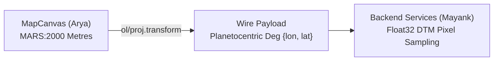

# VyomPath — Backend/Frontend Integration Contract

> **Document:** Backend/Frontend Integration Contract Specification  
> **Team:** NAKSHATRA X | NASA Space Apps Challenge 2026 (Jaipur, India)  
> **Audience:** Arya Tiwari (Map Lead), Kumkum Kushwah (Dashboard Lead), Mayank Sharma (Backend Lead)  
> **Canonical Path:** `docs/backend-frontend-integration-contract.md`  
> **Last Updated:** November 14, 2026  

---

## 1. Network & Host Configuration

### 1.1 Local Development Base URLs
- **Backend API:** `http://127.0.0.1:8000` (or `http://localhost:8000`)
- **Frontend Dev Server:** `http://localhost:5173`
- **Offline Production Preview:** `http://127.0.0.1:4173`
- **Interactive Swagger Docs:** `http://127.0.0.1:8000/docs`
- **OpenAPI Schema:** `http://127.0.0.1:8000/openapi.json`

### 1.2 CORS Configuration
The backend allows local cross-origin requests from frontend hosts via `CORSMiddleware`:
```text
CORS_ORIGINS="http://localhost:5173,http://127.0.0.1:5173,http://localhost:4173,http://127.0.0.1:4173"
```
Headers exposed: `Content-Type`, `Authorization`. Allowed HTTP methods: `GET`, `POST`, `OPTIONS`.

---

## 2. Coordinate System & Geodetic Rules

VyomPath enforces strict planetary geodetic standards signed off by Terrain Lead Pranav Sharma:



### 2.1 Coordinate Conventions
1. **Projection:** `MARS:2000` Equirectangular projection:
   ```text
   +proj=eqc +lat_ts=0 +lat_0=0 +lon_0=0 +R=3396190 +units=m +no_defs
   ```
2. **Mars Sphere Radius ($R$):** Exactly **$3,396,190.0\text{ m}$** (IAU Mars 2000 Spherical Model).
3. **Projected Extent:** `[-10669445.55, -5334722.78, 10669445.55, 5334722.78]`.
4. **Coordinate Ordering on Wire:**
   - **JSON Objects:** Strictly `{"lon": <float>, "lat": <float>}`. Never pass latitude first.
   - **GeoJSON Arrays:** Strictly `[longitude, latitude]`.
5. **Valid Extents:**
   - Longitude: East-positive, range $[-180.0^\circ, +180.0^\circ]$.
   - Latitude: Planetocentric, range $[-90.0^\circ, +90.0^\circ]$.

> [!CAUTION]
> **Unit Transformation Invariant:** The frontend must transform screen canvas metres (e.g., `4,590,180 m`) into geodetic degrees before dispatching requests to `/api/routes/analyze`. Transmitting canvas metres triggers an immediate `HTTP 422 Unprocessable Entity`.

---

## 3. Authoritative Analytical Boundary

1. **Authoritative Vector Boundary:** [`data/footprints/jezero_dtm.geojson`](file:///home/mayank-sharma/Hackathon/NASA/nakshatra-vyompath/data/footprints/jezero_dtm.geojson).
2. **Raster Coverage:** $63.16\%$ valid data within the $9014 \times 10896$ pixel HiRISE stereo DTM swath (`jezero_aoi_v2.tif`).
3. **NoData Behavior:**
   - Traverses fully within the 63.16% mask return `coverage_status: "complete"`.
   - Traverses crossing the 36.84% nodata margins return `coverage_status: "partial_gap"`.
   - Traverses entirely outside return `coverage_status: "out_of_bounds"`.

---

## 4. API Endpoints Specification

### 4.1 Health Check (`GET /api/health`)

Checks API liveness and active operational mode.

**Response (`HTTP 200 OK`):**
```json
{
  "status": "ok",
  "service": "vyompath-api",
  "version": "0.1.0-day1",
  "mode": "development/mock",
  "timestamp_utc": "2026-11-14T11:00:00.000000+00:00",
  "notes": "All route-analysis and layer data is synthetic or illustrative. No real HiRISE/MOLA raster sampling is performed in this mode."
}
```
*Frontend Requirement:* When `mode` is `"development/mock"`, the dashboard must render a prominent `DEVELOPMENT / MOCK` status badge.

---

### 4.2 Map Layer Manifest (`GET /api/layers`)

Returns available basemap, hillshade, and elevation layers loaded directly from `data/layers.json`.

**Response (`HTTP 200 OK`):**
```json
{
  "count": 4,
  "layers": [
    {
      "id": "mola-colorhillshade",
      "name": "MOLA Color Shaded Relief",
      "type": "base",
      "mission": "Mars Global Surveyor (MGS)",
      "instrument": "Mars Orbiter Laser Altimeter (MOLA)",
      "format": "image/jpeg",
      "bounds": [-180.0, -90.0, 180.0, 90.0],
      "source": "NASA / GSFC / JPL Solar System Treks"
    },
    {
      "id": "ctx-mosaic",
      "name": "CTX Global Visible Mosaic",
      "type": "overlay",
      "mission": "Mars Reconnaissance Orbiter (MRO)",
      "instrument": "Context Camera (CTX)",
      "format": "image/jpeg",
      "bounds": [-180.0, -90.0, 180.0, 90.0],
      "source": "NASA / JPL-Caltech / MSSS / Murray Lab"
    }
  ],
  "source": "data/layers.json"
}
```

---

### 4.3 Route Analysis (`POST /api/routes/analyze`)

Evaluates a drawn traverse, calculates 2D/3D distances, elevation profile, slopes, and buffers nearby science POIs.

#### Request Payload (`RouteAnalysisRequest`)
```json
{
  "route_id": "traverse-jezero-alpha",
  "coordinates": [
    {"lon": 77.46313311, "lat": 18.46079140},
    {"lon": 77.46235628, "lat": 18.46263369},
    {"lon": 77.46157944, "lat": 18.46447597}
  ],
  "buffer_distance_m": 250.0
}
```

#### Request Validation Rules
1. `coordinates` array must contain at least 2 coordinate points and at most 500 points.
2. Longitude must satisfy $-180.0 \le \text{lon} \le 180.0$.
3. Latitude must satisfy $-90.0 \le \text{lat} \le 90.0$.
4. Lateral buffer `buffer_distance_m` must be between $50.0\text{ m}$ and $2000.0\text{ m}$.
5. **Cumulative Length Limit:** Traverses exceeding **$25.0\text{ km}$** cumulative distance trigger an immediate `HTTP 422 Unprocessable Entity`.

#### Response Payload (`RouteAnalysisResponse`)
```json
{
  "route_id": "traverse-jezero-alpha",
  "total_distance_m": 482.35,
  "elevation_profile": [
    {
      "distance_m": 0.0,
      "elevation_m": -2568.87
    },
    {
      "distance_m": 241.17,
      "elevation_m": -2568.12
    },
    {
      "distance_m": 482.35,
      "elevation_m": -2567.74
    }
  ],
  "total_gain_m": 1.13,
  "total_loss_m": 0.0,
  "max_slope_deg": 3.45,
  "slope_window_m": 50.0,
  "coverage_status": "complete",
  "dtm_source": "stub",
  "dtm_posting_m": 0.0,
  "nearby_pois": [],
  "limitations": [
    "MOCK DATA: Elevation profile is a deterministic synthetic sine-wave, not sampled from real DTM rasters. No HiRISE or MOLA data was accessed.",
    "MOCK DATA: Gain, loss and slope metrics are derived from the synthetic profile. They are internally consistent but do not represent actual Martian terrain.",
    "MOCK DATA: Nearby POIs are empty. The science-POI service (owner: Dheer) is not yet integrated. No fabricated science points are returned.",
    "MOCK DATA: Terrain service (owner: Pranav) is not yet integrated. DTM source and posting are placeholders.",
    "This analysis is NOT scientifically validated and MUST NOT be used for mission-critical route planning."
  ]
}
```

---

### 4.4 Science POI Registry (`GET /api/science/points`) [Event-Day Integration]

Direct HTTP endpoint for catalogued Mars 2020 Perseverance telemetry waypoints. In the baseline architecture, science POI buffering is executed internally via `backend/app/services/science.py` by Dheer, which loads from `data/science_points.json`. Direct route mounting on FastAPI is scheduled during the event-day integration window.

**Response Schema (`HTTP 200 OK`):**
```json
[
  {
    "id": "POI-M20-SOL-386",
    "name": "Perseverance position, sol 386",
    "coordinates": [77.46313311, 18.46079140],
    "sol": 386,
    "elevation_geoid_m": -2568.87,
    "source": "NASA MMGIS Mars 2020 Telemetry",
    "source_url": "https://mars.nasa.gov/mmgis-maps/M20/Layers/json/M20_waypoints.json"
  }
]
```

---

## 5. Tile URL Scheme & Directory Mapping

The regional tile bundles are served statically by the backend or Vite preview server:

| Region | Zoom Range | Tile Count | Format | On-Disk Directory | URL Scheme |
|---|---|---|---|---|---|
| **Jezero Crater** | $z=12\text{--}15$ | 1,860 tiles | PNG (v1.6) | `tiles/jezero-aoi-v2-1/` | `/tiles/jezero_aoi_v2/{style}/{z}/{x}/{y}.png` |
| **Syrtis Major** | $z=12\text{--}14$ | 520 tiles | PNG (v1.6) | `tiles/syrtis-1/` | `/tiles/syrtis/{style}/{z}/{x}/{y}.png` |
| **Fallback Archive** | $z=10\text{--}16$ | 7,313 tiles | JPEG (v1.4) | `tiles/tiles_aoi/` | `/tiles/tiles_aoi/{z}/{x}/{y}.jpg` |

*Notice:* The on-disk directory uses hyphens (`jezero-aoi-v2-1`), while Arya's client request URL uses underscores (`jezero_aoi_v2`). The local server mounts an alias symlink between `jezero_aoi_v2` and `jezero-aoi-v2-1`.

---

## 6. Science POI Provenance & Geographic Reality

1. **Operational Rover Telemetry vs. Geological Features:** All 5 POIs in `data/science_points.json` (Sols 13, 23, 34, 386, 387) are strictly **operational rover traverse waypoints** from Mars 2020 Perseverance telemetry. They are **not** natural geological landmarks.
2. **Footprint Reality:**
   - **In-Footprint Subset:** Only **Sol 386** and **Sol 387** lie within the valid HiRISE stereo DTM strip.
   - **Out-of-Footprint Subset:** Sols 13, 23, and 34 lie $\sim 0.6\text{ km}$ west outside coverage.
   - **Sols 383–387 Series:** In telemetry, Sols 384 and 385 are separated by only **$13.56\text{ m}$**. OpenLayers must enable marker decluttering (`declutter: true`) at regional zooms ($z=12\text{--}14$) to prevent visual marker collision.
3. **Zero Geological Features:** Across the valid $8.31 \times 10.00\text{ km}$ HiRISE stereo strip, zero catalogued geological features exist. The UI must render an honest empty state for geological queries rather than inventing features or relabeling rover waypoints.
4. **Licensing Disclosure:** Raw NASA MMGIS feed licensing remains unverified (`terms_of_use: null`).

---

## 7. Mandatory UI Presentation Rules

1. **Truth in Analysis Mode:** The UI must clearly indicate `DEVELOPMENT / MOCK` while the route API returns synthetic curves.
2. **Prohibition of "Safe" Claims:** Traversability outputs are advisory risk indicators. The UI must **never** describe or label any route as "safe".
3. **Responsive Error Handling:** The UI must gracefully render user-friendly alert banners on `HTTP 422` (e.g. traverse exceeding 25.0 km or coordinates out of range).
