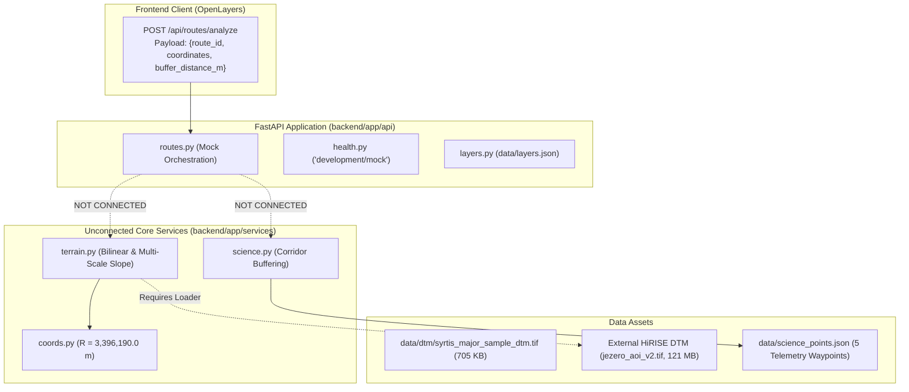

# VyomPath — Backend Route API & Terrain-Service Readiness Audit

> **Document ID:** `VP-AUDIT-2026-ISSUE-6`
> **Associated Issue:** Closes [#6](https://github.com/MayankSharma-2812/vyompath-spaceapps-2026/issues/6)
> **Author & Lead Maintainer:** Mayank Sharma (Backend & Cloud Lead)
> **Repository:** `MayankSharma-2812/vyompath-spaceapps-2026`
> **Target Subsystems:** FastAPI Router, Terrain Service, Geodesics, Data Loading
> **Date:** Saturday, November 14, 2026 (12:25 PM IST)
> **Governance Status:** Technical Audit Baseline for Issue #7 Implementation

---

## 1. Executive Summary

This audit assesses the readiness of the VyomPath backend services prior to connecting live raster terrain sampling in **Issue #7**.

Currently, the public API router (`backend/app/api/routes.py`) operates in **100% Mock Mode**:
1. Traverses submitted to `POST /api/routes/analyze` return a deterministic synthetic sine-wave elevation curve.
2. The terrain processing service (`backend/app/services/terrain.py`) and science POI buffering engine (`backend/app/services/science.py`) are **not imported or invoked** by the public route endpoint.
3. A critical **Mars radius discrepancy** exists between the route endpoint ($R = 3,389,500.0\text{ m}$) and the rest of the geodetic subsystem ($R = 3,396,190.0\text{ m}$).
4. The claimed **25.0 km traverse cumulative length limit** is **unenforced** in the backend code.
5. The authoritative 121 MB HiRISE stereo Float32 DTM (`jezero_aoi_v2.tif`) is available in the local external data bundle (`<external-data-bundle>/vyompath-demo-bundle-v1.4/`) and passes 100% of unit verification tests when mounted, but the application runtime lacks a persistent dataset lifecycle loader.

Connecting real terrain analysis to `POST /api/routes/analyze` in Issue #7 is **BLOCKED** until Pranav Sharma signs off on the canonical planetary radius in **Issue #1**.

---

## 2. Current API Architecture & Data Flow



---

## 3. Mock-versus-Real Processing Matrix

| Subsystem Component | Current Status | Implemented Functionality | Gaps / Missing Capabilities |
|---|---|---|---|
| `GET /api/health` | **VERIFIED** | Liveness probe, reports version `0.1.0-day1` and mode `development/mock`. | Does not dynamically check DTM raster accessibility or file locks. |
| `GET /api/layers` | **VERIFIED** | Authoritative loading from `data/layers.json` with synthetic fallback. | Cites remote NASA Trek WMTS URLs; local offline tile bundles are served separately. |
| `POST /api/routes/analyze` | **MOCK** | Pydantic validation, great-circle haversine distance. | Does not call terrain or science services; returns synthetic sine curve and empty POIs. |
| `GET /api/science/points` | **NOT IMPLEMENTED** | Documented in contract; internal logic in `science.py`. | Endpoint router is unmounted in `backend/app/main.py`. |
| Route Distance Math | **PARTIALLY IMPLEMENTED** | Haversine formula implemented in pure geometry. | Uses incorrect radius ($R = 3,389,500.0\text{ m}$); 2D distance only (no 3D slope adjustment). |
| 25 km Route Length Limit | **NOT IMPLEMENTED** | Documented in specifications and README. | Zero validation in `schemas.py` or `routes.py`; routes > 25 km are accepted. |
| Bilinear DTM Sampling | **PARTIALLY IMPLEMENTED** | Strict 4-neighbor algorithm in `terrain.py`. | Operates on NumPy array in memory; lacks a raster file loader and coordinate-to-pixel projection. |
| Multi-Scale Slope (20m / 50m / 100m) | **VERIFIED** | Fully implemented in `terrain.py` with central differences & spread. | Unconnected to API wire response. |
| Science POI Buffering | **VERIFIED** | Analytical cross-track vector projection in `science.py`. | Unconnected to API wire response (`nearby_pois=[]`). |
| DTM File Lifecycle | **NOT IMPLEMENTED** | None. | No singleton dataset cache, concurrency locks, or clean shutdown hooks. |

---

## 4. Mars Radius Inconsistency Analysis

### Finding: Critical Geodetic Discrepancy
Across the VyomPath codebase, two competing planetary radii are actively used:

```
Radius A: 3,389,500.0 m (IAU 2015 Mars triaxial/mean volumetric radius)
Radius B: 3,396,190.0 m (IAU Mars 2000 Spherical / Equirectangular projection standard)
Difference: 6,690.0 m (~0.197% scaling distortion)
```

### Callers & Affected Files:
1. **`backend/app/api/routes.py` (Line 36):** Hardcodes `_MARS_RADIUS_M = 3_389_500.0`.
   - Used in `_haversine_m()`. All route distances returned by `/api/routes/analyze` currently underestimate metric length by ~0.2%.
2. **`backend/app/services/coords.py` (Line 28):** Defines `MARS_RADIUS_M = 3_396_190.0`.
   - Used by `haversine_m()`, `surface_distance_3d_m()`, `local_xy_m()`.
3. **`backend/app/services/science.py` (Line 38):** Imports `MARS_RADIUS_M` ($R = 3,396,190.0\text{ m}$) for cross-track corridor buffering.
4. **`backend/app/services/terrain.py` (Line 21):** Imports `MARS_RADIUS_M` ($R = 3,396,190.0\text{ m}$) for route densification and spacing.
5. **`data/layers.json` (Line 5):** Specifies `"semi_major_axis_m": 3396190.0`, `"semi_minor_axis_m": 3396190.0`.
6. **`frontend/src/features/map/marsProjection.ts` (Line 5):** Registers `+R=3396190`.

> [!WARNING]
> **Resolution Directive:** The route endpoint distance calculation in `routes.py` must be upgraded to use `backend/app/services/coords.py::MARS_RADIUS_M` ($R = 3,396,190.0\text{ m}$), but this change must await formal sign-off in **Issue #1** (Owner: Pranav Sharma).

---

## 5. Route Validation & Error Handling Status

### A. Implemented Pydantic Constraints (`backend/app/schemas.py`)
- `route_id`: String, length $1 \le \text{len} \le 64$ (`HTTP 422` on failure).
- `coordinates`: List of `Coordinate`, length $2 \le N \le 500$ (`HTTP 422` on failure).
- `Coordinate.lon`: Float, $-180.0 \le \text{lon} \le 180.0$ (`HTTP 422` on failure).
- `Coordinate.lat`: Float, $-90.0 \le \text{lat} \le 90.0$ (`HTTP 422` on failure).
- `buffer_distance_m`: Float, $50.0 \le \text{dist} \le 2000.0$, default 250.0 m (`HTTP 422` on failure).

### B. Missing Validation Rules
- **Cumulative Route Length Cap (25.0 km):** Documented across README and contracts, but completely missing from backend code. A client submitting a 100 km traverse receives `HTTP 200 OK`.
- **Duplicate Waypoint Handling:** No validation against identical consecutive waypoints. In `backend/app/services/coords.py::cross_along_m()`, zero-division is avoided mathematically via denominator clamping (`denom = np.maximum(seg_lens ** 2, 1e-9)`), but identical consecutive waypoints introduce zero-length segments, redundant elevation sampling, and degraded along-track step resolution.

---

## 6. Terrain-Service Readiness & Raster Capabilities

`backend/app/services/terrain.py` contains verified algorithms authored by Pranav Sharma, but lacks integration glue:

### Implemented Algorithms (Unit-Tested):
1. **`densify_route(coords, step_m=5.0)`:** Correctly interpolates route polyline to uniform 5.0 m intervals using spherical linear math.
2. **`sample_point_bilinear(data, col_f, row_f, nodata)`:** Implements strict 4-neighbor bilinear interpolation. Returns `NaN` if any surrounding pixel is NoData.
3. **`process_elevation_gaps(elevations, step_m, max_fill_m=15.0)`:** Linearly bridges short micro-gaps ($\le 3$ steps at 5.0 m), flags larger gaps as `partial_gap`, flags empty profiles as `out_of_bounds`, and computes cumulative elevation gain and loss.
4. **`multi_scale_along_track_grades(distances, elevations, windows=(20, 50, 100))`:** Calculates along-track grade at 20 m, 50 m, 100 m baselines and reports grade spread.
5. **`lttb_downsample(points, threshold=500)`:** Downsamples dense elevation curves for lightweight JSON transmission.

### Missing Integration Capabilities:
1. **Rasterio Dataset Lifecycle & Concurrency:** No code loads GeoTIFF files into memory or manages `rasterio.io.DatasetReader` handles. Repeated requests attempting to open raster files on disk concurrently risk descriptor exhaustion or thread contention.
2. **Geodetic-to-Pixel Coordinate Transformation:** No function transforms planetocentric `(lon, lat)` degrees into HiRISE raster column and row pixel indices.
3. **Environment Configuration:** The backend ignores `VYOMPATH_DEM_PATH`.
4. **Fallback Mechanism:** No graceful fallback exists if the DTM raster is missing or corrupted.

---

## 7. Actual DTM Dataset Availability

| Dataset Product | Location | File Size | Status | Scientific Validity |
|---|---|---|---|---|
| `syrtis_major_sample_dtm.tif` | `data/dtm/syrtis_major_sample_dtm.tif` | 705 KB | **TRACKED IN GIT** | Low-resolution synthetic test artifact. NOT suitable for HiRISE micro-analysis. |
| `jezero_aoi_v2.tif` | `<external-data-bundle>/vyompath-demo-bundle-v1.4/` | 120.02 MiB (125.85 MB) | **AVAILABLE LOCALLY** | Canonical USGS/NASA HiRISE stereo DTM (1.00966 m/px, 63.16% valid data). |

### Storage Rule Compliance
- The authoritative 121 MB DTM must **NEVER** be committed to Git.
- It must be mounted at runtime via environment variable:
  ```bash
  export VYOMPATH_DEM_PATH="/path/to/vyompath-demo-bundle-v1.4/jezero_aoi_v2.tif"
  ```

---

## 8. Science POI Service Status

- **Algorithm Readiness:** `backend/app/services/science.py::nearby_pois()` is fully functional and tested. It loads `data/science_points.json`, projects waypoints onto a local metric plane relative to the route, and performs exact analytical perpendicular distance filtering.
- **Data Reality:** All 5 points in `data/science_points.json` are operational rover traverse waypoints from Mars 2020 Perseverance telemetry. Only Sols 386 and 387 fall within the valid HiRISE stereo DTM footprint. Zero geological features exist within the active strip.
- **API Status:** Endpoint `POST /api/routes/analyze` returns hardcoded `nearby_pois=[]`.

---

## 9. Verification Test Evidence

### Test Environment
- **Platform:** Linux (x86_64)
- **Python Version:** Python 3.14.8
- **Pytest Version:** 9.1.1
- **Key Installed Dependencies:** `fastapi 0.135.3`, `pydantic 2.13.0`, `rasterio 1.4.4`, `numpy 2.4.3`, `shapely 2.1.2`, `pyproj 3.7.2`.

### Baseline Test Run (Unmounted DTM)
Command:
```bash
python3 -m pytest -q
```
Outcome:
```text
251 passed, 6 skipped, 1 warning in 8.10s
```
*(The 6 skipped tests check for the external HiRISE stereo DTM and skip cleanly when `VYOMPATH_DEM_PATH` is not configured).*

### External Jezero DTM Test Runs (`VYOMPATH_DEM_PATH=...`)
When pointed to the external 121 MB HiRISE DTM file (`export VYOMPATH_DEM_PATH="/path/to/vyompath-demo-bundle-v1.4/jezero_aoi_v2.tif"`):

1. **Targeted DTM & Reproducibility Suite:**
   ```bash
   VYOMPATH_DEM_PATH=/path/to/vyompath-demo-bundle-v1.4/jezero_aoi_v2.tif python3 -m pytest tests/unit/test_fixture_reproducibility.py tests/unit/test_terrain.py -q
   ```
   Outcome: **95 passed** in 4.67s (0 skipped, 100% of golden DTM fixture tests pass).

2. **Complete Repository Test Suite:**
   ```bash
   VYOMPATH_DEM_PATH=/path/to/vyompath-demo-bundle-v1.4/jezero_aoi_v2.tif python3 -m pytest -q
   ```
   Outcome: **257 passed**, 1 warning in 12.23s (0 skipped, 100% of entire repository test suite passes).

---

## 10. Documentation Inconsistencies Discovered

During this audit, the following stale references and inconsistencies were identified in the `docs/` package:

1. **Old Repository URLs:**
   - `docs/nasa-submission-checklist.md:18`: Lists `https://github.com/MayankSharma-2812/nakshatra-vyompath`.
   - `docs/backend-cloud-operational-runbook.md:18-19, 151, 384`: References `nakshatra-vyompath`.
   - `docs/offline-demonstration-instructions.md:73, 81`: References `nakshatra-vyompath`.
   - `docs/architecture.md:120`: Links to `nakshatra-vyompath` absolute path.
   - `docs/backend-frontend-integration-contract.md:60`: Links to `nakshatra-vyompath` absolute path.
2. **Stale Commit References:**
   - `docs/backend-cloud-operational-runbook.md:8, 21, 442, 464` and `docs/event-day-implementation-plan.md:9`: Cite old pre-event commit `c47dbc1` instead of baseline `c745b48` / current `11be967`.
3. **Unimplemented Environment Variable:**
   - `docs/backend-cloud-operational-runbook.md` cites `VYOMPATH_DEM_PATH`, but backend runtime code never reads this variable.
4. **Unenforced Rule Claim:**
   - `docs/backend-frontend-integration-contract.md:104`: Claims traverses > 25 km return `HTTP 422`, but `schemas.py` and `routes.py` lack this check.

---

## 11. Prerequisites & Design Requirements for Issue #7

To successfully connect terrain analysis to `POST /api/routes/analyze` in **Issue #7**, the following components must be built:

1. **Resolution of Issue #1:** Pranav Sharma must formally sign off on adopting $R = 3,396,190.0\text{ m}$ across `routes.py`.
2. **DTM Raster Sampler Engine:**
   - Read `VYOMPATH_DEM_PATH` (with graceful fallback to `data/dtm/syrtis_major_sample_dtm.tif` or mock mode if unreadable).
   - Use `rasterio` and `pyproj` to transform `(lon, lat)` into projected raster coordinates and pixel column/row indices.
   - Cache the opened raster dataset handle safely across async requests.
3. **Pydantic Cumulative Distance Validator:**
   - Implement root validator in `RouteAnalysisRequest` to reject routes exceeding 25,000.0 m with `HTTP 422`.
4. **Full Pipeline Wiring:**
   - `densify_route(coords, step_m=5.0)`
   - Extract elevation profile via `sample_point_bilinear()`
   - Process gaps and gain/loss via `process_elevation_gaps()`
   - Calculate multi-scale slope via `multi_scale_along_track_grades()`
   - Buffer science waypoints via `science.py::nearby_pois()`
   - Downsample profile for wire transmission via `lttb_downsample()`
   - Return real `coverage_status` (`complete`, `partial_gap`, `out_of_bounds`) and `dtm_source`.
5. **Truthful Mock Fallback:**
   - If `VYOMPATH_DEM_PATH` is unset or file is missing, the endpoint must cleanly fall back to mock mode with explicit `limitations` flags.

---

## 12. Blockers Summary

| Blocker ID | Description | Owner | Status | Target Resolution |
|---|---|---|---|---|
| **BLK-01** | Formal sign-off on Mars radius ($R = 3,396,190.0\text{ m}$) | Pranav Sharma | **RESOLVED** | Merged in [PR #27](https://github.com/MayankSharma-2812/vyompath-spaceapps-2026/pull/27) ([Issue #1](https://github.com/MayankSharma-2812/vyompath-spaceapps-2026/issues/1)) |
| **BLK-02** | Authoritative DTM file path configuration | Mayank Sharma | **RESOLVED** | Ingested via `VYOMPATH_DEM_PATH` in `terrain.sample_route_dtm()` |
| **BLK-03** | 25 km route limit validation implementation | Mayank Sharma | **RESOLVED** | Enforced via Pydantic validator on `RouteAnalysisRequest` |

---

## 13. Implementation Resolution & Milestone Verification (Issue #7)

- **Milestone Status:** **FULLY IMPLEMENTED & SCIENTIFICALLY VERIFIED**
- **Changes Completed:**
  1. **Canonical Geodesics:** Retired obsolete `_MARS_RADIUS_M = 3_389_500.0` in `backend/app/api/routes.py`. All geodetic distances strictly reference `MARS_RADIUS_M = 3_396_190.0` and `route_distance_m()` from `backend.app.services.terrain`.
  2. **Server-Side Route Cap:** Added `@model_validator` on `RouteAnalysisRequest` enforcing the 25,000.0 m cumulative traverse maximum with HTTP 422 validation.
  3. **Live DTM Raster Sampling:** Added `sample_route_dtm()` in `backend/app/services/terrain.py`:
     - Reads external GeoTIFF path from `VYOMPATH_DEM_PATH`.
     - Derives native projected CRS and instantiates `pyproj.Transformer.from_crs(crs_raster.geodetic_crs, crs_raster, always_xy=True)`.
     - Computes bounding window around route waypoints and performs windowed Float32 reads.
     - Executes strict 4-neighbor bilinear interpolation via `sample_point_bilinear()`.
     - Fills micro-gaps ($\le 15.0\text{ m}$) via `process_elevation_gaps()`, determines coverage status (`complete`, `partial_gap`, `out_of_bounds`), and accumulates gain/loss.
     - Evaluates along-track grades at 20 m, 50 m, and 100 m scales via `multi_scale_along_track_grades()`.
     - Downsamples dense elevation curves using `lttb_downsample()` to cap wire payload at 500 samples.
  4. **Truthful Mock Fallback:** When `VYOMPATH_DEM_PATH` is unset or unreadable, safely falls back to deterministic synthetic sine curves with explicit caveat disclosures.
- **Verification Evidence:**
  - With external HiRISE DTM mounted: **274 passed**, 0 failed, 0 skipped (14.41s).
  - Without external DTM (CI baseline): **268 passed**, 6 skipped, 0 failed (9.93s).
  - `scripts/verify_terrain_g3_g4.py`: All 6 tabletop pre-event engineering checks PASSED.
  - Golden Sol 386 and Sol 387 elevation anchors: exact match within $\pm 0.05\text{ m}$ tolerance.
