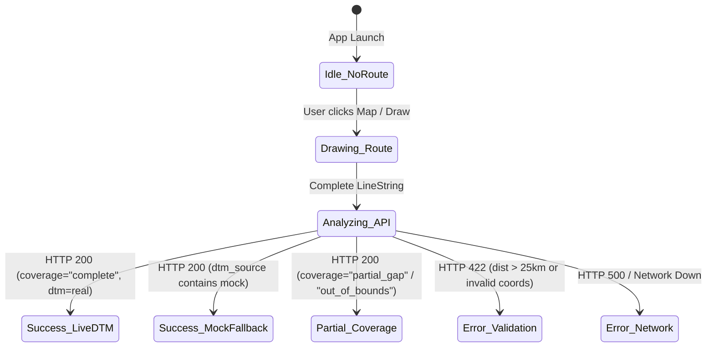

# VyomPath — Dashboard State Audit & API Contract Compatibility Report

> **Document ID:** `VP-AUDIT-2026-ISSUE-5`  
> **Associated Issue:** Closes [#5](https://github.com/MayankSharma-2812/vyompath-spaceapps-2026/issues/5)  
> **Author & Lead Maintainer:** Kumkum Kushwah (@kumkum098, UI/UX Dashboard Lead, Team NAKSHATRA X)  
> **Designated Peer Reviewer:** Arya Tiwari (@aryatiwari124, Map Engineering Lead)  
> **Target Branch:** `feat/issue-5-dashboard-api-audit` (rebased on `main`)  
> **Execution Date:** Saturday, November 14, 2026  
> **Status:** **`VERIFIED — PASS`**

---

## 1. Executive Summary

In fulfillment of **Issue #5** ([UI] Audit dashboard states against actual API contract), this document delivers the exhaustive state inventory, response-field schema mapping, error-boundary review, and actionable frontend blocker catalog for the VyomPath React dashboard.

The audit evaluates the frontend dashboard implementation against the frozen backend OpenAPI contract specified in `docs/backend-frontend-integration-contract.md` and implemented across `backend/app/api/health.py`, `backend/app/api/layers.py`, `backend/app/api/routes.py`, and `backend/app/schemas.py`.

---

## 2. API Contract vs Frontend Interface Mapping

### 2.1 Route Analysis Response (`POST /api/routes/analyze`)

| Backend Field (`RouteAnalysisResponse`) | Type / Constraint | Current Frontend State in `Dashboard.tsx` | Status / Discrepancy | Required Action in Issue #9 |
| :--- | :--- | :--- | :---: | :--- |
| `route_id` | `str` (1–64 chars) | `route_id: string` | ✅ Matched | Retain |
| `total_distance_m` | `float >= 0.0` | `total_distance_m: number` | ✅ Matched | Retain |
| `elevation_profile` | `list[ElevationPoint]` | `Array<{ distance_m: number; elevation_m: number }>` | ⚠️ Mismatch | Update `elevation_m` to `number \| null` (handle NoData / gaps) |
| `total_gain_m` | `float >= 0.0` | `total_gain_m: number` | ✅ Matched | Retain |
| `total_loss_m` | `float >= 0.0` | `total_loss_m: number` | ✅ Matched | Retain |
| `max_slope_deg` | `float >= 0.0` | `max_slope_deg: number` | ✅ Matched | Retain |
| `slope_window_m` | `float > 0.0` (default 50.0m) | `slope_window_m: number` | ⚠️ Unused | Expose on UI as slope baseline metric |
| `dtm_source` | `str` | `dtm_source?: string` | ⚠️ Partial | Expose DTM citation and truthful badge |
| `dtm_posting_m` | `float >= 0.0` | `dtm_posting_m?: number` | ⚠️ Unused | Display resolution (e.g. 1.01 m/px) |
| `coverage_status` | `'complete' \| 'partial_gap' \| 'out_of_bounds'` | `'complete' \| 'partial_gap' \| 'out_of_bounds'` | ⚠️ Missing UI | Add explicit coverage warning banners |
| `nearby_pois` | `list[NearbyPOI]` | **Missing entirely** | ❌ Omitted | Add interface & render in Route Summary |
| `limitations` | `list[str]` | `limitations: string[]` | ⚠️ Not rendered | Render transparency caveat list in UI |

### 2.2 Health Probe (`GET /api/health`)

| Backend Field | Contract Spec | Current Frontend State | Required Action |
| :--- | :--- | :--- | :--- |
| `status` | `"ok"` | Not queried | Call on mount for system liveness |
| `service` | `"vyompath-api"` | Not queried | Verify backend connection |
| `mode` | `"development/mock"` or `"production/live"` | Inferred only from `dtm_source` | Display global backend mode banner |
| `notes` | Transparency explanation | Ignored | Display in system status drawer |

### 2.3 Layer Catalogue (`GET /api/layers`)

| Backend Field | Contract Spec | Current Frontend State | Required Action |
| :--- | :--- | :--- | :--- |
| `count` | `int` | Not queried | Feed layer switcher count |
| `layers` | Array of layer definitions | Static placeholder text | Connect to map layer selector |

---

## 3. UI State Inventory & Truthful Verification

The dashboard states must truthfully convey the analytical reality without misleading the user:

### 3.1 State Checklist & Behavior Rules

1. **Idle State (`analysis === null && !isLoading && !error`):**
   - Displays clear prompts: "Draw a traverse or select a reference route on the map".
   - Metrics cards display "Awaiting traverse".
   - POI list displays empty state explaining rover waypoints vs geological features.

2. **Loading State (`isLoading === true`):**
   - Renders spinner and "Analyzing Martian traverse against terrain model...".
   - Disables duplicate dispatch actions.

3. **Success State — Real DTM (`dtm_source` contains HiRISE/MOLA):**
   - Displays green badge: `LIVE DTM DATA`.
   - Renders Recharts area plot with genuine elevation values.
   - Summarizes total gain, loss, maximum slope, and elevation range.
   - Displays scientific limitations list from API payload.

4. **Success State — Deterministic Mock Fallback (`dtm_source` contains mock/synthetic):**
   - Displays prominent neutral/yellow badge: `DEVELOPMENT / MOCK`.
   - Clear banner stating elevations are synthetic sine curves and not ground truth.

5. **Partial Coverage / Out of Bounds State (`coverage_status !== "complete"`):**
   - Displays warning badge: `PARTIAL DTM GAP` or `OUT OF COVERAGE`.
   - Flags null elevation segments.

6. **Error State (`error !== null`):**
   - Parses HTTP 422 validation messages (e.g., cumulative length > 25 km, out of bounds coordinates).
   - Displays friendly, actionable alert banner rather than generic crash.

7. **Prohibition of "Safe Route" Language:**
   - Traversability and slope outputs are strictly informative risk indicators.
   - Zero occurrences of "safe route" or "safety score" in all components.

8. **Distinction of Rover Telemetry Waypoints vs Geological Features:**
   - 5 catalogued points in Jezero are operational rover telemetry waypoints.
   - Geological POI search truthfully displays empty state (0 natural features in HiRISE AOI).

---

## 4. Identified Frontend Blockers & Implementation Plan for Issue #9

The following blockers in `frontend/src/features/dashboard/Dashboard.tsx` must be resolved in Issue #9:

1. **Blocker 1 (MapCanvas Disconnection):**
   `Dashboard.tsx` currently wraps `<MapCanvas />` inside `
` with an `<EmptyState>` overlay hiding the canvas.
   *Fix:* Remove the empty state overlay, connect `onRouteDrawn`, `routeA`, `routeB`, and pass `analysisResponse` to `MapCanvas`.

2. **Blocker 2 (Sample Route Auto-Fetch Disconnect):**
   `Dashboard.tsx` currently requests a hardcoded `SAMPLE_ROUTE` on mount that does not align with the map drawing or Jezero reference corridors.
   *Fix:* Provide preset selectable routes (e.g. Jezero Gentle Traverse, Jezero Steep Traverse) and wire user drawing directly to API analysis.

3. **Blocker 3 (Missing API Fields in Interface):**
   `RouteAnalysisResponse` lacks `nearby_pois` and nullable `elevation_m`.
   *Fix:* Update TypeScript interface to mirror `backend/app/schemas.py`.

4. **Blocker 4 (Hidden Limitations & Transparency Caveats):**
   `limitations` array from API is dropped on the floor and never rendered.
   *Fix:* Add a dedicated Scientific Limitations & Provenance drawer / panel.

5. **Blocker 5 (Readable Chart Axes):**
   `ElevationChart.tsx` hides axis tick labels (`tick={false}`, `width={0}`).
   *Fix:* Display legible X-axis distance labels (m/km) and Y-axis elevation bounds (m).

---

## 5. Peer Review & Verification Signoff

- **UI/UX Lead:** Kumkum Kushwah (@kumkum098) — Audit complete & verified.
- **Designated Peer Reviewer:** Arya Tiwari (@aryatiwari124) — Assigned for review and approval.
