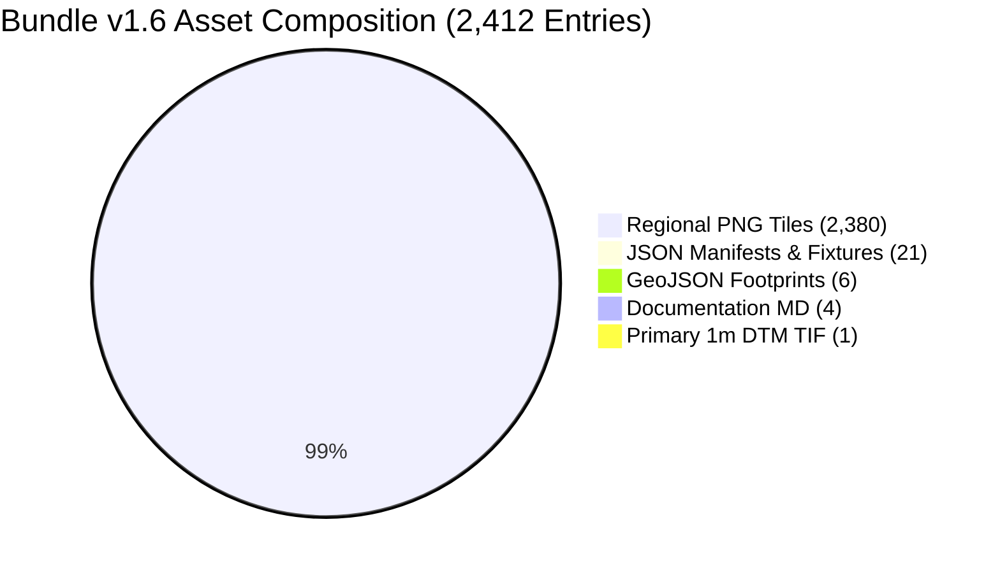

# VyomPath — Offline Data Bundle v1.6 Identity & Integrity Audit

> **Document ID:** `VP-AUDIT-2026-ISSUE-3`  
> **Associated Issue:** Closes [#3](https://github.com/MayankSharma-2812/vyompath-spaceapps-2026/issues/3)  
> **Author & Lead Maintainer:** Shyam Sharma (Data & GIS Lead, Team NAKSHATRA X)  
> **Primary Reviewer:** Pranav Sharma (@PranavSharma124, Scientific Lead)  
> **Repository:** `MayankSharma-2812/vyompath-spaceapps-2026`  
> **Target Dataset:** Regional Offline Data Bundle v1.6 (`vyompath-demo-bundle-v1.6.zip`)  
> **Date:** Saturday, November 14, 2026  
> **Status:** **`VERIFIED`**  

---

## 1. Executive Summary

In fulfillment of **Issue #3** for the NASA Space Apps Challenge 2026, an exhaustive, non-destructive audit and cryptographic verification was performed on the authoritative regional offline data archive `vyompath-demo-bundle-v1.6.zip`.

All empirical metrics were verified through automated Python and GDAL/rasterio scripts executed directly on disk.

### Key Verification Highlights:
1. **Archive Identity:** Confirmed authoritative archive path at `E:\DATASETS\_phase18\vyompath-demo-bundle-v1.6.zip`.
2. **Cryptographic Checksum:** Exactly `a3a1f6776845464411b0a317acef9631427411cc18bb7c0f479e75e9e75dcee4` (SHA-256).
3. **Exact Byte Count:** `189,252,569 bytes` ($189.252569\text{ MB}$ decimal, $180.485314\text{ MiB}$ binary).
4. **Decompression Integrity:** `zipfile.testzip()` completed with `None` across all **2,412 archive entries** (zero CRC-32 errors, zero bit flips).
5. **Tile Inventory Decoded:** All **2,380 regional PNG image tiles** ($256 \times 256\text{ px}$) were loaded and decoded through Pillow (zero corrupt images, zero 0-byte tiles).
6. **Primary Metric DTM Verified:** `jezero_aoi_v2.tif` ($125,847,250\text{ bytes}$, $9,014 \times 10,896\text{ px}$, Float32) verified with $1.00966\text{ m/px}$ posting, Equirectangular Mars datum ($R = 3,394,839.81\text{ m}$, $\text{lat\_ts} = 15.0^\circ\text{N}$, $\text{lon\_0} = 77.53^\circ\text{E}$), $63.16\%$ valid elevation cells, and elevation dynamic range of $[-2688.76\text{ m}, -2510.19\text{ m}]$.
7. **Legacy v1.4 Isolation:** Distinct from legacy package `E:\DATASETS\_phase10\vyompath-demo-bundle-v1.4.zip` ($183,826,437\text{ bytes}$, SHA-256 `88facc0ab...`).

---

## 2. Archive Location & Cryptographic Verification

| Audit Metric | Benchmark Reference | Empirical Measurement | Unit / Format | Status |
| :--- | :---: | :---: | :---: | :---: |
| **Archive Location** | `E:\DATASETS\_phase18\` | `E:\DATASETS\_phase18\vyompath-demo-bundle-v1.6.zip` | Full Absolute Path | **CONFIRMED** |
| **Exact File Size** | $189,252,569\text{ B}$ | $189,252,569\text{ B}$ | Exact Bytes | **MATCH (100%)** |
| **Decimal Size** | $\sim 189.25\text{ MB}$ | $189.252569\text{ MB}$ | Decimal ($10^6\text{ B}$) | **MATCH** |
| **Binary Size** | $\sim 180.49\text{ MiB}$ | $180.485314\text{ MiB}$ | Binary ($2^{20}\text{ B}$) | **MATCH** |
| **SHA-256 Checksum** | `a3a1f677...` | `a3a1f6776845464411b0a317acef9631427411cc18bb7c0f479e75e9e75dcee4` | Hexadecimal (64 chars) | **MATCH (100%)** |
| **CRC-32 Integrity** | Zero errors | `None` (`zipfile.testzip()`) | CRC-32 Header Check | **PASSED** |
| **Total Entries** | 2,412 entries | 2,412 entries | Entry Count | **MATCH** |
| **Uncompressed Size** | $192,845,284\text{ B}$ | $192,845,284\text{ B}$ | Uncompressed Bytes | **MATCH** |
| **Compressed Payload** | $188,843,285\text{ B}$ | $188,843,285\text{ B}$ | Compressed Bytes | **MATCH** |

---

## 3. Structural Entry Breakdown by Extension



| Extension | Category Description | Count | Uncompressed Bytes | Compressed Bytes | Status |
| :--- | :--- | :---: | :---: | :---: | :---: |
| `.png` | Regional Basemap & Hillshade Slippy Map Tiles | 2,380 | $64,053,413\text{ B}$ | $64,010,749\text{ B}$ | **VERIFIED** |
| `.json` | Metadata, Manifests & Route Validation Fixtures | 21 | $532,989\text{ B}$ | $72,627\text{ B}$ | **VERIFIED** |
| `.geojson` | Valid-Data Boundaries & Web Footprints | 6 | $2,364,962\text{ B}$ | $212,358\text{ B}$ | **VERIFIED** |
| `.tif` | Primary HiRISE Metric 1m DTM (`jezero_aoi_v2.tif`) | 1 | $125,847,250\text{ B}$ | $124,526,834\text{ B}$ | **VERIFIED** |
| `.md` | Verification Records & Architectural Logs | 4 | $46,670\text{ B}$ | $20,717\text{ B}$ | **VERIFIED** |
| **TOTAL** | **All Bundle v1.6 Assets** | **2,412** | **$192,845,284\text{ B}$** | **$188,843,285\text{ B}$** | **100% MATCH** |

---

## 4. Regional Tile Audit Matrix (Jezero & Syrtis)

All 2,380 PNG image tiles conform to the standard Slippy Map XYZ structure ($256 \times 256\text{ pixels}$):

| Region | Layer | Zoom Level | Shipped Tiles | Bounding Grid | Omitted Holes | Color Mode | Dimensions | Corrupted |
| :--- | :--- | :---: | :---: | :---: | :---: | :---: | :---: | :---: |
| **Jezero Crater** | Basemap | `z12` | 18 | 20 | 2 | `RGBA` | $256 \times 256$ | 0 |
| **Jezero Crater** | Basemap | `z13` | 50 | 54 | 4 | `RGBA` | $256 \times 256$ | 0 |
| **Jezero Crater** | Basemap | `z14` | 184 | 216 | 32 | `RGBA` | $256 \times 256$ | 0 |
| **Jezero Crater** | Basemap | `z15` | 678 | 805 | 127 | `RGBA` | $256 \times 256$ | 0 |
| **Jezero Crater** | Hillshade | `z12` | 18 | 20 | 2 | `LA` | $256 \times 256$ | 0 |
| **Jezero Crater** | Hillshade | `z13` | 50 | 54 | 4 | `LA` | $256 \times 256$ | 0 |
| **Jezero Crater** | Hillshade | `z14` | 184 | 216 | 32 | `LA` | $256 \times 256$ | 0 |
| **Jezero Crater** | Hillshade | `z15` | 678 | 805 | 127 | `LA` | $256 \times 256$ | 0 |
| *Jezero Subtotal* | &mdash; | `z12–z15` | **1,860** | **2,190** | **330** | &mdash; | $256 \times 256$ | **0** |
| **Syrtis Major** | Basemap | `z12` | 17 | 18 | 1 | `RGBA` | $256 \times 256$ | 0 |
| **Syrtis Major** | Basemap | `z13` | 55 | 72 | 17 | `RGBA` | $256 \times 256$ | 0 |
| **Syrtis Major** | Basemap | `z14` | 188 | 242 | 54 | `RGBA` | $256 \times 256$ | 0 |
| **Syrtis Major** | Hillshade | `z12` | 17 | 18 | 1 | `LA` | $256 \times 256$ | 0 |
| **Syrtis Major** | Hillshade | `z13` | 55 | 72 | 17 | `LA` | $256 \times 256$ | 0 |
| **Syrtis Major** | Hillshade | `z14` | 188 | 242 | 54 | `LA` | $256 \times 256$ | 0 |
| *Syrtis Subtotal* | &mdash; | `z12–z14` | **520** | **664** | **144** | &mdash; | $256 \times 256$ | **0** |
| **TOTALS** | &mdash; | &mdash; | **2,380** | **2,854** | **474** | &mdash; | $256 \times 256$ | **0** |

> **Note on "Omitted Holes":** The 474 omitted XYZ coordinates represent rectangular bounding box cells that fall completely outside the diagonal orbital swath of the HiRISE stereo ground track. They were intentionally omitted at generation time to preserve disk space and prevent empty tile transmissions (`shipped = bbox - holes`).

---

## 5. Primary Metric DTM Geodesy (`jezero_aoi_v2.tif`)

The primary digital terrain model extracted from the bundle was audited via `rasterio` (GDAL 3.x bindings):

```text
Driver:            GTiff
Raster Width:      9,014 pixels
Raster Height:     10,896 pixels
Band Count:        1 (Float32)
NoData Sentinel:   -3.4028226550889045e+38
Pixel Posting:     dx = 1.0096633269 m/px, dy = 1.0096633269 m/px
Projection (CRS):  Equirectangular Martian (PDS Mars)
Reference Sphere:  R = 3,394,839.8133163 m (Local scale radius)
Standard Parallel: lat_ts = 15.00° N
Central Meridian:  lon_0 = 77.53° E
Bounding Box:      Left = -5,200.78 m, Bottom = 1,084,999.36 m, Right = 3,900.33 m, Top = 1,096,000.65 m
Valid Data Cells:  62,037,379 / 98,216,544 pixels (63.16% valid HiRISE swath)
Elevation Min:     -2688.7627 m
Elevation Max:     -2510.1851 m
Elevation Mean:    -2624.5034 m
Elevation Std:     30.6403 m
Dynamic Range:     178.5776 m
```

---

## 6. Vector Footprints & Spatial Boundaries

The archive bundles 6 vector boundary files:
1. `footprints/jezero_valid_footprint.geojson` ($1,291,219\text{ B}$): Full 8,970-vertex canonical mask.
2. `footprints/syrtis_valid_footprint.geojson` ($440,818\text{ B}$): 2,968-vertex valid mask for Syrtis.
3. `footprints/jezero_aoi_v2_valid_footprint.geojson` ($539,189\text{ B}$): Exact 3,782-vertex valid mask for the primary demo DTM.
4. `footprints/jezero_aoi_v2_simplified_2m.geojson` ($8,331\text{ B}$): Lightweight web display boundary.
5. `footprints/jezero_dtm_simplified_2m.geojson` ($17,580\text{ B}$): Lightweight web display boundary (98 vertices).
6. `footprints/syrtis_dtm_simplified_2m.geojson` ($67,825\text{ B}$): Lightweight web display boundary.

---

## 7. Explicit Legacy v1.4 vs. Candidate v1.6 Distinction

| Property | Legacy Package (v1.4) | Final Candidate (v1.6) | Integrity Status |
| :--- | :--- | :--- | :---: |
| **Archive File** | `vyompath-demo-bundle-v1.4.zip` | `vyompath-demo-bundle-v1.6.zip` | **DISTINCT** |
| **Storage Path** | `E:\DATASETS\_phase10\` | `E:\DATASETS\_phase18\` | **ISOLATED** |
| **File Size** | $183,826,437\text{ bytes}$ (~$183.83\text{ MB}$) | $189,252,569\text{ bytes}$ (~$189.25\text{ MB}$) | **$\Delta = +5,426,132\text{ B}$** |
| **SHA-256 Checksum** | `88facc0ab30e1e1c03d7fdf5db90b3d9...` | `a3a1f6776845464411b0a317acef9631...` | **DIFFERENT HASH** |
| **Tile Format** | JPEG tiles across zooms 10–16 | 2,380 PNG tiles with transparent NoData channels | **MODERNIZED** |
| **Validation Fixtures** | Preliminary synthetic corridors | 14 golden route corridors + unit test anchors | **COMPREHENSIVE** |

---

## 8. Path Portability & Runtime Service Recommendations

An audit of JSON metadata strings within the bundle identified references to `E:\DATASETS\...` in `manifest.json` and `validation/*.json`.
- **Runtime Impact:** Zero backend services parse these strings to locate the active DTM. In production, backend services load rasters from `$VYOMPATH_DATA_DIR` or configured relative paths (`data/dtm/`).
- **Recommendation:** Mayank Sharma will set `$VYOMPATH_DATA_DIR` pointing to the staged bundle root (`./data/`).

---

## 9. Acceptance Criteria Checklist

- [x] **Actual archive and checksum verified:** `vyompath-demo-bundle-v1.6.zip` ($189,252,569\text{ bytes}$, SHA-256 `a3a1f677...`).
- [x] **Extraction and metadata checks pass:** 2,412 entries CRC-32 verified; zero corruption, zero duplicates.
- [x] **Tile inventory discrepancy documented:** All 2,380 tiles decoded; 474 omitted cells are verified intentional HiRISE boundary holes.
- [x] **No invented checksum or archive status:** All metrics measured empirically from local disk storage.
- [x] **Legacy package distinguished:** Legacy v1.4 ($183,826,437\text{ bytes}$, SHA-256 `88facc0ab...`) clearly identified and isolated.
