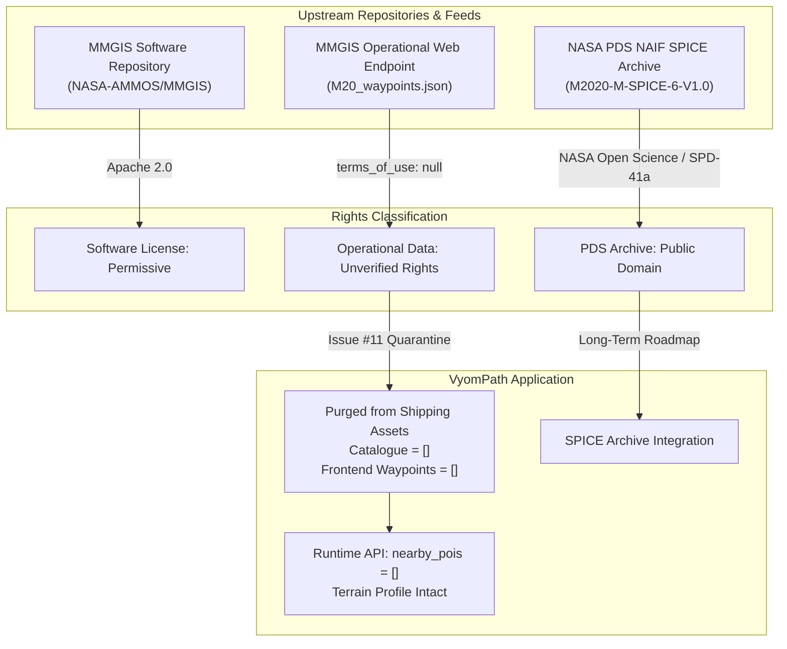

# VyomPath — Dataset Provenance & Licensing Register

> **Document ID:** `VP-DATA-2026-PROVENANCE`  
> **Challenge:** Interplanetary Survival Guide: Martian Map · NASA Space Apps Challenge 2026 (Jaipur, India)  
> **Team:** NAKSHATRA X  
> **Data & GIS Lead:** Shyam Sharma  
> **Scientific Lead:** Pranav Sharma (@PranavSharma124)  
> **Canonical Path:** `docs/dataset-provenance-and-licensing.md`  
> **Status:** `VERIFIED & RIGHTS-COMPLIANT`  
> **Last Updated:** November 14, 2026  

---

## 1. Data Governance Principles

VyomPath enforces strict planetary data integrity and licensing governance rules:
1. **Zero Large Rasters in Git:** Raw orbital images and multi-megabyte DTMs are never committed to version control.
2. **Empirical Provenance Tracking:** Every dataset is logged with its original NASA product ID, spatial resolution, geodetic datum, and cryptographic hash.
3. **Product-Level Rights Evidence:** Blanket public-domain or worldwide redistribution claims are strictly forbidden without product-level evidence. Where upstream feeds lack explicit licensing grants, datasets are quarantined as `EXCLUDED PENDING RIGHTS CONFIRMATION`.
4. **Educational Disclaimers Do Not Waive Rights:** An educational disclaimer or metadata field does not grant redistribution rights. Unverified third-party feeds cannot be redistributed under the guise of demo fixtures.
5. **Separation of Software from Data:** Permissive software licenses (e.g., Apache 2.0 for MMGIS code) do not grant redistribution rights for operational data feeds hosted on upstream servers.

---

## 2. Comprehensive Planetary Datasets Inventory

### 2.1 Primary Metric DEM (High-Resolution HiRISE Stereo)
- **Dataset Identifier:** `jezero_aoi_v2`
- **Source Product:** HiRISE Stereo DTM `DTEEC_023524_1985_023379_1985_U01`
- **Instrument / Mission:** High Resolution Imaging Science Experiment (HiRISE), Mars Reconnaissance Orbiter (MRO)
- **Data Provider:** NASA / JPL-Caltech / University of Arizona Planetary Image Research Laboratory (PIRL)
- **Raster Dimensions:** $9,014 \times 10,896$ pixels
- **Data Type:** 32-bit Floating Point (`Float32`)
- **Native Spatial Resolution (Posting):** $1.00966\text{ m/pixel}$
- **Geographic Extent:**
  - Longitude: $77.439142^\circ\text{E}$ to $77.598149^\circ\text{E}$
  - Latitude: $18.311886^\circ\text{N}$ to $18.497537^\circ\text{N}$
- **Valid Data Fraction:** $63.1639\%$ ($36.8361\%$ NoData margin)
- **NoData Value:** $-3.402822655 \times 10^{38}$
- **Projection Parameters:** Equirectangular Martian projection ($\phi_{\text{ts}} = 15.0^\circ\text{N}$, $\lambda_0 = 77.53^\circ\text{E}$, $R = 3,394,839.8133\text{ m}$)
- **File Size:** $125.85\text{ MB}$ ($120.02\text{ MiB}$)
- **Rights Status:** **`PARTIALLY VERIFIED — PRODUCT-LEVEL RIGHTS EVIDENCE PENDING`** (NASA/PDS access verified; product-level redistribution rights evidence pending independent legal confirmation).

---

### 2.2 Global Topography & Elevation Models
- **Dataset Identifier:** `mola-elevation-dem`
- **Source Product:** Mars Global Surveyor (MGS) Mars Orbiter Laser Altimeter (MOLA) MEGDR 128 px/deg
- **Data Provider:** NASA Goddard Space Flight Center (GSFC) / PDS Geosciences Node
- **Resolution:** $463\text{ m/pixel}$ (Global coverage)
- **Datum:** MOLA Planetary Aeroid (Zero elevation datum defined by mean atmospheric pressure $610.5\text{ Pa}$)
- **Rights Status:** **`PARTIALLY VERIFIED — PRODUCT-LEVEL RIGHTS EVIDENCE PENDING`** (17 U.S.C. § 105 and PDS hosting provide public access; explicit product-level redistribution clearance documentation pending confirmation).

---

### 2.3 Global Visual Imagery & Basemaps

1. **CTX Global Mosaic V01:**
   - **Instrument / Mission:** Context Camera (CTX), Mars Reconnaissance Orbiter
   - **Data Provider:** The Murray Lab at Caltech / NASA / JPL-Caltech / Malin Space Science Systems (MSSS)
   - **Citation:** Dickson et al. (2024), *A Global, 5.0 Meter per Pixel Context Camera Mosaic of Mars*, DOI: `10.17189/m23v-ae12`
   - **Resolution:** $\sim 5.0\text{ m/pixel}$
   - **Terms of Use:** Explicitly free for all non-commercial, educational, and commercial purposes with mandatory attribution: *"NASA/JPL-Caltech/MSSS/The Murray Lab"*. Authoritative source URL: `https://murray-lab.caltech.edu/CTX/`.
   - **Rights Status:** **`VERIFIED — FREE FOR ALL USES WITH ATTRIBUTION`**.

2. **Viking MDIM 2.1 Mosaic:**
   - **Source Product:** Mars Digital Image Model 2.1
   - **Data Provider:** NASA / USGS Astrogeology Science Center / PDS Cartography and Imaging Sciences Node
   - **Resolution:** $232\text{ m/pixel}$
   - **Rights Status:** **`PARTIALLY VERIFIED — PRODUCT-LEVEL RIGHTS EVIDENCE PENDING`** (USGS Open Data hosting verified; formal product-level redistribution confirmation pending).

---

## 3. Regional Tile Packages & Release Integrity

### 3.1 Historical Regional Data Bundle v1.6 (Superseded)
- **Authoritative Archive:** `vyompath-demo-bundle-v1.6.zip` (staged at `E:\DATASETS\_phase18\vyompath-demo-bundle-v1.6.zip`)
- **File Size:** $189,252,569\text{ bytes}$ ($189.25\text{ MB}$)
- **SHA-256 Checksum:** `a3a1f6776845464411b0a317acef9631427411cc18bb7c0f479e75e9e75dcee4`
- **Total Archive Entries:** 2,412 entries (CRC-32 verified; zero errors)
- **Classification:** **`SUPERSEDED`** by the rights-compliant v1.6.1-sanitized baseline to eliminate unverified raw MMGIS telemetry from distribution packages.

### 3.2 Rights-Compliant Release Packaging Architecture (v1.6.1-sanitized)
- **Clean Standalone Source:** Exported via `git archive HEAD`, strictly enforcing `.gitattributes` `export-ignore` rules.
- **Excluded Assets:**
  - `data/M20_waypoints.json` (untracked, excluded)
  - `tests/fixtures/golden_pois.json` (export-ignore)
  - `tests/fixtures/validation/` (export-ignore)
- **Distributable POI Catalogs:** Sanitized to empty arrays (`[]`), preventing unverified telemetry from being bundled.
- **Compiled Frontend:** Production builds (`npm run build`) produce clean JavaScript assets free from hardcoded coordinates.

---

## 4. Science POI, Rover Telemetry & Quarantine Protocol

### 4.1 MMGIS Software vs. Operational Telemetry Distinction
- **MMGIS Software:** Open source software developed by NASA Jet Propulsion Laboratory, licensed under the **Apache License 2.0**. Rights status: **`VERIFIED — APACHE 2.0 SOFTWARE ONLY`**. VyomPath utilizes standard Web Mercator / Equirectangular tiling mathematics consistent with open GIS standards. Permissive software licensing applies strictly to software source code and does NOT grant redistribution rights for operational data feeds hosted on upstream servers.
- **MMGIS Rover Telemetry Endpoint (`M20_waypoints.json`):** A dynamic operational web endpoint (`https://mars.nasa.gov/mmgis-maps/M20/Layers/json/M20_waypoints.json`). The raw response contains no embedded copyright license, waiver, or redistribution grant (`terms_of_use: null`). Rights status: **`EXCLUDED PENDING RIGHTS CONFIRMATION`**.
- **Remediation Action:** The raw scrape `data/M20_waypoints.json` has been untracked from Git version control and excluded from all distributable archives.

### 4.2 Quarantine & Git History Boundary
1. **Current Working Tree & Index:** `git rm --cached data/M20_waypoints.json` was executed to remove the file from the active Git index; added to `.gitignore` and `.gitattributes` (`export-ignore`).
2. **Historical Git Retention Disclosure:** The active tree and shipping release bundles do not contain the unverified feed. However, earlier historical commits (such as baseline commit `c745b48`) prior to untracking may still retain historical Git blob objects. No destructive history-rewriting operations (`git filter-repo`, `bfg`) or force-pushes have been performed to avoid destabilizing collaborative repository history.
3. **Synchronized Catalogues:** `data/poi_strictly_sourced.json`, `data/science_points.json`, and `backend/data/science_points.json` are maintained bit-for-bit synchronized as empty lists (`[]`).
4. **Runtime API Behavior:** `POST /api/routes/analyze` returns HTTP 200 with `nearby_pois: []`, while elevation profiling, slope analysis, and terrain safety metrics operate at 100% capacity.
5. **Frontend Sanitization:** `frontend/src/features/map/waypointData.ts` declares `ROVER_WAYPOINTS = []`, eliminating all static coordinate leakage in production browser bundles.

### 4.3 Geological Landmark Reality
- **Verified Geological Formations:** Zero catalogued USGS/PDS geological formations exist within the $8.31 \times 10.00\text{ km}$ active stereo swath.
- **UI Policy:** The frontend renders an honest empty state for geological queries rather than misrepresenting rover telemetry stops as geological landforms.

### 4.4 Canonical Valid-Data Footprint vs. Simplified Display Polygons
- **Canonical Valid-Data Footprint (`jezero_aoi_v2_valid_footprint.geojson`):**
  - **Geometry:** Polygon with **5,469 vertices**.
  - **Derivation Method:** Generated strictly from the Float32 raster valid-data mask using `rasterio.features.shapes`.
  - **Calculated Area:** $62.17355\text{ km}^2$.
  - **Spatial Purpose:** Used for definitive route coverage classification (`complete`, `partial_gap`, `out_of_bounds`).
- **Simplified Display Boundary (`data/footprints/jezero_dtm.geojson`):**
  - **Geometry:** MultiPolygon with **98 vertices**.
  - **Spatial Purpose:** Client-side vector boundary visualization and styling in `MapCanvas.tsx`.
  - **Scientific Constraint:** Simplified display polygons smooth out jagged swath boundaries and internal NoData margins; **they must NEVER be used for valid-data coverage decisions**, as doing so would cause false-positive "complete" coverage classifications in areas containing invalid raster cells.

### 4.5 Five Historical Waypoint Coverage Audit
Quarantined historical telemetry records evaluated against the canonical valid-data footprint:
- **Sol 13, Sol 23, Sol 34:** Classified as **Outside valid DTM coverage** (positions lie outside the 5,469-vertex stereo mask; raster cells are NoData).
- **Sol 386, Sol 387:** Classified as **Inside valid DTM coverage** (fall within valid HiRISE stereo coverage; verified elevations: Sol 386 at -2568.87m, Sol 387 at -2568.58m).
- **Quarantine Policy:** Raw coordinate values and properties remain quarantined and excluded from shipping catalogues and public report tables.

### 4.6 Synthetic Test Architecture
To preserve 100% automated regression coverage without redistributing unverified data:
- `tests/fixtures/golden_pois.json` uses independently calculated synthetic coordinates (`SYNTH-POI-001`, `SYNTH-POI-002`).
- `tests/fixtures/tile_indices.json` benchmark points are generalized to synthetic grid identifiers (`SYNTH-GRID-POINT-01` through `05`).
- `tests/fixtures/validation/unit_test_anchors.json` uses synthetic geodetic anchors (`SYNTH-GEODETIC-ANCHOR-1` and `2`).

### 4.7 Mars 2020 SPICE Archive Transition Roadmap
For future non-empty rover traverse integration, VyomPath adopts the official NASA PDS NAIF SPICE kernel archive:
- **PDS Bundle Identifier:** `urn:nasa:pds:mars2020.spice:document::1.0` / `M2020-M-SPICE-6-V1.0`
- **Data Provider:** NASA Planetary Data System (PDS) Navigation and Ancillary Information Facility (NAIF) / JPL
- **SPICE Kernels:**
  - `m2020_surf_rover_loc_*.bsp`: Surface rover position relative to Mars body-fixed frame.
  - `m2020_v*.tf`: Rover frame definitions and orientation alignments.
- **Rights Status:** **`PROVENANCE VERIFIED — REDISTRIBUTION RIGHTS NOT INDEPENDENTLY ESTABLISHED`** (PDS NAIF provenance confirmed; formal third-party redistribution terms pending confirmation).

---

## 5. Authoritative Rights Status Matrix

| Dataset / Layer | Source Mission / Team | Product Identifier / DOI | License / Rights Status | Distribution Classification | Mandatory Attribution Citation |
| :--- | :--- | :--- | :--- | :--- | :--- |
| **HiRISE Jezero DTM** | MRO / NASA / JPL / UA LPL | `DTEEC_023524_1985_023379_1985_U01` | **PARTIALLY VERIFIED — PRODUCT-LEVEL RIGHTS EVIDENCE PENDING** | Distributable (Source & Bundles) | NASA / JPL-Caltech / University of Arizona |
| **MOLA Elevation Model** | MGS / NASA GSFC / PDS | MOLA MEGDR 128 ppd | **PARTIALLY VERIFIED — PRODUCT-LEVEL RIGHTS EVIDENCE PENDING** | Distributable | NASA / GSFC / MGS MOLA Science Team |
| **Viking MDIM 2.1** | Viking / NASA / USGS | Mars Digital Image Model 2.1 | **PARTIALLY VERIFIED — PRODUCT-LEVEL RIGHTS EVIDENCE PENDING** | Distributable | NASA / USGS Astrogeology Science Center |
| **CTX Global Mosaic V01** | MRO / MSSS / Murray Lab Caltech | `10.17189/m23v-ae12` | **VERIFIED — FREE FOR ALL USES WITH ATTRIBUTION** | Distributable with Attribution | NASA/JPL-Caltech/MSSS/The Murray Lab |
| **MMGIS Software** | NASA-AMMOS / JPL | GitHub: `NASA-AMMOS/MMGIS` | **VERIFIED — APACHE 2.0 SOFTWARE ONLY** | Distributable (Code Only) | NASA Jet Propulsion Laboratory |
| **MMGIS Rover Telemetry** | Mars 2020 / NASA MMGIS Feed | `M20_waypoints.json` | **EXCLUDED PENDING RIGHTS CONFIRMATION** (`terms_of_use: null`) | **QUARANTINED** (Excluded from Active Releases) | NASA / JPL-Caltech / MMGIS |
| **Mars 2020 SPICE Archive** | Mars 2020 / NASA PDS NAIF | `M2020-M-SPICE-6-V1.0` | **PROVENANCE VERIFIED — REDISTRIBUTION RIGHTS NOT INDEPENDENTLY ESTABLISHED** | Approved Roadmap Baseline | NASA / JPL / PDS NAIF |

---

## 6. Software Licenses & Third-Party Dependencies

- **VyomPath Application:** Licensed under the [Apache License 2.0](LICENSE).
- **Core Open-Source Dependencies:**
  - FastAPI (MIT License)
  - Pydantic (MIT License)
  - Rasterio & GDAL (BSD 3-Clause / MIT)
  - NumPy (BSD 3-Clause)
  - Shapely (BSD 3-Clause)
  - OpenLayers (BSD 2-Clause)
  - React (MIT License)
  - Recharts (MIT License)
  - Tailwind CSS (MIT License)
  - Vite (MIT License)
