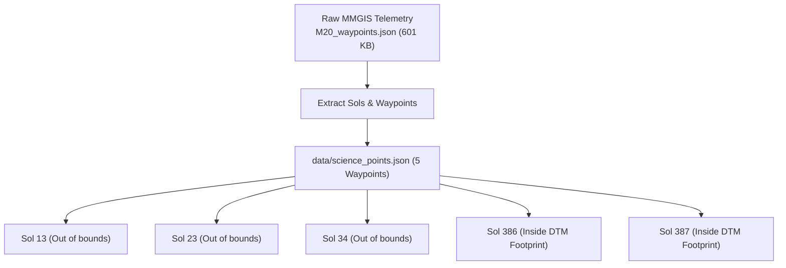

# VyomPath — Dataset Provenance & Licensing Register

> **Document ID:** `VP-DATA-2026-PROVENANCE`  
> **Challenge:** Interplanetary Survival Guide: Martian Map · NASA Space Apps Challenge 2026 (Jaipur, India)  
> **Team:** NAKSHATRA X  
> **Data & GIS Lead:** Shyam Sharma  
> **Scientific Lead:** Pranav Sharma  
> **Canonical Path:** `docs/dataset-provenance-and-licensing.md`  
> **Last Updated:** November 14, 2026  

---

## 1. Data Governance Principles

VyomPath enforces strict planetary data integrity rules:
1. **Zero Large Rasters in Git:** Raw orbital images and multi-megabyte DTMs are never committed to version control.
2. **Empirical Provenance Tracking:** Every dataset is logged with its original NASA product ID, pixel resolution, datum, and cryptographic hash.
3. **Transparent Licensing Disclosures:** Where license terms are not explicitly defined in upstream feeds (e.g., raw rover telemetry JSON), the status is preserved as `unverified` rather than assuming public domain grants.

---

## 2. Comprehensive Planetary Datasets Inventory

### 2.1 Primary Demo DTM (High-Resolution HiRISE Stereo)
- **Dataset Identifier:** `jezero_aoi_v2`
- **Source Product:** HiRISE Stereo DTM `DTEEC_023524_1985_023379_1985_U01`
- **Instrument / Mission:** High Resolution Imaging Science Experiment (HiRISE), Mars Reconnaissance Orbiter (MRO)
- **Data Provider:** NASA / JPL-Caltech / University of Arizona Planetary Image Research Laboratory
- **Raster Dimensions:** $9,014 \times 10,896$ pixels
- **Data Type:** 32-bit Floating Point (`Float32`)
- **Native Spatial Resolution (Posting):** $1.00966\text{ m/pixel}$
- **Geographic Extent:**
  - Longitude: $77.439142^\circ\text{E}$ to $77.598149^\circ\text{E}$
  - Latitude: $18.311886^\circ\text{N}$ to $18.497537^\circ\text{N}$
- **Valid Data Fraction:** $63.1639\%$ ($36.8361\%$ NoData margin)
- **NoData Value:** $-3.402822655 \times 10^{38}$
- **Projection Parameters:** Equirectangular Martian projection ($\phi_{\text{ts}} = 15.0^\circ\text{N}$, $\lambda_0 = 77.53^\circ\text{E}$)
- **File Size:** $125.85\text{ MB}$ ($120.02\text{ MiB}$)
- **License / Terms of Use:** Open NASA PDS Data Policy (Public domain, USGS/PDS release). Attribution to NASA/JPL/University of Arizona.

---

### 2.2 Global Topography & Elevation Models
- **Dataset Identifier:** `mola-elevation-dem`
- **Source Product:** Mars Global Surveyor (MGS) Mars Orbiter Laser Altimeter (MOLA) Megadr 128 px/deg
- **Data Provider:** NASA Goddard Space Flight Center (GSFC) / MGS MOLA Science Team
- **Resolution:** $463\text{ m/pixel}$ (Global coverage)
- **Datum:** MOLA Planetary Aeroid (Zero elevation datum defined by mean atmospheric pressure $610.5\text{ Pa}$)
- **License / Terms of Use:** NASA Open Data Policy (Public domain).

---

### 2.3 Global Visual Imagery & Basemaps
1. **CTX Global Mosaic:**
   - **Instrument / Mission:** Context Camera (CTX), Mars Reconnaissance Orbiter
   - **Data Provider:** NASA / JPL-Caltech / MSSS / The Murray Lab at Caltech
   - **Resolution:** $\sim 5.0\text{ m/pixel}$
   - **Attribution:** NASA/JPL-Caltech/MSSS/The Murray Lab.
2. **Viking MDIM 2.1 Mosaic:**
   - **Source Product:** Mars Digital Image Model 2.1
   - **Data Provider:** NASA / USGS Astrogeology Science Center
   - **Resolution:** $232\text{ m/pixel}$
   - **Attribution:** NASA/USGS.

---

## 3. Regional Tile Packages

### 3.1 Candidate v1.6 PNG Specification
- **Total Tiles:** Exactly **2,380 PNG tiles** ($61.09\text{ MiB}$) across zooms 12–15:
  - **Jezero Crater ($z=12\text{--}15$):** 930 basemap + 930 hillshade = 1,860 tiles ($48.04\text{ MiB}$)
  - **Syrtis Major ($z=12\text{--}14$):** 260 basemap + 260 hillshade = 520 tiles (~$12\text{ MiB}$)
- **Tile Scheme:** XYZ Equirectangular Martian projection ($R = 3,396,190.0\text{ m}$, $256 \times 256\text{ px}$, origin at $(-HX, HY)$).
- **Generation Script:** `scripts/build_regional_tiles.py`.

### 3.2 Physical On-Disk Fallback Archive (v1.4)
- **Archive Path:** `dist/offline_bundle/vyompath-offline-v1.4.0.tar.gz`
- **Compressed Size:** $57\text{ MB}$ ($59,715,648\text{ bytes}$)
- **Uncompressed Size:** $183.83\text{ MB}$
- **SHA-256 Checksum:** `f5cd07c5a5590321c4869d036b3dff55da11f4c94eb925709117d773f46de377`
- **Contents:** 7,313 JPEG tiles across zooms 10–16, standalone git repository bundle `vyompath-repo.bundle` ($1,384,854\text{ bytes}$), and offline launch scripts.

---

## 4. Science POI & Rover Telemetry Provenance

### 4.1 Telemetry Sourcing Details
- **Source Feed:** NASA Multi-Mission Geographic Information System (MMGIS) Mars 2020 Waypoints Layer
- **Source URL:** `https://mars.nasa.gov/mmgis-maps/M20/Layers/json/M20_waypoints.json`
- **Payload SHA-256:** `5A27BA1647F98FA374A7CFA7AC90616900A40C33010C73516E0A6F454790EE9F`
- **Payload Size:** $601,446\text{ bytes}$

### 4.2 In-Footprint vs. Out-of-Footprint Waypoints
- **Total Registered POIs in `data/science_points.json`:** 5 operational waypoints:
  1. `POI-M20-SOL-013`: Perseverance position Sol 13 ($77.4509^\circ\text{E}, 18.4446^\circ\text{N}$) — **Outside DTM** ($\sim 0.6\text{ km}$ west).
  2. `POI-M20-SOL-023`: Perseverance position Sol 23 ($77.4518^\circ\text{E}, 18.4452^\circ\text{N}$) — **Outside DTM**.
  3. `POI-M20-SOL-034`: Perseverance position Sol 34 ($77.4510^\circ\text{E}, 18.4449^\circ\text{N}$) — **Outside DTM**.
  4. `POI-M20-SOL-386`: Perseverance position Sol 386 ($77.4631^\circ\text{E}, 18.4608^\circ\text{N}$) — **Inside DTM** (Elevation: $-2568.87\text{ m}$).
  5. `POI-M20-SOL-387`: Perseverance position Sol 387 ($77.4616^\circ\text{E}, 18.4645^\circ\text{N}$) — **Inside DTM** (Elevation: $-2567.74\text{ m}$).

### 4.3 Geological Landmark Reality
- **Verified Geological Features:** **Zero** catalogued USGS/PDS geological formations (craters, buttes, deltas, or named outcrops) exist within the $8.31 \times 10.00\text{ km}$ active stereo swath.
- **UI Policy:** The frontend renders an honest empty state for geological queries rather than misrepresenting rover telemetry stops.

### 4.4 Upstream Licensing Disclosure
- **Licensing Status:** **`unverified`** (`terms_of_use: null`). No explicit dataset license grant or CC-BY waiver was embedded in the raw MMGIS JSON response. While general NASA imagery is public domain, raw web API endpoint rights remain unverified upstream.

---

## 5. Software Licenses & Third-Party Dependencies

- **VyomPath Codebase:** Licensed under the [Apache License 2.0](LICENSE).
- **Core Open-Source Libraries:**
  - FastAPI (MIT License)
  - Pydantic (MIT License)
  - Rasterio & GDAL (BSD 3-Clause / MIT)
  - NumPy (BSD 3-Clause)
  - Shapely (BSD 3-Clause)
  - OpenLayers (BSD 2-Clause)
  - React (MIT License)
  - Recharts (MIT License)
  - Tailwind CSS (MIT License)
  - Vite (MIT License)
