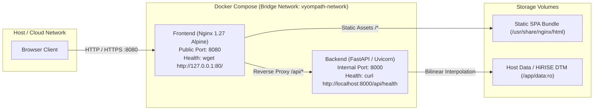

# VyomPath — Production Containerization & Deployment Runbook

> **Document ID:** `VP-DEPLOY-2026`  
> **Challenge:** Interplanetary Survival Guide: Martian Map · NASA Space Apps Challenge 2026  
> **Target:** Cloud & Local Multi-Container Deployment  
> **Architecture:** FastAPI (Backend) + React / OpenLayers on Nginx (Frontend Reverse Proxy)

---

## 1. System Architecture

VyomPath is orchestrated as a dual-container, production-hardened topology:



### Architectural Highlights
1. **Single Entrypoint:** All browser traffic routes through the Nginx reverse proxy (default `:8080`). No internal backend ports need public exposure.
2. **Multi-Stage Build:** The frontend uses Node.js 20 Alpine for Vite compilation, then discards all node runtime and dependencies, copying static assets to an ultra-lean Nginx image.
3. **Non-Root Execution:** The backend container runs as dedicated non-root user `appuser` (UID 1000).
4. **Deterministic Healthchecks:** Both containers implement automated health probes (`wget` for Nginx, `curl` for FastAPI) with dependency ordering (`depends_on: condition: service_healthy`).
5. **Zero Bundled Secrets:** No credentials or confidential API keys exist in Dockerfiles or images. Configuration is strictly injected via environment variables.

---

## 2. Environment Variables & Configuration

Copy `.env.example` to `.env`:

```bash
cp .env.example .env
```

| Variable | Default | Purpose |
|---|---|---|
| `PORT` | `8080` | Public browser-facing HTTP port mapped to Nginx container. |
| `CORS_ORIGINS` | `http://localhost:8080,http://127.0.0.1:8080,http://localhost:5173` | Comma-separated allowed origins for cross-origin API calls. |
| `VYOMPATH_DEM_PATH` | `""` (Empty) | Path to HiRISE GeoTIFF DTM raster. When empty, backend initializes in `development/mock` mode. |
| `LOCAL_DATA_DIR` | `./data` | Host directory mounted as read-only volume to `/app/data:ro` in backend container. |

---

## 3. Quick Start Deployment Commands

### Option A: Standard Production (Mock / Development Mode)
Launches the full containerized application without requiring external raster datasets:

```bash
# Build and start services in the background
docker compose up -d --build

# Verify container health
docker compose ps

# Inspect logs
docker compose logs -f
```

The application is accessible at:
- **Web UI & Map Explorer:** `http://localhost:8080`
- **API Health Probe:** `http://localhost:8080/api/health`
- **API Documentation (Swagger UI):** `http://localhost:8080/api/docs`

### Option B: Live Jezero DTM Mode (Real Scientific Data)
Mount an external HiRISE stereo DTM raster (e.g. `jezero_aoi_v2.tif`):

```bash
# Set external raster path and mount local data directory
LOCAL_DATA_DIR=/path/to/my/data \
VYOMPATH_DEM_PATH=/app/data/dtm/jezero_aoi_v2.tif \
docker compose up -d --build
```

Verify live mode in `/api/health`:
```bash
curl -s http://localhost:8080/api/health | jq .mode
# Output: "production/live"
```

---

## 4. Verification and Health Probing

Execute the following automated health and route analysis checks:

```bash
# 1. Probe frontend landing page
curl -sI http://localhost:8080/ | grep "HTTP/1.1 200 OK"

# 2. Probe backend health via Nginx reverse proxy
curl -s http://localhost:8080/api/health | jq '{status, mode, version}'

# 3. Submit real traverse analysis through the reverse proxy
curl -s -X POST http://localhost:8080/api/routes/analyze \
  -H "Content-Type: application/json" \
  -d '{
    "route_id": "verify-001",
    "coordinates": [
      {"lon": 77.46313311, "lat": 18.46079140},
      {"lon": 77.46157944, "lat": 18.46447597}
    ]
  }' | jq '{route_id, total_distance_m, total_gain_m, total_loss_m, max_slope_deg, coverage_status}'
```

---

## 5. Cloud Platform Deployment Guidelines

### Generic Docker Host (DigitalOcean Droplet, AWS EC2, GCP GCE)
1. Install Docker and Docker Compose v2.
2. Clone repository: `git clone https://github.com/MayankSharma-2812/vyompath-spaceapps-2026.git`.
3. Configure `.env` with appropriate `PORT` (e.g. `80`) and `CORS_ORIGINS`.
4. Run `docker compose up -d --build`.
5. For SSL/TLS, terminate HTTPS at a reverse proxy (Certbot/Caddy/Cloudflare) pointing to port 8080.

### Container-as-a-Service (Google Cloud Run / AWS Fargate / Railway / Render)
- **Backend:** Deploy `Dockerfile` directly with environment variable `PORT=8000`.
- **Frontend:** Build frontend with `VITE_API_URL=https://your-backend-service.run.app` and deploy Nginx container, or deploy as a static site (Cloudflare Pages, Vercel, Netlify) pointing API calls to the backend service.

---

## 6. Teardown and Cleanup

To gracefully stop and remove containers, networks, and ephemeral volumes:

```bash
docker compose down
```
