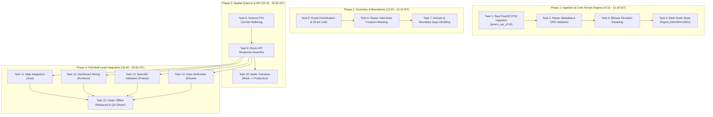

# VyomPath — Event-Day Implementation Plan (November 14–15, 2026)

> **Document ID:** `VP-PLAN-2026-EVENT`  
> **Challenge:** Interplanetary Survival Guide: Martian Map · NASA Space Apps Challenge 2026 (Jaipur, India)  
> **Team:** NAKSHATRA X  
> **Execution Window:** Saturday, November 14, 2026 – Sunday, November 15, 2026 (Timezone: IST)  
> **Author & Integration Owner:** Mayank Sharma (Backend & Cloud)  
> **Collaborating Leads:** Arya Tiwari (Map Engineering), Kumkum Kushwah (UI/UX Dashboard), Pranav Sharma (Terrain and Scientific Analysis), Shyam Sharma (Data and GIS), Dheer Jain (QA and Testing)  
> **Baseline Commit:** `c47dbc1`  
> **Last Updated:** November 14, 2026  

---

## 1. Executive Implementation Roadmap

During the authorized hackathon event window, Team NAKSHATRA X transitions VyomPath from pre-event scaffolding and synthetic mock curves to live Float32 DTM elevation processing:

---

## 2. Phase 1: Core Engine & Data Ingestion (10:15–12:30 IST)

### Task 1: Real Float32 DTM Data Ingestion
- **Description:** Establish runtime loading of the primary Jezero Crater HiRISE DTM (`jezero_aoi_v2.tif`, $125.8\text{ MB}$, Float32, $1.01\text{ m/px}$).
- **Status Distinction:** Pre-event mode isolates DTM behind optional unit test flag; event day connects file handle directly to memory cache.
- **Dependencies:** `VYOMPATH_DEM_PATH` environment variable, `rasterio`.
- **Expected Outputs:** Open `rasterio.DatasetReader` handle or cached memory array with valid bounding box and affine transform.
- **Files to Modify:** `backend/app/services/terrain.py`, `backend/app/api/routes.py`.
- **Acceptance Criteria:** Reads band 1 Float32 raster cleanly; returns HTTP 503 if DTM is missing.
- **Owner:** Mayank Sharma (Backend & Cloud).

---

### Task 2: Raster Metadata & CRS Validation
- **Description:** Dynamically validate DTM coordinate reference system, pixel posting ($1.00966\text{ m/px}$), standard parallel ($\phi_{\text{ts}} = 15.0^\circ\text{N}$), and spatial extents at server startup.
- **Status Distinction:** Standalone script verification embedded into FastAPI lifespan initialization.
- **Dependencies:** Task 1.
- **Expected Outputs:** Cached `RasterMetadata` struct (`crs`, `transform`, `bounds`, `nodata`, `posting_m`).
- **Files to Modify:** `backend/app/main.py`, `backend/app/services/terrain.py`.
- **Acceptance Criteria:** `pyproj.Transformer` correctly created without hardcoded terrestrial datum assumptions.
- **Owner:** Pranav Sharma & Mayank Sharma.

---

### Task 3: Bilinear Elevation Sampling Pipeline
- **Description:** Sub-pixel bilinear interpolation for arbitrary geodetic coordinates `(lon, lat)` against Float32 DTM pixel grid.
- **Status Distinction:** Pre-event mock returns sine waves; event day evaluates real MOLA aeroid elevation values.
- **Dependencies:** Task 1, Task 2.
- **Expected Outputs:** Elevation $z$ in metres relative to MOLA datum, or `NaN` if in NoData margin.
- **Files to Modify:** `backend/app/services/terrain.py`.
- **Acceptance Criteria:** Sol 386 golden anchor ($77.46313311^\circ\text{E}, 18.46079140^\circ\text{N}$) evaluates to $-2568.87\text{ m} \pm 0.05\text{ m}$.
- **Owner:** Pranav Sharma (Terrain and Scientific Analysis).

---

### Task 4: Multi-Scale Slope and Terrain Metrics
- **Description:** Calculate along-track terrain grades and multi-scale slope gradients ($W = 20\text{ m}, 50\text{ m}, 100\text{ m}$) using central differences.
- **Status Distinction:** Wires multi-scale slope engine into route response schema (`max_slope_deg`, `average_slope_deg`, `slope_spread`).
- **Dependencies:** Task 3.
- **Expected Outputs:** Elevation array, slope gradient array, cumulative elevation gain and loss.
- **Files to Modify:** `backend/app/services/terrain.py`.
- **Acceptance Criteria:** Scarp traverse (`J-steep` fixture) peaks at $4.09^\circ$ at $50\text{ m}$ window and $8.66^\circ$ at $20\text{ m}$ window.
- **Owner:** Pranav Sharma & Mayank Sharma.

---

## 3. Phase 2: Geometry, Limits & Boundary Gaps (13:45–15:15 IST)

### Task 5: Route Densification & 25.0 km Route Length Limit
- **Description:** Densify arbitrary user waypoints into uniform $5.0\text{ m}$ steps along spherical geodesics ($R = 3,396,190.0\text{ m}$). Enforce documented 25.0 km maximum length ceiling.
- **Status Distinction:** Pre-event scaffold accepted uncapped routes; event day enforces hard $25.0\text{ km}$ maximum limit.
- **Expected Outputs:** Uniformly spaced point array, or `HTTP 422 Unprocessable Entity` with `{"detail": "Route length exceeds maximum allowed limit of 25.0 km"}`.
- **Files to Modify:** `backend/app/services/coords.py`, `backend/app/api/routes.py`.
- **Acceptance Criteria:** Traverses $>25.0\text{ km}$ rejected immediately; traverses $\le 25.0\text{ km}$ densified to $\sim 5\text{ m}$ spacing.
- **Owner:** Mayank Sharma (Backend & Cloud).

---

### Task 6: Raster Valid-Data Footprint Masking & NoData Handling
- **Description:** Intersect route segments with the valid-data footprint (`data/footprints/jezero_dtm.geojson` / 63.16% valid pixel mask).
- **Status Distinction:** Pre-event returned fixed `"complete"`; event day dynamically computes coverage status:
  - `"complete"`: All sampled points have valid DTM elevation.
  - `"partial_gap"`: Route crosses NoData margins; NoData points marked `NaN` and skipped in slope math.
  - `"out_of_bounds"`: Route lies entirely outside valid coverage.
- **Files to Modify:** `backend/app/services/terrain.py`, `backend/app/api/routes.py`.
- **Acceptance Criteria:** Fixture `J-edge` returns `coverage_status: "partial_gap"`.
- **Owner:** Mayank Sharma & Shyam Sharma.

---

## 4. Phase 3: Spatial Science & API Integration (15:15–16:30 IST)

### Task 7: Science POI Corridor Buffering
- **Description:** Implement Euclidean corridor buffering (default: $250.0\text{ m}$) along traverse line to discover nearby telemetry waypoints from `data/science_points.json`.
- **Status Distinction:** Pre-event returned empty list `[]`; event day returns matched waypoints with offset and stationing.
- **Files to Modify:** `backend/app/services/science.py`, `backend/app/api/routes.py`.
- **Acceptance Criteria:** Demo corridor with $250\text{ m}$ buffer discovers Sol 386 and Sol 387 with $<1.0\text{ mm}$ cross-track error.
- **Owner:** Mayank Sharma & Dheer Jain.

---

### Task 8: API Mode Transition (`development/mock` -> `production`)
- **Description:** Switch operational mode in `backend/app/api/health.py` from `"development/mock"` to `"production"`. Update `dtm_source` in route responses to reflect authoritative HiRISE product.
- **Files to Modify:** `backend/app/api/health.py`, `backend/app/api/routes.py`.
- **Acceptance Criteria:** `GET /api/health` reports `mode: "production"`.
- **Owner:** Mayank Sharma (Backend & Cloud).

---

## 5. Phase 4: Full Multi-Lead Integration & Verification (16:30–19:30 IST)

### Task 9: Map Engineering Integration (Arya)
- Connect OpenLayers traverse drawing tools to live `/api/routes/analyze` endpoint.
- Verify canvas metre-to-degree transformation prior to POST dispatch.
- Enable `declutter: true` for Sols 384–385 markers ($13.56\text{ m}$ separation).

### Task 10: UI/UX Dashboard Integration (Kumkum)
- Bind live route elevation profile to Recharts component.
- Display dynamic coverage status badge (`COMPLETE`, `PARTIAL GAP`, `OUT OF BOUNDS`).
- Display truthful status banner; ensure zero "safe route" labels exist.

### Task 11: Scientific Sign-Off (Pranav)
- Verify Sol 386 golden elevation matches $-2568.87\text{ m} \pm 0.05\text{ m}$.
- Confirm slope spread and gradient units across all output cards.
- Issue written scientific sign-off for submission.

### Task 12: Data & Licensing Audit (Shyam)
- Verify regional tile bundle loading and on-disk directory alias mapping.
- Confirm dataset attributions (NASA/JPL/MRO/HiRISE, MGS/MOLA, USGS).
- Disclose unverified NASA MMGIS telemetry licensing status.

### Task 13: QA, Windows Rehearsal & Release Gate Audit (Dheer)
- Run full regression suite (`pytest tests/ -v`, 257 tests passing).
- Execute air-gapped rehearsal on presentation machine with Wi-Fi disconnected.
- Complete 9-gate release audit and deliver formal written GO/NO-GO recommendation.
