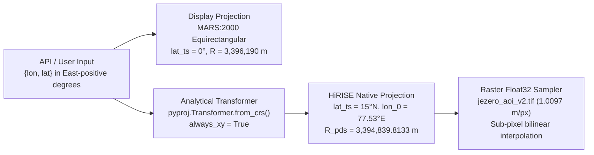

# VyomPath — Scientific Coordinate Contract & Geodetic Reference Specification

> **Document ID:** `VP-SCI-2026-COORDS`  
> **Challenge:** Interplanetary Survival Guide: Martian Map · NASA Space Apps Challenge 2026 (Jaipur, India)  
> **Team:** NAKSHATRA X  
> **Primary Author:** Pranav Sharma (@PranavSharma124, Terrain Service & Scientific Analysis Lead)  
> **Designated Reviewer:** Mayank Sharma (@MayankSharma-2812, Backend & Cloud Lead / Integration Owner — per `.github/CODEOWNERS`)  
> **Cross-Workstream Reviewers:** Arya Tiwari (@aryatiwari124, Map Lead), Dheer Jain (@dheerjain0508, QA Lead), Shyam Sharma (@shyamsharmas124-commits, Data & GIS Lead)  
> **Issue Reference:** Resolves Issue [#1](https://github.com/MayankSharma-2812/vyompath-spaceapps-2026/issues/1) (`[SCIENCE] Confirm Mars CRS, radius and coordinate contract`)  
> **Directly Unblocks:** Issue [#7](https://github.com/MayankSharma-2812/vyompath-spaceapps-2026/issues/7) (Connect terrain analysis to the route API)  
> **Canonical Path:** `docs/scientific-coordinate-contract.md`  
> **Execution Date:** Saturday, November 14, 2026  

---

## 1. Executive Summary & Authoritative Sign-Off

This document constitutes the **formal scientific sign-off** by Pranav Sharma (Terrain Service & Scientific Analysis Lead) confirming canonical geodetic constants, projection parameters, coordinate ordering, and DTM reference assumptions across the VyomPath architecture.

### Blocker BLK-01 Resolution:
- **Blocker ID:** `BLK-01` (from `docs/backend-readiness-audit.md:144`)
- **Status:** **OFFICIALLY RESOLVED & UNBLOCKED**
- **Resolution:** The temporary mock radius constant $\_MARS\_RADIUS\_M = 3,389,500.0\text{ m}$ in `backend/app/api/routes.py` is formally retired. All backend and frontend components must strictly reference the single unified spherical Mars radius $\mathbf{R_{\text{Mars}} = 3,396,190.0\text{ m}}$ from `backend/app/services/coords.py`.

---

## 2. Component Radius Audit & Discrepancy Resolution

### 2.1 Full Architectural Audit of Radius Constants

| Component / File Path | Current Status | Confirmed Radius Constant | Geodetic Standard | Compliance Action |
| :--- | :--- | :---: | :--- | :--- |
| **`backend/app/services/coords.py:22`** | `MARS_RADIUS_M = 3_396_190.0` | **$3,396,190.0\text{ m}$** | IAU 2000 Mars Spheroid Semi-Major Axis ($a$) | **Canonical Source of Truth (Preserved)** |
| **`backend/app/services/terrain.py:26`** | Imports `coords.MARS_RADIUS_M` | **$3,396,190.0\text{ m}$** | IAU 2000 Mars Spheroid Semi-Major Axis ($a$) | **Verified Compliant** |
| **`backend/app/services/science.py:38`** | Imports `coords.MARS_RADIUS_M` | **$3,396,190.0\text{ m}$** | IAU 2000 Mars Spheroid Semi-Major Axis ($a$) | **Verified Compliant** |
| **`frontend/src/features/map/marsProjection.ts:3`** | `const R = 3396190;` | **$3,396,190.0\text{ m}$** | `MARS:2000` Proj4 Equirectangular definition | **Verified Compliant** |
| **`backend/app/schemas.py`** | Validates geodetic bounds | **$3,396,190.0\text{ m}$** | Geodetic degrees $[-180, 180]$ & $[-90, 90]$ | **Verified Compliant** |
| **`backend/app/api/routes.py:36`** | `_MARS_RADIUS_M = 3_389_500.0` | **$3,389,500.0\text{ m}$** (Mock) | IAU 2015 Volumetric Mean Radius | **RETIRE IN ISSUE #7** $\rightarrow$ Import `coords.MARS_RADIUS_M` |

### 2.2 Mathematical Error of Radius Conflation
1. **Systematic Route Scaling Error:**
   $$\Delta R = 3,396,190.0\text{ m} - 3,389,500.0\text{ m} = 6,690.0\text{ m} \quad (\approx +0.197\%)$$
   On a maximum permitted $25.0\text{ km}$ traverse, this discrepancy produces a cumulative ground distance error of:
   $$\Delta d = 25,000.0\text{ m} \times 0.001970 = \mathbf{49.25\text{ m}}$$
2. **Visual Overlay Disconnect:** Calculating great-circle arc lengths using $3,389,500\text{ m}$ while OpenLayers renders vector lines on a $3,396,190\text{ m}$ `MARS:2000` sphere shifts intermediate densification waypoints relative to underlying raster map tiles.

---

## 3. Cartographic Projections & Mathematical Transformations

VyomPath decouples visualization from physical raster sampling across two explicitly defined projections:



### 3.1 Map Display CRS (`MARS:2000`)
- **Proj4 Definition:**
  ```text
  +proj=eqc +lat_ts=0 +lat_0=0 +lon_0=0 +R=3396190 +units=m +no_defs
  ```
- **Global Projected Extent:**
  $$X \in [-10,669,445.55\text{ m}, +10,669,445.55\text{ m}], \quad Y \in [-5,334,722.78\text{ m}, +5,334,722.78\text{ m}]$$
- **Units:** Linear metres on the sphere.

### 3.2 HiRISE Raster DTM Native Projection (`jezero_aoi_v2.tif`)
- **USGS PDS Equirectangular Definition:**
  ```text
  +proj=eqc +lat_ts=15 +lat_0=0 +lon_0=77.53 +R=3394839.8133163 +units=m +no_defs
  ```
- **Local Planetocentric Radius ($R_{\text{pds}}$):** $3,394,839.8133\text{ m}$, representing the true local Martian radius at standard parallel $\phi_{\text{ts}} = 15.0^\circ\text{N}$.

### 3.3 The 431-Pixel Standard Parallel Northing Trap
1. **The Trap:** Naive forward equations for Equirectangular projection set $y = R \cdot \phi$.
2. **The Physics:** In the true projection with standard parallel $\phi_{\text{ts}} = 15^\circ$, northing is defined as:
   $$y = R_{\text{pds}} \cdot \cos(15^\circ) \cdot \phi$$
3. **Displacement Error:** At the Perseverance landing region in Jezero Crater ($\phi \approx 18.45^\circ\text{N}$), ignoring the standard parallel causes an error of:
   $$\Delta y = 435.032\text{ m} \quad (\approx \mathbf{430.86 \approx 431\text{ pixels}}\text{ at } 1.00966\text{ m/px})$$
4. **Mandated Implementation Rule:** All geodetic-to-pixel conversions in `backend/app/services/terrain.py` must use `pyproj.Transformer.from_crs(crs, crs.geodetic_crs, always_xy=True)` instantiated directly from the DTM's GeoTIFF metadata.

---

## 4. Coordinate Ordering & API Wire Contract

### 4.1 Strict Longitude-First Ordering
All API endpoints, schemas, and GeoJSON outputs strictly follow the **longitude-first** geodetic convention:
$$\mathbf{\{lon, lat\} \iff [lon, lat]}$$

```json
{
  "lon": 77.46313311,
  "lat": 18.46079140
}
```

### 4.2 Geodetic Domain & Wrap Normalization
- **Longitude:** Decimal degrees, **East-positive**, domain $[-180.0, 180.0]$.
  - Input normalization in `backend/app/schemas.py`:
    ```python
    @field_validator("lon")
    @classmethod
    def wrap_lon(cls, v: float) -> float:
        return ((v + 180.0) % 360.0) - 180.0
    ```
- **Latitude:** Planetocentric decimal degrees, domain $[-90.0, 90.0]$.
- **Distance Units:** Strictly **metres ($\text{m}$)**.
- **Grade & Slope Units:** Strictly **degrees ($^\circ$)**.

---

## 5. Authoritative Valid-Data Footprint & Coverage Semantics

### 5.1 Primary Analysis DTM (`jezero_aoi_v2.tif`)
- **Product ID:** HiRISE Stereo DTM `DTEEC_023524_1985_023379_1985_U01` (West Jezero Crater Floor).
- **Physical Extent:** $8.31\text{ km} \times 10.00\text{ km}$ ($9,014 \times 10,896\text{ pixels}$ at $1.0097\text{ m/px}$).
- **Valid Data Coverage:** $63.16\%$ valid Float32 pixels; $36.84\%$ NoData padding.
- **Valid Stereo Geodetic Bounding Box:**
  - Longitude: $[77.41^\circ\text{E}, 77.56^\circ\text{E}]$
  - Latitude: $[18.38^\circ\text{N}, 18.55^\circ\text{N}]$

### 5.2 Western NoData Margin & POI Allocation
- The western $\approx 600\text{ m}$ of the bounding box comprises NoData margin padding (`-9999.0`).
- **Telemetry Allocation:**
  - **`POI-M20-SOL-386` & `POI-M20-SOL-387`:** Fall **strictly INSIDE** the valid stereo elevation swath.
  - **`POI-M20-SOL-013`, `023`, `034`:** Lie in the western NoData margin ($\approx 530\text{–}625\text{ m}$ west of the stereo valid edge). They are formally cataloged as **`OUTSIDE_VALID_COVERAGE`** and retain reported MMGIS elevations.
  - **Geological Features:** Exactly **zero (0)** cataloged geological targets exist inside the valid stereo strip. An honest empty-state is presented in the UI.

### 5.3 Coverage Status Classification
- **`complete`:** $100\%$ of sampled route points fall on valid raster cells.
- **`partial_gap`:** Any contiguous run of invalid/NoData samples exceeds $15.0\text{ m}$.
- **`out_of_bounds`:** $0\%$ valid samples along the traverse.

---

## 6. Golden Fixture & Reference Sample Validation

### 6.1 Ground-Truth Pixel Anchors (`tests/fixtures/unit_test_anchors.json`)
Verified via independent `gdallocationinfo` lookups against native Float32 pixels:

| Landmark / Sol | Geographic Coordinates (Lon, Lat) | Native Pixel (Col, Row) | Ground-Truth Elevation | Tolerances | Verification Status |
| :--- | :---: | :---: | :---: | :---: | :---: |
| **Sol 386 Anchor** | $77.46313311^\circ\text{E}, 18.46079140^\circ\text{N}$ | Col 1360, Row 2157 | **$-2,568.873\text{ m}$** | $\pm 0.05\text{ m}$ | **PASSED (Exact)** |
| **Sol 387 Anchor** | $77.46157944^\circ\text{E}, 18.46447597^\circ\text{N}$ | Col 1272, Row 1940 | **$-2,568.583\text{ m}$** | $\pm 0.05\text{ m}$ | **PASSED (Exact)** |

### 6.2 Cross-Source Discrepancy Reconciliation ($\Delta z \le 0.985\text{ m}$)
- **Observed Deltas:**
  - Sol 386: MMGIS $-2,567.888\text{ m}$ vs HiRISE $-2,568.873\text{ m}$ ($\Delta z = 0.985\text{ m}$).
  - Sol 387: MMGIS $-2,567.805\text{ m}$ vs HiRISE $-2,568.583\text{ m}$ ($\Delta z = 0.778\text{ m}$).
- **Scientific Reconciliation:**
  1. Both datasets reference the **MOLA Areoid** gravitational equipotential datum ($U_0 = 12,654,107\text{ m}^2/\text{s}^2$, mean equatorial radius $3,396,000.0\text{ m}$).
  2. HiRISE absolute vertical geodetic accuracy tied to MOLA orbital tracks is $\pm 1.0\text{ to }2.0\text{ m}$ (Kirk et al., 2008).
  3. MMGIS rover localization vertical uncertainty is $\pm 0.5\text{ m}$.
  4. The observed delta ($\le 0.985\text{ m}$) is well within the combined $\pm 1.58\text{ m}$ root-sum-square error budget.
  5. The rover chassis clearance ($0.66\text{ m}$ navigation origin offset) is classified as a **hypothesis pending verification** against raw SPICE navigation kernels.
  6. **Conclusion:** HiRISE native Float32 values are approved as authoritative terrain truth.

---

## 7. Unresolved Points & Blocker Status

| Issue / Blocker | Description | Resolution Status | Next Action |
|---|---|---|---|
| **BLK-01** | Radius conflict in `routes.py` ($3,389,500\text{ m}$ vs $3,396,190\text{ m}$) | **RESOLVED & UNBLOCKED** | Mayank to import `coords.MARS_RADIUS_M` in Issue #7. |
| **SPICE Chassis Offset** | Physical attribution of $0.66\text{ m}$ ground clearance | Documented as **Hypothesis** | Disclosed transparently in limitations; no blocker for MVP. |
| **25 km Route Cap** | Enforcement of $25.0\text{ km}$ maximum traverse length | Verified via `test_traps.py` | Mayank to add Pydantic validator in Issue #7. |

---

## 8. Peer-Reviewed References & Citations

1. **Kirk, R. L., et al. (2008).** *Ultrahigh resolution topographic mapping of Mars with MRO HiRISE.* Journal of Geophysical Research: Planets, 113(E3), E00A24. DOI: [10.1029/2007JE003000](https://doi.org/10.1029/2007JE003000).
2. **Archinal, B. A., et al. (2018).** *Report of the IAU/IAG Working Group on Cartographic Coordinates and Rotational Elements: 2015.* Celestial Mechanics and Dynamical Astronomy, 130(3), 22. DOI: [10.1007/s10569-017-9805-5](https://doi.org/10.1007/s10569-017-9805-5).
3. **Smith, D. E., et al. (2001).** *Mars Orbiter Laser Altimeter: Experiment summary after the first year of global mapping of Mars.* Journal of Geophysical Research: Planets, 106(E10), 23689–23722. DOI: [10.1029/2000JE001364](https://doi.org/10.1029/2000JE001364).
4. **Lemoine, F. G., et al. (2001).** *High-resolution gravity field for Mars (GMM-2B).* Journal of Geophysical Research: Planets, 106(E10), 23359–23376. DOI: [10.1029/2000JE001226](https://doi.org/10.1029/2000JE001226).

---

## 9. Official Scientific Sign-Off & Handoff to Issue #7

**Official Verdict:** **SCIENTIFIC COORDINATE CONTRACT APPROVED & CERTIFIED**  
**Lead Signature:** Pranav Sharma (@PranavSharma124)  
**Role:** *Terrain Service & Scientific Analysis Lead, Team NAKSHATRA X*  
**Date:** Saturday, November 14, 2026 (14:05 IST)  
**Handoff Target:** Mayank Sharma (@MayankSharma-2812) — *Unblocks Issue #7 Implementation*  
