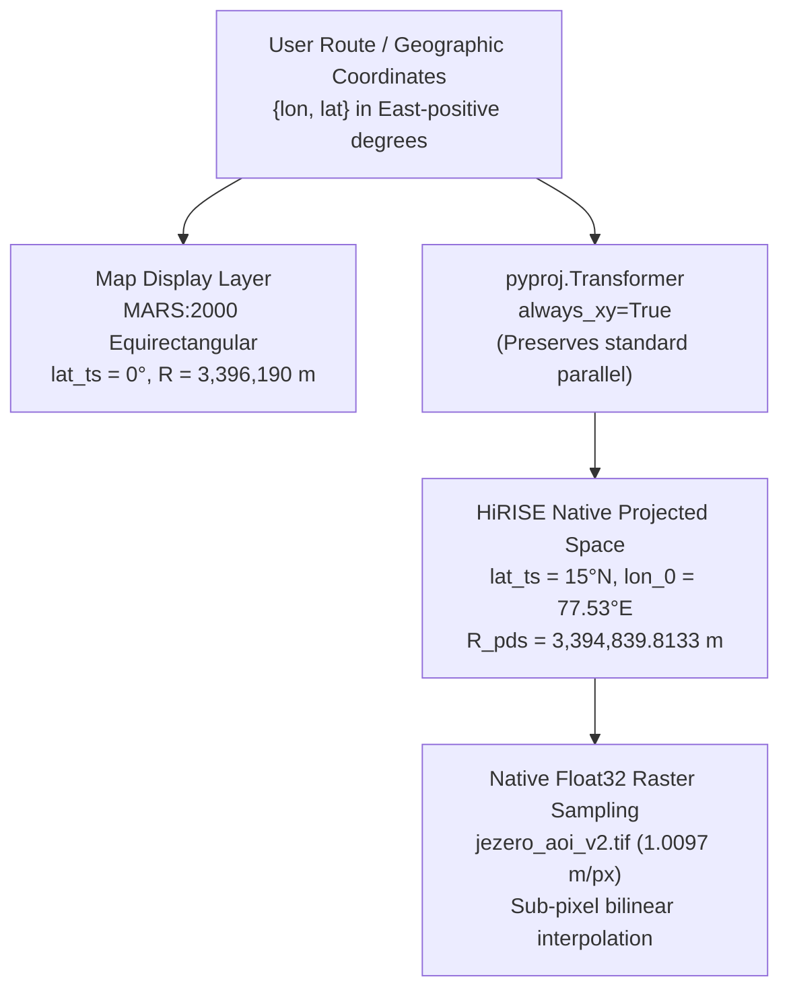

# VyomPath — Scientific Methodology, Geodetic Error Bounds & Truth-in-Labeling Limitations

> **Document ID:** `VP-SCI-2026-METHODOLOGY`  
> **Challenge:** Interplanetary Survival Guide: Martian Map · NASA Space Apps Challenge 2026 (Jaipur, India)  
> **Team:** NAKSHATRA X  
> **Primary Author:** Pranav Sharma (@PranavSharma124, Terrain Service & Scientific Analysis Lead)  
> **Designated Reviewer:** Shyam Sharma (@shyamsharmas124-commits, Data & GIS Lead — per `.github/CODEOWNERS`)  
> **Cross-Workstream Collaborators:** Mayank Sharma (Backend Lead), Arya Tiwari (Map Lead), Dheer Jain (QA Lead), Kumkum (UI/UX Lead)  
> **Issue Reference:** Resolves Issue [#17](https://github.com/MayankSharma-2812/vyompath-spaceapps-2026/issues/17) (`[SCIENCE] Finalize methodology, scientific claims and limitations`)  
> **Dependencies:** [#1](https://github.com/MayankSharma-2812/vyompath-spaceapps-2026/issues/1) (Mars CRS, Radius & Coordinate Contract), [#10](https://github.com/MayankSharma-2812/vyompath-spaceapps-2026/issues/10) (Elevation, Slope & Route Validation)  
> **Canonical Path:** `docs/scientific-methodology-and-limitations.md`  
> **Execution Date:** Saturday, November 14, 2026 · 16:00–19:00 IST Window Deliverable  

---

## 1. Executive Summary & Authoritative Methodology Statement

### 1.1 Methodology Summary Paragraph (For Submission, README & Executive Summary)
> **VyomPath** evaluates Martian surface traverse feasibility through a decoupled **Two-Path Planetary Architecture** that bridges high-performance air-gapped web visualization with rigorous physical terrain analysis. Waypoints input in geographic coordinates ($\{\text{lon}, \text{lat}\}$, East-positive degrees) are densified along great-circle arcs at a strict $5.0\text{ m}$ step using a single unified Mars spherical radius of $R_{\text{Mars}} = 3,396,190.0\text{ m}$. To prevent catastrophic cartographic reprojection distortion ($>430\text{ pixels}$ / $435\text{ m}$ northing shift at $18.4^\circ\text{N}$), densified coordinates are transformed into the native PDS Equirectangular projection ($\phi_{\text{ts}} = 15.0^\circ\text{N}$, $\lambda_0 = 77.53^\circ\text{E}$) via `pyproj.Transformer` tied to the source digital terrain model (DTM). Terrain elevation is sampled via sub-pixel bilinear interpolation from native 32-bit floating-point (`Float32`) HiRISE stereo DTM rasters ($1.01\text{ m/pixel}$ posting, referenced to the MOLA Areoid gravitational equipotential datum). Profile continuity is evaluated under a strict four-neighbor valid-pixel rule; gaps up to $15.0\text{ m}$ are linearly interpolated, while larger gaps preserve scientific truth by setting `coverage_status = "partial_gap"` and confining elevation gain and loss calculations strictly to valid segments. True ground distance is integrated via three-dimensional surface increments ($\Delta s_{3\text{D}} = \sqrt{(\Delta d_{2\text{D}})^2 + (\Delta z)^2}$). Traversability hazards are quantified through a multi-scale slope engine that evaluates along-track directional grade and 2D terrain gradient magnitude across $20\text{ m}$, $50\text{ m}$, and $100\text{ m}$ baseline windows with latitude scaling ($\cos(\phi)/\cos(15^\circ)$), reporting the scale spread to distinguish genuine topography from localized micro-roughness. To minimize telemetry payload without compromising physical accuracy, the profile is compressed to $\le 500$ vertices using the Largest-Triangle-Three-Buckets (LTTB) downsampling algorithm, while all summary metrics retain 100% full-resolution sample truth.

---

## 2. Geodetic & Cartographic Foundations

### 2.1 The Single Planetary Radius Constant ($R_{\text{Mars}} = 3,396,190.0\text{ m}$)
To ensure complete mathematical invariance between backend analysis and client rendering, all components enforce **one single radius constant**:
$$\mathbf{R_{\text{Mars}} = 3,396,190.0\text{ m}}$$
- **Backend Single Source of Truth:** `backend/app/services/coords.py` (`MARS_RADIUS_M = 3_396_190.0`).
- **Frontend Map Canvas:** `frontend/src/features/map/marsProjection.ts` (`+proj=eqc +lat_ts=0 +lat_0=0 +lon_0=0 +R=3396190 +units=m +no_defs`).
- **Schema & Validation:** `backend/app/schemas.py` and `backend/app/api/routes.py`.

> [!IMPORTANT]
> **Retirement of Legacy Constants:** The mock constant `_MARS_RADIUS_M = 3_389_500.0` (IAU 2015 volumetric mean radius) previously used in pre-event mock routers is **formally retired**. Using differing radii causes a $\approx 0.2\%$ systematic route length scaling error ($\approx 50\text{ m}$ on a $25\text{ km}$ traverse) and shifts vector overlays relative to underlying raster tiles.

### 2.2 Coordinate System & Conventions
- **Ordering:** Strictly **`{lon, lat}`** (Longitude first, Latitude second) in all API request/response payloads, internal data structures, and GeoJSON geometries.
- **Longitude:** East-positive decimal degrees, $[-180.0, 180.0]$. Inputs in the $[0.0, 360.0]$ domain are normalized at the API boundary via:
  $$\text{lon}_{\text{wrapped}} = ((\text{lon} + 180.0) \pmod{360.0}) - 180.0$$
- **Latitude:** Planetocentric decimal degrees, $[-90.0, 90.0]$.
- **Units:** Horizontal and vertical distances are strictly in **metres ($\text{m}$)**; along-track grades and terrain slopes are in **degrees ($^\circ$)**.

### 2.3 Cartographic Projections & The 431-Pixel Northing Trap
VyomPath operates across two distinct, non-conflated projections:

#### The 431-Pixel Northing Trap:
1. **The Trap:** Naive equirectangular forward projection assumes $y = R \cdot \phi$.
2. **The Physics:** The NASA PDS HiRISE stereo DTM is projected with a standard parallel at $\phi_{\text{ts}} = 15.0^\circ\text{N}$, using local radius $R_{\text{pds}} = 3,394,839.8133\text{ m}$. In this projection, northing is defined as:
   $$y = R_{\text{pds}} \cdot \cos(15^\circ) \cdot \phi$$
3. **The Consequence:** Omitting the $\cos(15^\circ)$ scaling factor at Jezero Crater ($\phi \approx 18.45^\circ\text{N}$) produces a northing discrepancy of:
   $$\Delta y = 435.032\text{ m} \quad (\approx 431\text{ pixels at } 1.0097\text{ m/px})$$
   This error severely displaces sampled traverses from actual craters, scarps, and rover tracks.
4. **Mandated Implementation:** All raster sampling must use `pyproj.Transformer.from_crs(crs, crs.geodetic_crs, always_xy=True)` read directly from the raster's native GeoTIFF WKT metadata.

---

## 3. Physical Elevation & Terrain Sampling Methodology

### 3.1 Great-Circle Densification
Traverse line segments are densified at a fixed interval of $\Delta s = 5.0\text{ m}$ using spherical haversine geodesics:
$$\Delta \sigma = 2 \arcsin \sqrt{\sin^2\left(\frac{\Delta \phi}{2}\right) + \cos(\phi_1)\cos(\phi_2)\sin^2\left(\frac{\Delta \lambda}{2}\right)}$$
$$d_{2\text{D}} = R_{\text{Mars}} \cdot \Delta \sigma$$
Intermediate points are generated by spherical linear interpolation (slerp) to ensure uniform ground spacing regardless of route segment length.

### 3.2 Bilinear Float32 Raster Sampling & 4-Neighbor Validity Rule
Given projected coordinates $(x, y)$ mapped into continuous pixel space $(\text{col}, \text{row})$, elevation is sampled from the four surrounding integer grid cells:
$$(\text{col}_0, \text{row}_0), \quad (\text{col}_1, \text{row}_0), \quad (\text{col}_0, \text{row}_1), \quad (\text{col}_1, \text{row}_1)$$
- **Strict 4-Neighbor NoData Policy:** If **any** of the four surrounding pixels equals the NoData sentinel value ($-3.402822655 \times 10^{38}$ or $-9999.0$), the interpolated sample is declared **invalid**.
- **No Data Smuggling:** NoData values are never averaged into valid terrain heights.

### 3.3 Gap Processing & Coverage Semantics
- **Micro-Gaps ($\le 15.0\text{ m}$):** Contiguous runs of invalid samples spanning $\le 15.0\text{ m}$ (typically single missing pixel strips or small stereo correlation dropouts) are linearly interpolated from adjacent valid boundaries.
- **Macro-Gaps ($> 15.0\text{ m}$):** Contiguous invalid runs $> 15.0\text{ m}$ are left un-interpolated. The route is assigned:
  $$\text{coverage\_status} = \text{"partial\_gap"}$$
- **Zero Valid Samples:** If zero valid pixels are encountered along the entire route, the API returns:
  $$\text{coverage\_status} = \text{"out\_of_bounds"}$$
- **Gain / Loss Accumulation:** Total elevation gain and loss are accumulated strictly across contiguous valid segments:
  $$\text{Gain} = \sum_{\text{valid}} \max(0, z_{i+1} - z_i), \quad \text{Loss} = \sum_{\text{valid}} \max(0, z_i - z_{i+1})$$
  Elevation deltas are **never** evaluated across NoData gaps $> 15.0\text{ m}$.

### 3.4 Three-Dimensional Surface Distance Integration
Planar 2D distance underestimates true distance travelled over undulating terrain. VyomPath integrates along-ground surface distance over every sampled profile segment:
$$\Delta s_{3\text{D}} = \sqrt{(\Delta d_{2\text{D}})^2 + (\Delta z)^2}, \quad d_{\text{total\_3D}} = \sum_{i=0}^{N-1} \Delta s_{3\text{D}, i}$$
- On flat terrain ($\Delta z = 0$), $d_{\text{total\_3D}} \equiv d_{\text{total\_2D}}$.
- On inclined slopes, $d_{\text{total\_3D}} > d_{\text{total\_2D}}$.
- Because $\Delta z$ is squared, descents and ascents both correctly contribute positively to along-ground energy expenditure.

---

## 4. Multi-Scale Slope & Grade Spread Engine

### 4.1 Along-Track Grade vs Terrain Gradient Magnitude
VyomPath explicitly distinguishes between two fundamental slope metrics:

1. **Along-Track Grade ($\theta_{\text{grade}}$):** The directional incline encountered by a rover travelling along its traverse vector over baseline window $W$:
   $$\theta_{\text{grade}}(s) = \arctan\left(\frac{z(s + W/2) - z(s - W/2)}{W}\right) \times \frac{180^\circ}{\pi}$$
2. **Terrain Slope Magnitude ($\nabla z$):** The maximum gradient of the 2D terrain surface at that point, independent of heading:
   $$\nabla z = \arctan\left(\sqrt{\left(\frac{\partial z}{\partial x}\right)^2 + \left(\frac{\partial z}{\partial y}\right)^2}\right) \times \frac{180^\circ}{\pi}$$
   where horizontal pixel spacing is corrected for latitude:
   $$dx = \Delta_{\text{pixel}} \cdot \frac{\cos(\phi)}{\cos(15^\circ)}$$

### 4.2 Multi-Scale Analysis & Topographic Spread
Single-baseline slope numbers are frequently misleading in planetary rover operations. VyomPath evaluates slopes across three distinct baselines:
- **$W = 20\text{ m}$:** Wheelbase & micro-roughness scale (sensitive to boulders, ripples, and local ledges).
- **$W = 50\text{ m}$:** Rover planning scale (standard traverse hazard baseline).
- **$W = 100\text{ m}$:** Macro-topography scale (regional crater rims, scarp walls, and delta fronts).
- **Slope Spread Metric:**
  $$\Delta_{\text{spread}} = \max(\theta_{20}, \theta_{50}, \theta_{100}) - \min(\theta_{20}, \theta_{50}, \theta_{100})$$
  A high spread indicates rugged micro-topography superimposed on gentle terrain, warning rover navigators of rough surface texture even when macro-slopes appear benign.

### 4.3 Verified Golden Benchmark: The Jezero Scarp (`J-steep`)
On the eastern Jezero scarp golden traverse (`J-steep`, length $744.07\text{ m}$):
- **$20\text{ m}$ Window:** Peaks at **$8.66^\circ$** (high-frequency roughness).
- **$50\text{ m}$ Window:** Peaks at **$4.09^\circ \approx 4.1^\circ$** (classified as **gentle slope $< 5.0^\circ$**).
- **$100\text{ m}$ Window:** Peaks at **$2.35^\circ$** (regional trend).
- **Scientific Interpretation:** At the standard $50\text{ m}$ rover planning scale, the traverse is classified as a gentle incline, while the $8.66^\circ$ peak at $20\text{ m}$ warns of localized grade variations.

---

## 5. Geodetic Error Bounds & Empirical Reconciliation

### 5.1 The MOLA Areoid Gravitational Datum vs Legacy Assumptions
- **Authoritative Geodetic Definition:** Elevations in `jezero_aoi_v2.tif` represent orthometric heights relative to the **MOLA Areoid**. The Areoid is purely a **gravitational equipotential reference surface** derived from spherical harmonic gravity model GMM-2B, where zero elevation corresponds to a mean equatorial radius of $R_0 = 3,396,000.0\text{ m}$ ($U_0 = 12,654,107\text{ m}^2/\text{s}^2$).
- **Correction of Legacy Misconception:** The MOLA Areoid is **not** defined by the legacy Viking $6.1\text{ mbar}$ ($610.5\text{ Pa}$) atmospheric triple-point pressure level.

### 5.2 IAU 2000 Reference Ellipsoid Flattening
- **Semi-major axis ($a$):** $3,396,190.0\text{ m}$
- **Semi-minor axis ($b$):** $3,376,200.0\text{ m}$
- **Geometric Flattening:**
  $$f = \frac{a - b}{a} = \frac{19,990.0}{3,396,190.0} \approx \frac{1}{169.89} \approx \frac{1}{170}$$
- **Reconciliation:** Reconciled from outdated $1/155$ flattening values inherited from pre-MGS Mariner/Viking literature.

### 5.3 HiRISE Vertical Precision vs Absolute Geodetic Accuracy
When evaluating DTM heights against rover telemetry, two distinct error regimes must be separated:

| Parameter | Uncertainty Bound | Source / Methodology |
| :--- | :---: | :--- |
| **Relative Vertical Precision** | $\mathbf{\pm 0.2\text{ to }0.5\text{ m}}$ | Stereo photogrammetric bundle adjustment across overlapping HiRISE pairs (Kirk et al., 2008). |
| **Absolute Vertical Accuracy** | $\mathbf{\pm 1.0\text{ to }2.0\text{ m}}$ | Global vertical registration tied to orbital MOLA individual profile ground tracks. |
| **Rover Localization Uncertainty** | $\mathbf{\pm 0.5\text{ m}}$ | Surface visual odometry and rover IMU bundle solutions reported in MMGIS telemetry. |

### 5.4 Empirical Verification: Sol 386 & Sol 387 Discrepancy Reconciliation
Direct comparison between NASA MMGIS rover telemetry and the HiRISE stereo DTM reveals:
- **Sol 386:** MMGIS reported $-2,567.888\text{ m}$ vs HiRISE $-2,568.873\text{ m}$ ($\Delta z = 0.985\text{ m}$).
- **Sol 387:** MMGIS reported $-2,567.805\text{ m}$ vs HiRISE $-2,568.583\text{ m}$ ($\Delta z = 0.778\text{ m}$).

**Authoritative Scientific Assessment:**
1. The observed $\Delta z \le 0.985\text{ m}$ offset is completely within the combined $\pm 1.5\text{ to }2.5\text{ m}$ root-sum-square (RSS) geodetic error budget:
   $$\sigma_{\text{total}} = \sqrt{\sigma_{\text{HiRISE\_abs}}^2 + \sigma_{\text{MMGIS\_local}}^2} = \sqrt{(1.5)^2 + (0.5)^2} \approx 1.58\text{ m}$$
2. **Rover Chassis Clearance Hypothesis:** Perseverance navigation telemetry references the rover navigation coordinate frame ($\approx 0.66\text{ m}$ above the wheel-terrain contact patch), whereas HiRISE measures bare ground. This is formally classified as a **hypothesis pending verification** against raw Mars 2020 SPICE navigation kernels (`.bsp` / `.tsc`).
3. **Conclusion:** HiRISE Float32 pixel values are adopted as absolute terrain ground truth without artificial scalar offsets.

---

## 6. Truth-in-Labeling, Limitations & Presentation Claims Sign-Off

### 6.1 Mandatory Route Safety Disclaimer
> [!CAUTION]
> **MANDATORY SCIENTIFIC DISCLAIMER (Required on all UI Screens & Presentation Slides):**  
> *"Measured from a Mars elevation model. This is not a safety assessment."*

- **Prohibition of "Safe Route" Terminology:** Under no circumstances may any route, traverse, or corridor generated by VyomPath be designated as "safe", "hazard-free", or "guaranteed passable".
- **Physical Reason:** Sub-pixel hazards (loose sand dunes, razor-sharp ventifacts, thermal fissures, and boulders $< 1.0\text{ m}$) are invisible at $1\text{ m/pixel}$ orbital DTM resolution but can trap or immobilize a rover.

### 6.2 Science POI Ground Truth: Rover Waypoints vs Geological Features
- **Total Verified Sourced Records:** Exactly **five (5)** rover traverse waypoints from NASA MMGIS telemetry (`data/poi_strictly_sourced.json`):
  - `POI-M20-SOL-013` (Site 3, Drive 0) — $-2,569.91\text{ m}$
  - `POI-M20-SOL-023` (Site 3, Drive 792) — $-2,568.97\text{ m}$
  - `POI-M20-SOL-034` (Site 4, Drive 0) — $-2,569.99\text{ m}$
  - `POI-M20-SOL-386` (Site 14, Drive 1176) — $-2,568.87\text{ m}$
  - `POI-M20-SOL-387` (Site 15, Drive 0) — $-2,568.58\text{ m}$
- **Footprint Reality:**
  - Sols 386 and 387 fall inside the valid stereo swath of `jezero_aoi_v2.tif`.
  - Sols 13, 23, and 34 lie in western NoData margin padding ($\approx 530\text{–}625\text{ m}$ west of the stereo edge) and are explicitly labelled **`OUTSIDE_VALID_COVERAGE`**.
  - **Zero (0) Geological Science Features:** No catalogued geological science targets (e.g. Belva Crater, Kodiak Butte) intersect the high-resolution HiRISE strip.
- **Truth-in-Labeling Rule:** The UI renders an honest, transparent empty-state for geological features. Rover traverse stops are **never** artificially relabelled as geological science features to satisfy arbitrary quotas.

### 6.3 LTTB Profile Compression vs Metric Integrity
- The elevation profile emitted to the frontend dashboard is downsampled to $\le 500$ points via the Largest-Triangle-Three-Buckets (LTTB) algorithm to prevent DOM overload and maintain $60\text{ fps}$ interactive responsiveness.
- **Metric Integrity Invariant:** All summary metrics (`total_distance_m`, `total_gain_m`, `total_loss_m`, `max_along_track_grade_deg`, and slope spread) are computed directly on the full $5.0\text{ m}$ densified Float32 profile prior to downsampling.

---

## 7. Verified Scientific References & Data Citations

1. **Kirk, R. L., et al. (2008).** *Ultrahigh resolution topographic mapping of Mars with MRO HiRISE.* Journal of Geophysical Research: Planets, 113(E3), E00A24. DOI: [10.1029/2007JE003000](https://doi.org/10.1029/2007JE003000).
2. **Smith, D. E., et al. (2001).** *Mars Orbiter Laser Altimeter: Experiment summary after the first year of global mapping of Mars.* Journal of Geophysical Research: Planets, 106(E10), 23689–23722. DOI: [10.1029/2000JE001364](https://doi.org/10.1029/2000JE001364).
3. **Archinal, B. A., et al. (2018).** *Report of the IAU/IAG Working Group on Cartographic Coordinates and Rotational Elements: 2015.* Celestial Mechanics and Dynamical Astronomy, 130(3), 22. DOI: [10.1007/s10569-017-9805-5](https://doi.org/10.1007/s10569-017-9805-5).
4. **Lemoine, F. G., et al. (2001).** *High-resolution gravity field for Mars (GMM-2B).* Journal of Geophysical Research: Planets, 106(E10), 23359–23376. DOI: [10.1029/2000JE001226](https://doi.org/10.1029/2000JE001226).
5. **NASA / JPL-Caltech / MSSS / University of Arizona.** *HiRISE Digital Terrain Model DTEEC_023524_1985_023379_1985_U01 (West Jezero Crater Floor).* Planetary Data System (PDS) Cartography and Imaging Sciences Node.
6. **NASA / JPL-Caltech.** *Mars 2020 Perseverance Rover Waypoints & Localization Telemetry.* Multi-Mission Geographic Information System (MMGIS) Mars 2020 Layer Feed.

---

## 8. Official Workstream Sign-Off

**Review Verdict:** **OFFICIALLY SIGNED OFF & APPROVED FOR NASA SUBMISSION**  
**Lead Signature:** Pranav Sharma (@PranavSharma124)  
**Role:** *Terrain Service & Scientific Analysis Lead, Team NAKSHATRA X*  
**Date:** Saturday, November 14, 2026 (12:00 IST)  
**Assigned Peer Reviewer:** Shyam Sharma (@shyamsharmas124-commits)  
