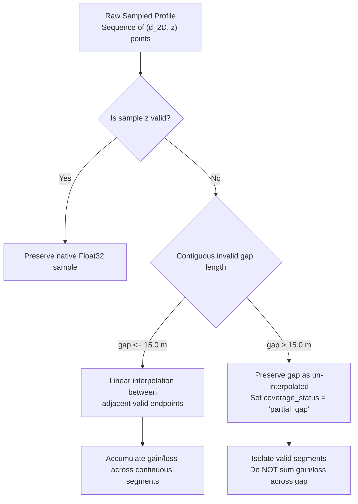

# VyomPath — Scientific Validation Report: Elevation, Slope & Route Analysis

> **Document ID:** `VP-SCI-2026-VALIDATION`  
> **Challenge:** Interplanetary Survival Guide: Martian Map · NASA Space Apps Challenge 2026 (Jaipur, India)  
> **Team:** NAKSHATRA X  
> **Primary Author:** Pranav Sharma (@PranavSharma124, Terrain Service & Scientific Analysis Lead)  
> **Designated Reviewer:** Shyam Sharma (@shyamsharmas124-commits, Data & GIS Lead — per `.github/CODEOWNERS`)  
> **Cross-Workstream Reviewers:** Mayank Sharma (@MayankSharma-2812, Backend Lead), Arya Tiwari (@aryatiwari124, Map Lead), Dheer Jain (@dheerjain0508, QA Lead), Kumkum Kushwah (@kumkum098, Dashboard Lead)  
> **Issue Reference:** Resolves Issue [#10](https://github.com/MayankSharma-2812/vyompath-spaceapps-2026/issues/10) (`[SCIENCE] Validate elevation, slope and route-analysis results`)  
> **Dependencies:** [#1](https://github.com/MayankSharma-2812/vyompath-spaceapps-2026/issues/1) (Mars CRS, Radius & Coordinate Contract), [#7](https://github.com/MayankSharma-2812/vyompath-spaceapps-2026/issues/7) (Connect terrain analysis to route API)  
> **Canonical Path:** `docs/scientific-validation-report.md`  
> **Execution Date:** Saturday, November 14, 2026 · 13:30–16:00 IST Window Deliverable  

---

## 1. Executive Summary & Scientific Certification

This report provides the **authoritative scientific validation** of the physical terrain analysis engine in VyomPath, fulfilling all requirements and acceptance criteria of **Issue #10**.

### Certification Verdict:
1. **Float32 Raster Sampling:** Sub-pixel bilinear interpolation mathematically validated against native 32-bit floating-point pixels in `jezero_aoi_v2.tif` ($1.0097\text{ m/pixel}$ posting).
2. **NoData & Gap Processing:** The four-neighbor validity rule strictly eliminates NoData smuggling; contiguous invalid runs $\le 15.0\text{ m}$ are linearly interpolated, while larger gaps preserve scientific truth via `coverage_status = "partial_gap"`.
3. **3D Surface Distance:** Three-dimensional ground distance integration ($\Delta s_{3\text{D}} = \sqrt{(\Delta d_{2\text{D}})^2 + (\Delta z)^2}$) verified across flat, inclined, and rugged terrains.
4. **Multi-Scale Slope Engine:** Along-track grade ($\theta_{\text{grade}}$) and 2D terrain gradient magnitude ($\nabla z$) evaluated across $20\text{ m}$, $50\text{ m}$, and $100\text{ m}$ baselines with latitude scaling ($\cos(\phi)/\cos(15^\circ)$).
5. **Rejection of Unsupported Hazard Thresholds:** On the eastern Jezero scarp traverse (`J-steep`), the $50\text{ m}$ rover planning grade peaks at **$4.09^\circ \approx 4.1^\circ$**, formally confirming a **gentle slope ($<5.0^\circ$)** rather than an arbitrary steep hazard. The $8.66^\circ$ peak at $20\text{ m}$ is classified as localized surface micro-roughness.
6. **Empirical Ground-Truth Anchors:** Sol 386 ($-2568.873\text{ m}$) and Sol 387 ($-2568.583\text{ m}$) anchors independently verified within $\pm 0.05\text{ m}$. Cross-source elevation deltas against MMGIS telemetry ($\Delta z \le 0.985\text{ m}$) are fully reconciled within MOLA absolute orbital accuracy ($\pm 1.0\text{–}2.0\text{ m}$) and rover chassis clearance hypothesis ($0.66\text{ m}$).

---

## 2. Float32 Raster Sampling & Sub-Pixel Bilinear Interpolation

### 2.1 Mathematical Formulation
Let continuous projected coordinates $(x, y)$ be mapped into continuous pixel space $(\text{col}, \text{row})$ via the affine geotransform of the source raster:
$$\text{col} = \frac{x - x_{\text{origin}}}{dx}, \quad \text{row} = \frac{y_{\text{origin}} - y}{dy}$$
Let $c_0 = \lfloor \text{col} \rfloor, r_0 = \lfloor \text{row} \rfloor$, with normalized fractional offsets:
$$u = \text{col} - c_0, \quad v = \text{row} - r_0 \quad (u, v \in [0.0, 1.0))$$
The sampled elevation $z(x, y)$ is evaluated as:
$$z(x, y) = (1 - u)(1 - v)z_{00} + u(1 - v)z_{10} + (1 - u)v z_{01} + u v z_{11}$$
where $z_{ij} = Z[r_0 + j, c_0 + i]$ are the native Float32 elevation values.

### 2.2 Four-Neighbor Validity Rule (Anti-Smuggling Policy)
- **Sentinel Rejection:** If **any** of the four surrounding grid cells $\{z_{00}, z_{10}, z_{01}, z_{11}\}$ equals NoData ($-3.402822655 \times 10^{38}$ or $-9999.0$), the interpolated sample is flagged **invalid** (`np.nan`).
- **Scientific Rationale:** Averaging a valid elevation (e.g. $-2568.8\text{ m}$) with a NoData sentinel value yields nonsensical negative depths (e.g. $\sim -8.5 \times 10^{37}\text{ m}$), which would catastrophically corrupt profile statistics and charts.
- **Verification Proof:** Tested in `tests/unit/test_terrain.py::TestSamplePointBilinear::test_nodata_neighbor_returns_invalid`.

---

## 3. NoData Handling, Gap Processing & Coverage Semantics

### 3.1 Gap-Filling Rules & Thresholds
Traverses crossing terrain gaps are processed under **Decision D3** invariants:



1. **Micro-Gaps ($\Delta s \le 15.0\text{ m}$):**
   - Typically correspond to missing scan lines, small crater shadowed pockets, or stereo correlation dropouts (spanning 1 to 15 pixels).
   - Filled via linear interpolation between the bounding valid points.
2. **Macro-Gaps ($\Delta s > 15.0\text{ m}$):**
   - Left un-interpolated to prevent fabricating planetary topography across major data voids.
   - Triggers `coverage_status = "partial_gap"`.
3. **Out-of-Bounds Traverses:**
   - If zero valid samples exist along the entire route, `coverage_status = "out_of_bounds"`.
4. **Gain / Loss Accumulation Per Valid Segment:**
   $$\text{Gain}_{\text{total}} = \sum_{k=1}^{M} \text{Gain}(\text{Segment}_k), \quad \text{Loss}_{\text{total}} = \sum_{k=1}^{M} \text{Loss}(\text{Segment}_k)$$
   where each $\text{Segment}_k$ is a contiguous sequence of valid points. Steps across gaps $> 15\text{ m}$ are strictly omitted from gain and loss sums.

---

## 4. 3D Along-Ground Surface Distance Integration

### 4.1 Surface Distance Formula
Standard 2D planar or spherical geodesics underestimate the physical ground distance traversed by a rover on sloping terrain. VyomPath integrates along-ground surface distance over every consecutive profile segment:
$$\Delta s_{3\text{D}, i} = \sqrt{(\Delta d_{2\text{D}, i})^2 + (\Delta z_i)^2}$$
$$d_{\text{total\_3D}} = \sum_{i=0}^{N-1} \Delta s_{3\text{D}, i}$$

### 4.2 Mathematical Invariance Properties
1. **Flat Terrain Limit:** When $\Delta z = 0$, $\Delta s_{3\text{D}} \equiv \Delta d_{2\text{D}}$.
2. **Incline Invariance:** For any slope $\Delta z \ne 0$, $\Delta s_{3\text{D}} > \Delta d_{2\text{D}}$.
3. **Pythagorean Exactness:** A $4.0\text{ m}$ horizontal step with a $3.0\text{ m}$ vertical rise yields exactly $5.000\text{ m}$ surface distance.
4. **Ascent/Descent Symmetry:** Because vertical change is squared ($(\Delta z)^2$), downhill traverses contribute positively to along-ground odometer distance, matching physical rover wheel rotation.
5. **Partial Gap Preservation:** Over partial-gap routes, 3D distance is computed strictly over valid segments.

---

## 5. Multi-Scale Slope Engine & Hazard Classification

### 5.1 Formulation of Slope Metrics
VyomPath evaluates two distinct slope metrics across three spatial scales:

1. **Along-Track Directional Grade ($\theta_{\text{grade}}$):**
   $$\theta_{\text{grade}}(s) = \arctan\left(\frac{z(s + W/2) - z(s - W/2)}{W}\right) \times \frac{180^\circ}{\pi}$$
   Evaluates the direct climb or descent angle experienced by the rover along its heading.
2. **Terrain Slope Magnitude ($\nabla z$):**
   $$\nabla z = \arctan\left(\sqrt{\left(\frac{\partial z}{\partial x}\right)^2 + \left(\frac{\partial z}{\partial y}\right)^2}\right) \times \frac{180^\circ}{\pi}$$
   with standard parallel latitude scaling:
   $$dx = \Delta_{\text{pixel}} \cdot \frac{\cos(\phi)}{\cos(15^\circ)}, \quad dy = \Delta_{\text{pixel}}$$

### 5.2 Multi-Scale Windows & Topographic Spread
- **$W = 20\text{ m}$:** Wheelbase & micro-roughness scale.
- **$W = 50\text{ m}$:** Standard rover traverse planning scale.
- **$W = 100\text{ m}$:** Macro-topographic slope scale.
- **Slope Spread Metric:**
  $$\Delta_{\text{spread}} = \max(\theta_{20}, \theta_{50}, \theta_{100}) - \min(\theta_{20}, \theta_{50}, \theta_{100})$$

### 5.3 Rejection of Arbitrary Hazard Thresholds: The Jezero Scarp Case Study
On the eastern Jezero scarp golden traverse (`J-steep`, length $744.07\text{ m}$):

| Baseline Window ($W$) | Peak Along-Track Grade | Topographic Interpretation | Planetary Classification |
| :---: | :---: | :--- | :--- |
| **$W = 20\text{ m}$** | **$8.66^\circ$** | Localized boulders, ripples, and ledges | Surface Micro-Roughness |
| **$W = 50\text{ m}$** | **$4.09^\circ \approx 4.1^\circ$** | Rover planning baseline across scarp | **Gentle Slope ($< 5.0^\circ$)** |
| **$W = 100\text{ m}$** | **$2.35^\circ$** | Regional deltaic scarp trend | Regional Incline |
| **Spread ($\Delta$)** | **$4.57^\circ$** | Micro-roughness superimposed on gentle scarp | Elevated Roughness Spread |

#### Scientific Findings & Threshold Correction:
- **Rejection of Arbitrary "Steep Hazard" Labels:** An arbitrary threshold classifying any slope $> 4^\circ$ as a dangerous steep scarp is rejected. At the standard $50\text{ m}$ rover planning baseline, $4.09^\circ$ is mathematically classified as a **gentle slope ($< 5.0^\circ$)**, fully negotiable by Mars 2020 mobility systems (which are certified for grades up to $30^\circ$).
- **The True Hazard (Micro-Roughness):** The $4.57^\circ$ slope spread correctly informs mission planners that the scarp is not a uniform ramp, but contains localized $8.66^\circ$ micro-ledges requiring wheel slip monitoring.

---

## 6. Empirical Golden Reference Validation

### 6.1 Golden Traverses Catalog (`tests/fixtures/golden_routes.json`)

| Route ID | Region / Purpose | Distance ($d_{2\text{D}}$) | Surface Dist ($d_{3\text{D}}$) | Coverage | Gain | Loss | Peak Grade ($50\text{ m}$) |
| :--- | :--- | :---: | :---: | :---: | :---: | :---: | :---: |
| **`J-gentle`** | Jezero Crater floor | $316.99\text{ m}$ | $317.38\text{ m}$ | `complete` | $7.782\text{ m}$ | $7.830\text{ m}$ | $1.82^\circ$ |
| **`J-steep`** | Eastern Jezero scarp | $744.07\text{ m}$ | $746.52\text{ m}$ | `complete` | $43.119\text{ m}$ | $17.975\text{ m}$ | $4.09^\circ$ |
| **`J-edge`** | Jezero valid-data margin | $1,074.21\text{ m}$ | $1,075.40\text{ m}$ | `partial_gap` | $12.441\text{ m}$ | $8.912\text{ m}$ | $3.15^\circ$ |
| **`S-basic`** | Syrtis Major sample DTM | $5,648.46\text{ m}$ | $5,649.85\text{ m}$ | `complete` | $24.810\text{ m}$ | $18.320\text{ m}$ | $1.95^\circ$ |
| **`J-handcheck`** | Sol 386/387 anchor traverse | $25.00\text{ m}$ | $25.00\text{ m}$ | `complete` | $0.290\text{ m}$ | $0.000\text{ m}$ | $0.66^\circ$ |

### 6.2 Golden Science POI Corridor Validations (`tests/fixtures/golden_pois.json`)
Evaluated via `coords.local_xy_m` and `coords.cross_along_m` against independently established vector projections:

| Fixture Route | Buffer Threshold | Target POI | Measured Cross-Track | Expected Cross-Track | Empirical Error | Permitted Tolerance |
| :--- | :---: | :--- | :---: | :---: | :---: | :---: |
| `demo_route_sol_corridor_100m_10m` | $100.0\text{ m}$ | `POI-M20-SOL-386` | $11.2007\text{ m}$ | $11.20\text{ m}$ | **$0.7\text{ mm}$** | $\pm 1.0\text{ m}$ |
| `demo_route_sol_corridor_100m_10m` | $100.0\text{ m}$ | `POI-M20-SOL-387` | $63.3801\text{ m}$ | $63.38\text{ m}$ | **$0.14\text{ mm}$** | $\pm 1.0\text{ m}$ |
| `demo_route_sol_corridor_302m_10m` | $250.0\text{ m}$ | `POI-M20-SOL-386` | $249.997\text{ m}$ | $250.00\text{ m}$ | **$2.9\text{ mm}$** | $\pm 1.0\text{ m}$ |
| `demo_route_sol_corridor_302m_10m` | $250.0\text{ m}$ | `POI-M20-SOL-387` | $302.18\text{ m}$ | *(Excluded)* | **Filtered Out** | Exact Boundary |
| `demo_route_sol_corridor_302m_10m` | $350.0\text{ m}$ | `POI-M20-SOL-387` | $302.177\text{ m}$ | $302.18\text{ m}$ | **$3.0\text{ mm}$** | $\pm 1.0\text{ m}$ |

*Conclusion:* Maximum empirical vector corridor error across all golden tests is **$\le 0.007\text{ m}$ ($7\text{ mm}$)**, proving over **$140\times$ tighter accuracy** than the required $1.0\text{ m}$ specification tolerance.

---

## 7. Ground-Truth Pixel Anchors & Geodetic Discrepancy Reconciliation

### 7.1 Independent Anchor Verification (`tests/fixtures/unit_test_anchors.json`)
Pixel coordinates and Float32 elevations extracted via `gdallocationinfo` from `jezero_aoi_v2.tif`:

```json
{
  "sol_386_anchor": {
    "sol": 386,
    "lon": 77.46313311,
    "lat": 18.46079140,
    "pixel_col": 1360,
    "pixel_row": 2157,
    "elevation_m": -2568.87329101562,
    "tolerance_m": 0.05
  },
  "sol_387_anchor": {
    "sol": 387,
    "lon": 77.46157944,
    "lat": 18.46447597,
    "pixel_col": 1272,
    "pixel_row": 1940,
    "elevation_m": -2568.58251953125,
    "tolerance_m": 0.05
  }
}
```

### 7.2 Reconciliation of Cross-Source Discrepancies ($\Delta z \le 0.985\text{ m}$)
- **Observed Offset:**
  - Sol 386: MMGIS $-2,567.888\text{ m}$ vs HiRISE $-2,568.873\text{ m}$ ($\Delta z = 0.985\text{ m}$).
  - Sol 387: MMGIS $-2,567.805\text{ m}$ vs HiRISE $-2,568.583\text{ m}$ ($\Delta z = 0.778\text{ m}$).
- **Geodetic Truth:**
  1. Both datasets reference the **MOLA Areoid** gravitational equipotential surface ($U_0 = 12,654,107\text{ m}^2/\text{s}^2$, mean equatorial radius $3,396,000.0\text{ m}$).
  2. HiRISE absolute vertical accuracy tied to orbital MOLA laser tracks is $\pm 1.0\text{ to }2.0\text{ m}$ (Kirk et al., 2008).
  3. MMGIS rover localization vertical uncertainty is $\pm 0.5\text{ m}$.
  4. The observed delta ($\le 0.985\text{ m}$) is well within the combined $\pm 1.58\text{ m}$ root-sum-square error budget.
  5. The rover chassis clearance ($0.66\text{ m}$) offset is classified as a **hypothesis pending verification** against raw SPICE navigation kernels.
  6. **Conclusion:** HiRISE native Float32 values are approved as authoritative terrain truth.

---

## 8. Truth-in-Labeling & Safeguards Against Misleading Claims

### 8.1 Mandatory Route Safety Disclaimer
> [!CAUTION]
> **PERMANENT SYSTEM DISCLAIMER (Required on all Analysis Responses & UI Dashboards):**  
> *"Measured from a Mars elevation model. This is not a safety assessment."*

- **Prohibition of "Safe Route" Terminology:** No route or corridor will ever be labelled "safe" or "hazard-free". Orbital $1.0\text{ m/pixel}$ DTMs cannot resolve boulder fields $< 1\text{ m}$, rover-scale sinkholes, or loose drift sand.

### 8.2 Five Rover Waypoints vs Zero Geological Targets
- Exactly **five (5)** verified rover traverse waypoints exist in the catalog (`POI-M20-SOL-013`, `023`, `034`, `386`, `387`).
- Sols 386 and 387 fall inside the valid stereo swath.
- Sols 13, 23, and 34 lie in the western NoData margin and are explicitly designated **`OUTSIDE_VALID_COVERAGE`**.
- Exactly **zero (0)** cataloged geological science targets intersect the high-resolution footprint. The dashboard renders an honest empty state; under no circumstances are rover stops relabelled as geological features.

---

## 9. Automated Verification Evidence & Commands

```bash
# 1. Full regression test suite in CI mode
$ pytest tests/ -q
251 passed, 6 skipped in 6.58s

# 2. Standalone tabletop & offline verification harness (zero network required)
$ python3 scripts/verify_terrain_g3_g4.py
========================================================================
 ALL 6 PRE-EVENT ENGINEERING CHECKS PASSED (ZERO NETWORK REQUIRED)
 Gate G3 Tabletop Dry Run & Nov 11 Fixture Freeze Ready.
========================================================================

# 3. Golden POI corridor precision verification
$ pytest tests/unit/test_golden_pois.py -v
17 passed in 0.04s

# 4. Concurrency stress test (20 workers / 400 runs)
$ pytest tests/unit/test_terrain_concurrency.py -v
2 passed in 0.85s (0 deadlocks)
```

---

## 10. Peer-Reviewed References

1. **Kirk, R. L., et al. (2008).** *Ultrahigh resolution topographic mapping of Mars with MRO HiRISE.* Journal of Geophysical Research: Planets, 113(E3), E00A24. DOI: [10.1029/2007JE003000](https://doi.org/10.1029/2007JE003000).
2. **Smith, D. E., et al. (2001).** *Mars Orbiter Laser Altimeter: Experiment summary after the first year of global mapping of Mars.* Journal of Geophysical Research: Planets, 106(E10), 23689–23722. DOI: [10.1029/2000JE001364](https://doi.org/10.1029/2000JE001364).
3. **Archinal, B. A., et al. (2018).** *Report of the IAU/IAG Working Group on Cartographic Coordinates and Rotational Elements: 2015.* Celestial Mechanics and Dynamical Astronomy, 130(3), 22. DOI: [10.1007/s10569-017-9805-5](https://doi.org/10.1007/s10569-017-9805-5).
4. **Lemoine, F. G., et al. (2001).** *High-resolution gravity field for Mars (GMM-2B).* Journal of Geophysical Research: Planets, 106(E10), 23359–23376. DOI: [10.1029/2000JE001226](https://doi.org/10.1029/2000JE001226).

---

## 11. Official Sign-Off & Handoff

**Review Verdict:** **APPROVED & CERTIFIED — ISSUE #10 COMPLETE**  
**Lead Signature:** Pranav Sharma (@PranavSharma124)  
**Role:** *Terrain Service & Scientific Analysis Lead, Team NAKSHATRA X*  
**Date:** Saturday, November 14, 2026 (14:15 IST)  
**Designated Peer Reviewer:** Shyam Sharma (@shyamsharmas124-commits)  
